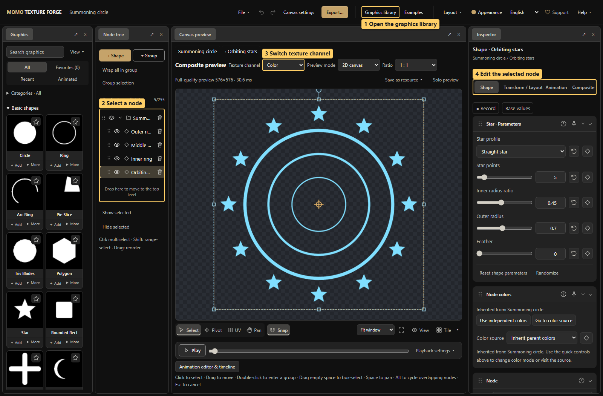
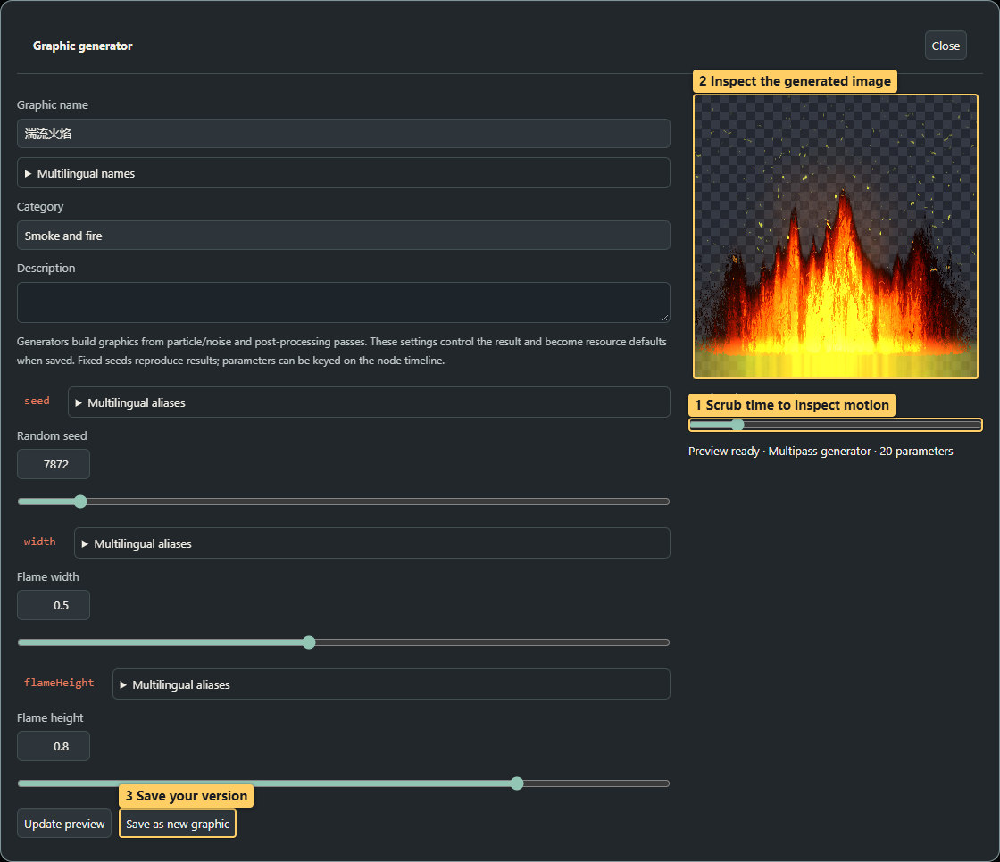
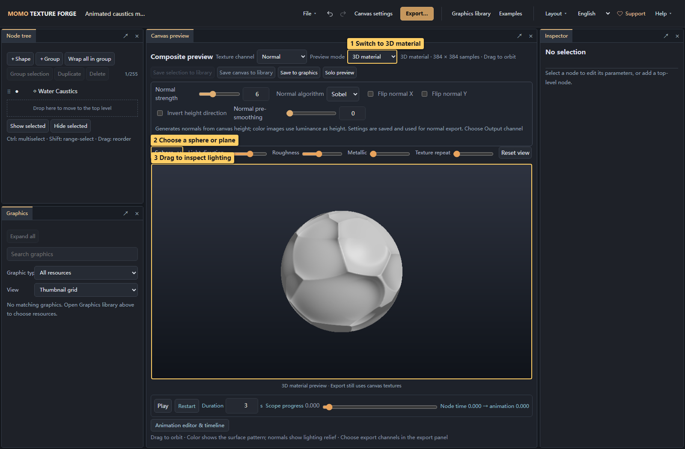
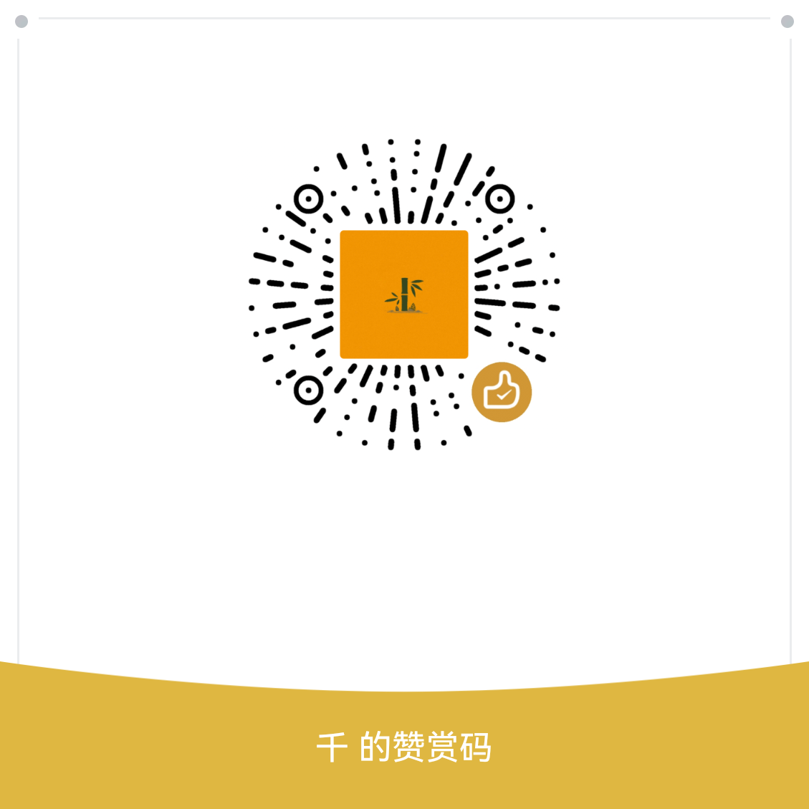

# Momo Texture Forge

<!-- doc-language -->
[简体中文](README.md) · [English](README.en.md)
<!-- /doc-language -->

Create graphics, textures and animated effects in your browser. Compose nodes, adjust parameters, write formulas or generators, and export images, normal maps and frame sequences. Editing and rendering run locally in the browser. You can also build a single offline HTML file.

**[Mainland China access (WorkBuddy)](https://momo-texture-forge.app.workbuddy.host/?sharecode=M22BZOBQB4) · [Open online (GitHub Pages)](https://breezymomo.github.io/MomoTextureForge/) · [Illustrated manual](docs/README.en.md) · [Quick start](docs/01-quick-start.en.md) · [FAQ](docs/faq.en.md)**

Users in mainland China can try WorkBuddy first. Keep the `sharecode` parameter when sharing the link: a browser that has visited before may open the root address, while new visitors may still need the full link. WorkBuddy synchronizes periodically and may lag behind GitHub Pages.

The two official online deployments use Baidu Analytics for basic traffic statistics and completed-export counts by format/channel, with clipboard copies counted separately. Pageview URLs exclude shared canvas data and `sharecode`. The app does not actively report canvas content or enable automatic click collection. Offline builds, local development and deployments on other domains do not load analytics. See [development documentation](docs/development.en.md#official-site-analytics).

Source and documentation: [GitHub primary repository](https://github.com/BreezyMomo/MomoTextureForge) · [Gitee mirror](https://gitee.com/BreezyMomo/MomoTextureForge). Both use the same Git history. If GitHub is difficult to reach, use Gitee to read the documentation or download the repository.



> Callouts: 1 Open the graphics library; 2 Select a node; 3 Switch texture channel; 4 Edit the selected node.

## What you can create

- **Graphics and textures:** 305 built-in shapes, patterns, noise and vector resources, plus your own images and SVG files.
- **Custom resources:** write GLSL formulas or multipass generator JSON, expose parameters, colors and opacity, and validate the live preview.
- **Animated effects:** fire, smoke, lightning, sparks, water, caustics and volumetric effects, with built-in time motion and parameter keyframes.
- **Ribbon textures:** folded strands, refractive membranes and particle strands, with trail style presets, evolving shapes and horizontal seamless tiling.
- **Compositions:** groups, regions and UVs; grid, radial, scatter, border, contour, herringbone, weave and rule-based arrangements; gradients, flow fields, blending, masks and node postprocessing with searchable effects, Before/After comparisons and drag ordering.
- **Batch editing:** multi-selection retains Shape (including coloring), Transform / Layout, Animation and Composite tabs for shared settings. Matching shapes also share shape-specific parameters. Alignment and even distribution are available.
- **Material inspection:** Color, Height and Normal channels; 2D textures or lit sphere, plane and cube previews.
- **Effect inspection:** compare alpha and additive blending on dark and light backgrounds using the same frame. Adjust playback, display size and preview brightness.
- **Custom workspaces:** dock, split, merge tabs and float panels inside the page. Layouts are remembered automatically and can be saved by name.
- **Common controls and appearance:** collapse, reorder and pin parameter modules to one or all nodes; move curve windows and customize themes, accents, style and density.
- **Delivery and reuse:** PNG, GIF animations, EXR, frame ZIPs, atlases, PSD, SVG contours, editable projects, resource backups and remote libraries.
- **Reference shaders:** [Shader reference packages](docs/14-shader-reference.en.md) export HLSL, a Unity URP reference wrapper, current effect settings, comparison images and masks from the hand-drawn effect panel for AI-assisted project integration using the Authoring Skill.

| Edit an effect generator | Inspect normals and lighting |
| --- | --- |
|  |  |

## First use

1. Open **Graphics library**, search for a resource and choose **Add directly to canvas**.
2. The library closes and selects the new node. For frequent reuse, also **Add to graphics list** and use **+ Add** from the left panel later.
3. Edit the selected node's shape, color, transform/layout, animation and compositing in the inspector.
4. **File → Save project** preserves editable content. **Export…** creates delivery files.

The library is the resource source, the graphics list holds reusable copies, and canvas nodes are editable instances. Editing an instance does not automatically update the library.

**Examples** provides 54 editable compositions and material presets with category filters. VFX includes slash trails, hit flashes, fractured shock rings, energy vortices, dissolve masks, and complete lightning strike, frost nova, fire explosion and holographic shield impact effects. New studies include a replaceable-unit dot array, three flowing ring waveforms, independent core/halo, aurora and holy light curtains, and an energy barrier. See [Ability, ring and curtain presets](docs/13-effect-presets.en.md). Seamless UI backgrounds, geometric compositions, hand-drawn hearts and style comparisons, material presets, puzzle/arrangement and boundary studies remain available. Choose **Edit on canvas** to inspect each layer; animated examples include one-shot or loop export settings.

The 31 node effects include print halftones, palette dithering, glitch slices, zoom blur, Kuwahara painting, bevel relief, pencil line art, retro CRT, ASCII art and pixel sorting. Four new exercises demonstrate Creative effect comparison, Comic print, Retro handheld and Hologram glitch. See [Creative style effects](docs/05-canvas-and-compositing.en.md#creative-style-effects).

Noise distortion adds heat-haze, water-refraction and energy-turbulence comparison examples, with continuous flow and closed trajectory motion. See [Noise distortion](docs/05-canvas-and-compositing.en.md#noise-distortion).

Dissolve / burn, Shockwave refraction and Liquid fusion add three editable comparisons with progress keyframes, image and group processing. See [Dissolve, shockwave and liquid fusion](docs/05-canvas-and-compositing.en.md#dissolve-shockwave-and-liquid-fusion). Post-processing uses a current stack plus a searchable, categorized picker with shared specimen previews. Bypass, removal and restoration preserve authored settings and keyframes.

The new-arrangement category includes rounded border lights, star-contour dots, herringbone tiles, basket weave, fading dots, wave flow fields and connected pipes. Puzzle examples demonstrate cell spacing, four connector styles, per-corner rounding and tabs extending outside their cells. Content-boundary comparisons, cross-cell dots and a seamless halo demonstrate **Transform / Layout → Boundary handling**: Clip, Allow overflow or Seamless repeat. Children can extend outwards and parents can wrap them; the final canvas boundary stays fixed. Choose **Edit on canvas** to inspect the node structure. Animated examples include one-shot/loop playback and export settings.

To try a ready-made canvas, download the [summoning-circle project](docs/examples/summoning-circle.json) and open it with **File → Open project**. See [Quick start](docs/01-quick-start.en.md) for the walkthrough and more examples.

## Illustrated tutorials

Each chapter includes real interface screenshots with numbered callouts, entry points, steps, things to inspect, and saving/export guidance. **Help → Detailed guide ↗** opens the README in the current documentation language.

| Task | Documentation |
| --- | --- |
| Learn the interface, add a graphic, save a project | [Quick start](docs/01-quick-start.en.md) |
| Search, trial-edit, insert and share resources | [Graphics library and graphics list](docs/02-graphics-library.en.md) |
| Upload, remove backgrounds, extract colors, center and convert to SVG | [Images and SVG](docs/03-images-and-svg.en.md) |
| Write formulas, create generators, tune fire and smoke | [Formulas and generators](docs/04-formulas-and-generators.en.md) |
| Select/group, transform, arrange, blend, mask and filter | [Canvas, arrangement and compositing](docs/05-canvas-and-compositing.en.md) |
| Record keys, edit curves, configure local time and loops | [Animation and timeline](docs/06-animation.en.md) |
| Convert images to normals, inspect height and lighting | [Normals and 3D preview](docs/07-normal-and-material.en.md) |
| Deliver PNG, GIF, EXR, frame sequences, atlases, PSD and SVG | [Export and delivery](docs/08-export.en.md) |
| Subscribe, host a no-build GitHub Pages library, maintain and publish | [Remote libraries and manager](docs/09-remote-libraries.en.md) |
| Download Skills, provide a catalog, import AI output | [AI collaboration and help](docs/10-ai-and-help.en.md) |
| Dock, split, float and save your workspace | [Custom panel layouts](docs/11-workspace-layout.en.md) |
| Switch language; configure resource names and parameter aliases | [Language and aliases](docs/12-language-and-aliases.en.md) |

More: [Manual contents](docs/README.en.md) · [FAQ](docs/faq.en.md) · [Development and deployment](docs/development.en.md).

## Local development and offline build

Development requires Node.js 22+ and a WebGL2 browser. Desktop Chrome or Edge is recommended.

```sh
npm ci
npm start
```

Open `http://127.0.0.1:8787/`. On Windows you can also run `start.bat`. To choose another port, use `npm start -- --port 8799`.

```sh
npm run build:standalone  # dist/MomoTextureForge.html and an offline ZIP
npm run build:pages       # also updates deployable site/index.html
```

The built offline HTML does not require Node.js. Browser storage is isolated by origin: the online site, local ports and offline files do not automatically share drafts or libraries. Save project files and resource packs as backups.

See [development documentation](docs/development.en.md) for tests, Skill regeneration, screenshot capture and GitHub Pages deployment.

## Working with AI

The toolbar's **AI tools** panel brings together the Authoring/Effects Skills, MCP connection and project handoff. Select an agent and Skills, then **Choose directory and install…** to select and authorize a location. The panel recommends the agent's directory and completes its Skill path. ZIP downloads are available next to each Skill. See [Skill installation](skills/texture-forge-author/references/installation.en.md). Export the current library catalog here when asking AI to recommend graphics.

The Authoring Skill also bundles offline project tools. AI can build node trees, groups, masks, arrangement, effects and animation without opening the website, then deliver a native ZIP with all dependencies. Users continue editing through **File → Open project** and can return saved revisions to AI. See the [offline project workflow](skills/texture-forge-author/references/offline-projects.en.md).

First use follows **Install Skill → Ask AI to start MCP → Configure MCP**. After installing the Authoring Skill, send AI the startup instructions provided by the page. AI prepares and verifies the runtime, dependencies and local service. Then connect this page and copy its MCP configuration into the client. AI can read works/resources and render references; see [Live editor and MCP connection](skills/texture-forge-author/references/live-editor.en.md).

[Workflow](docs/10-ai-and-help.en.md) · [CLI authoring and validation](AI_AUTHORING_CLI.en.md) · [Generator format](skills/texture-forge-author/references/generator-guide.en.md)

## Technical references and feedback

[Pattern definitions](PATTERN_DEFINITIONS.en.md) · [Local graphics library](LOCAL_GRAPHICS_LIBRARY.en.md) · [Resource-pack format](RESOURCE-PACK.en.md) · [Remote-library implementation](REMOTE_LIBRARIES.en.md)

Use **Help → GitHub repository ↗** for source and issue reports. **Gitee repository ↗** opens the mainland mirror for documentation and downloads. Include reproduction steps, browser version, screenshots and a minimal shareable project when reporting an issue.

Public GLSL libraries retain their attribution and licenses. See [PSD-LICENSES.txt](web/vendor/PSD-LICENSES.txt) for the PSD encoder's notices, and [ROUGH-LICENSES.txt](web/vendor/ROUGH-LICENSES.txt) for Rough.js and its bundled dependencies used by hand-drawn post-processing.

## Support the project

If Momo Texture Forge saves you time, you are welcome to make a voluntary donation to support continued development and maintenance. Thank you!

**Scan with WeChat to donate:** use WeChat to scan the appreciation code below.



## Referenced websites and projects

The following websites and projects informed the design, research or public algorithms used during development:

| Website / project | Reference |
| --- | --- |
| [EasyCG TexForge](https://easycg-texforge.app.workbuddy.host/) | Early tool design and some basic graphics |
| [NormalMap Online](https://cpetry.github.io/NormalMap-Online/) | Image-to-normal conversion, normal controls and 3D material preview |
| [GameAnimation texture creation](https://gameanimation.info/texture-create/) | Basic graphics and texture-generation tools |
| [Noise Creater · Voronoi Water Noise](https://noisecreater.com/noiseDetail/voronoiWaterNoise) | Research into noise, water, animated textures and frame export |
| [EffectTextureMaker](https://mebiusbox.github.io/contents/EffectTextureMaker/) | Procedural fire, lightning, smoke and animated sequences |
| [pixy.js](https://github.com/mebiusbox/pixy.js) | Source of the animated-caustics core GLSL; MIT attribution and license retained |
| [Ashima WebGL Noise](https://github.com/ashima/webgl-noise) / [Stegu WebGL Noise](https://github.com/stegu/webgl-noise) | Simplex-noise GLSL libraries; attribution and licenses retained |
