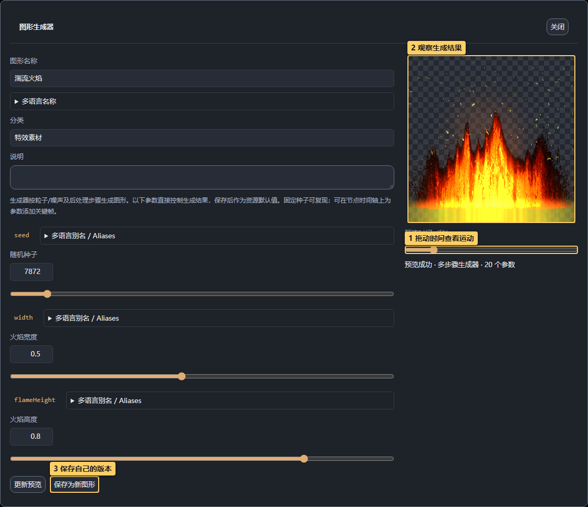
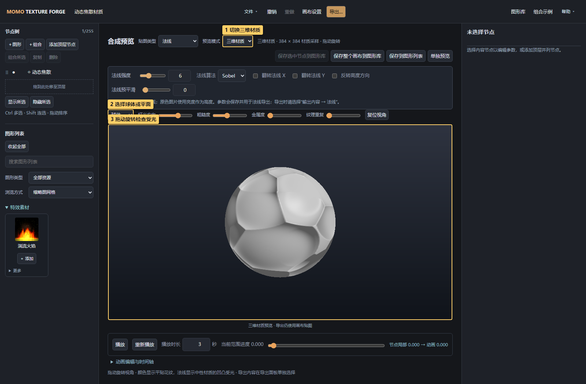

# Momo Texture Forge

<!-- doc-language -->
[简体中文](README.md) · [English](README.en.md)
<!-- /doc-language -->

在浏览器中制作图形、纹理和动态特效：组合节点、调整参数、创建公式或生成器，再导出图片、法线贴图和序列帧。编辑和渲染在浏览器中完成，也可构建为离线 HTML。

**[国内在线使用（WorkBuddy）](https://momo-texture-forge.app.workbuddy.host/?sharecode=M22BZOBQB4) · [在线使用（GitHub Pages）](https://breezymomo.github.io/MomoTextureForge/) · [图文操作手册](docs/README.md) · [快速上手](docs/01-quick-start.md) · [常见问题](docs/faq.md)**

国内用户可优先使用 WorkBuddy 入口，分享时请保留链接中的 `sharecode` 参数：已有访问记录的浏览器可能可直接打开根地址，但新访客仍可能需要完整链接。国内站通过 WorkBuddy 定时同步，版本可能晚于 GitHub Pages。

两个正式在线入口使用百度统计记录基础访问量及导出完成次数（按格式/通道区分，复制图片另计），页面浏览地址排除画布分享参数及 `sharecode`，不主动上报作品内容，不开启自动点击采集。离线版、本地开发及其他域名部署不加载统计代码；实现与维护见[开发文档](docs/development.md#正式站点访问统计)。

源码与文档：[GitHub 主仓库](https://github.com/BreezyMomo/MomoTextureForge) · [Gitee 国内镜像](https://gitee.com/BreezyMomo/MomoTextureForge)。访问 GitHub 不便时，可通过 Gitee 阅读教程或下载仓库；两边使用相同的提交历史。


> 图中标记：1 打开图形库；2 选择节点；3 切换贴图类型；4 编辑选中节点。

## 可以做什么

- **图形与纹理**：301 个内置图形、纹样、噪声与矢量资源，可加载自己的图片和 SVG。
- **自由创作**：输入 GLSL 公式或多步骤生成器 JSON，自定义参数、颜色和透明度，实时验证预览。
- **动态特效**：火焰、烟雾、闪电、火花、水纹、焦散和体积效果，支持内置时间运动与参数关键帧。
- **飘带贴图**：折叠线束、折光薄膜与粒子细丝，提供拖尾风格预设、形态演变和横向无缝。
- **组合设计**：节点分组、区域与 UV、网格/环形/随机、边框/轮廓、人字/编织、规则拼接与渐变/流场、混合与遮罩、渐变和后处理。
- **批量编辑**：多选保留图形（含颜色）、变换/排列、动画、合成页签，共有参数可统一修改；同一种图形支持专属参数批改，并提供对齐和等距分布。
- **材质检查**：颜色/高度/法线切换，二维贴图与球体、平面、立方体三维受光预览。
- **特效预览**：同一帧贴图在深浅背景上对比透明与相加混合，支持播放、显示大小与预览亮度调整。
- **自定义布局**：面板拖动停靠、拆分、合并标签、网页内悬浮，自动记住布局并可命名保存。
- **常用操作与外观**：参数模块可折叠、排序、固定到节点树或全部节点；曲线窗口可移动，支持主题、强调色、风格与密度设置。
- **交付与复用**：PNG、EXR、逐帧 ZIP、图集、PSD、SVG 轮廓，项目/资源备份以及远程图库。

| 编辑特效生成器 | 检查法线与三维受光 |
| --- | --- |
|  |  |

## 第一次使用

1. 打开 **图形库**，搜索资源并点 **直接添加到画布**。
2. 图库自动关闭并选中新节点。需要经常复用的资源，可另外 **添加到图形列表**，以后从左侧点 **＋ 添加**。
3. 选中节点，在右侧调整图形、变换/排列、动画和合成。
4. **文件 → 保存项目**保留可继续编辑的画布；**导出…**生成交付文件。

图库是资源来源，图形列表是常用副本，画布节点是编辑实例。修改实例不会自动修改图库。

顶栏 **组合示例** 提供 39 种可编辑组合与素材预设，并可按分类筛选。优先展示特效常用的刀光拖尾、命中爆闪、破碎冲击环、能量旋涡与溶解遮罩，另有面向 UI 界面背景的菱形格纹、交错菱砖、斜纹底纹与点阵底纹，可无缝平铺；并保留召唤特效、雷达光环、花瓣徽章、星光螺旋、蜂巢护盾与火焰法阵；新增“手绘心形”，展示深色描边与红色交叉排线后处理；“手绘样式对照”用九个心形比较原图与全部8种绘制填充。“素材预设”分类包含酸液飞溅和卷曲庆典彩带，均可拆解编辑并导出透明贴图。“新增排列”分类包含圆角边框灯带、星形轮廓光点、人字镶嵌、篮式编织、渐隐点阵、波浪流场和接口管线七个示例，另有单块拼图网格、彩色拼图板、拼图接口与圆角，演示四种接口、独立圆角与凸耳越界，并增加“内容边界对照”“跨格光点排列”“无缝光晕接续”。选中任意图形或组合 → 变换/排列 → 边界处理，可选裁切、允许超出、无缝重复；支持子级外伸、父级回绕，光晕可跨边缘接续，最终画布保持固定。点“在画布中编辑”即可拆解；动态示例已配置单次／循环动画及导出设置。

节点后处理共28项，新增印刷网点、抖动限色、故障撕裂、缩放模糊、油画笔触、浮雕斜面、铅笔线稿、复古显像管、字符画和像素排序。组合练习新增“后处理风格对照”“漫画印刷”“复古掌机”“全息故障”四个示例，详见[创意风格后处理](docs/05-canvas-and-compositing.md#创意风格后处理)。

新增“噪声扭曲”节点后处理及“热浪扭曲”“水波折射”“能量扰动”三个可编辑对照示例，支持连续流动与闭合轨迹循环；详见[噪声扭曲](docs/05-canvas-and-compositing.md#噪声扭曲)。

想先体验效果，可下载[召唤法阵演示画布](docs/examples/summoning-circle.json)，在 **文件 → 打开项目** 中打开。详细步骤与更多示例见[快速上手](docs/01-quick-start.md)。

## 图文教程

每篇包含带编号标记的实际界面截图、操作入口、步骤、观察点与保存/导出说明。帮助菜单中的“详细说明 ↗”可直接打开本页。

| 操作 | 文档 |
| --- | --- |
| 认识界面、添加第一张图、保存项目 | [快速上手](docs/01-quick-start.md) |
| 搜索、试编辑、加入画布、分享资源 | [图库与图形列表](docs/02-graphics-library.md) |
| 上传、去背景、提取颜色、居中、转 SVG | [图片与 SVG](docs/03-images-and-svg.md) |
| 创建公式、自定义生成器、调整火焰烟气 | [公式与生成器](docs/04-formulas-and-generators.md) |
| 选择/分组、变换、排列、混合、遮罩和滤镜 | [画布、排列与合成](docs/05-canvas-and-compositing.md) |
| 录制关键帧、曲线、局部时间和循环 | [动画与时间轴](docs/06-animation.md) |
| 图片转法线、灰度高度、三维受光 | [法线与三维预览](docs/07-normal-and-material.md) |
| PNG、EXR、动态序列、图集、PSD 和 SVG | [导出与交付](docs/08-export.md) |
| 订阅、免编译搭建 GitHub Pages 图库、维护与发布 | [远程图库与管理器](docs/09-remote-libraries.md) |
| 下载 Skill、提供图库目录、导入 AI 结果 | [AI 协作与帮助](docs/10-ai-and-help.md) |
| 拖动、拆分、悬浮面板，保存自己的工作布局 | [自定义面板布局](docs/11-workspace-layout.md) |
| 切换界面语言、参数变量与多语言别名 | [语言与参数别名](docs/12-language-and-aliases.md) |

更多：[手册总目录](docs/README.md) · [常见问题](docs/faq.md) · [开发与部署](docs/development.md)。

## 本地运行与离线版

开发环境需要 Node.js 22+，浏览器需支持 WebGL2，推荐桌面 Chrome / Edge。

```sh
npm ci
npm start
```

打开 `http://127.0.0.1:8787/`，Windows 也可双击 `start.bat`。指定端口使用 `npm start -- --port 8799`。

```sh
npm run build:standalone  # dist/MomoTextureForge.html 与离线 ZIP
npm run build:pages       # 同步生成可部署的 site/index.html
```

使用构建好的离线 HTML 无需 Node.js。浏览器数据按访问地址隔离；在线版、本地端口和离线文件不自动共享图库与草稿，请保存项目和资源包做备份。

测试、Skill 更新、截图重拍和 GitHub Pages 部署见[开发文档](docs/development.md)。

## 与 AI 协作

**帮助**菜单提供两个可下载的 Skill：创作 Skill 辅助制作可导入资源，效果指导 Skill 讲解如何在编辑器中完成效果。需要 AI 推荐图形时，从 **图形库 → 导出 AI 图形目录**提供当前可用资源与参数。

[操作教程](docs/10-ai-and-help.md) · [命令行创作与验证](AI_AUTHORING_CLI.md) · [生成器格式](skills/texture-forge-author/references/generator-guide.md)

## 深入资料与反馈

[图形定义](PATTERN_DEFINITIONS.md) · [本地图形库](LOCAL_GRAPHICS_LIBRARY.md) · [资源包格式](RESOURCE-PACK.md) · [远程图库技术说明](REMOTE_LIBRARIES.md)

**帮助 → GitHub 仓库 ↗**可查看源码与反馈问题；访问不便时，可通过 **Gitee 仓库 ↗**打开国内镜像阅读文档与下载仓库。提交问题时提供复现步骤、浏览器、截图以及可分享的最小项目。

公共 GLSL 保留其署名和许可文本，PSD 编码器许可见 [PSD-LICENSES.txt](web/vendor/PSD-LICENSES.txt)，手绘后处理的Rough.js及依赖许可见 [ROUGH-LICENSES.txt](web/vendor/ROUGH-LICENSES.txt)。

## 支持项目

如果 Momo Texture Forge 帮你节省了制作贴图的时间，欢迎自愿打赏，支持工具的持续开发与维护。感谢你的支持！

**微信扫码赞赏**：使用微信扫描下方赞赏码。


## 参考网站与项目

以下是开发过程中参考、调研或使用其公开算法的网站与项目：

| 网站 / 项目 | 参考内容 |
| --- | --- |
| [EasyCG TexForge](https://easycg-texforge.app.workbuddy.host/) | 早期工具设计与部分基础图形 |
| [NormalMap Online](https://cpetry.github.io/NormalMap-Online/) | 图片转法线、法线参数与三维材质预览 |
| [GameAnimation · 基础贴图生成](https://gameanimation.info/texture-create/) | 基础图形与贴图生成工具 |
| [Noise Creater · Voronoi Water Noise](https://noisecreater.com/noiseDetail/voronoiWaterNoise) | 噪声、水纹、动态纹理与序列导出功能调研 |
| [EffectTextureMaker](https://mebiusbox.github.io/contents/EffectTextureMaker/) | 火焰、闪电、烟雾等特效纹理生成与动态序列 |
| [pixy.js](https://github.com/mebiusbox/pixy.js) | 动态焦散核心 GLSL 算法来源，源码保留 MIT 署名与许可 |
| [Ashima WebGL Noise](https://github.com/ashima/webgl-noise) / [Stegu WebGL Noise](https://github.com/stegu/webgl-noise) | Simplex 噪声公共 GLSL 库来源，源码保留署名与许可 |
