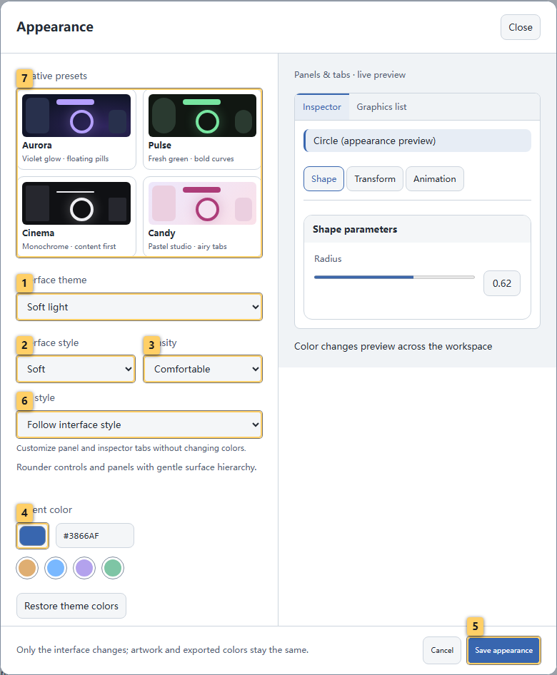
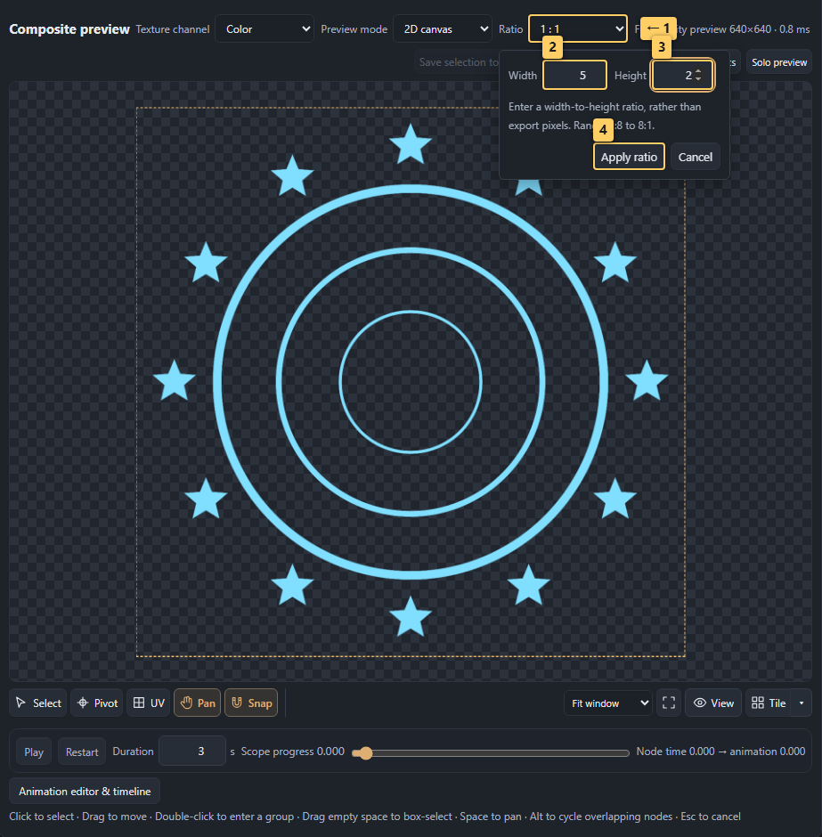
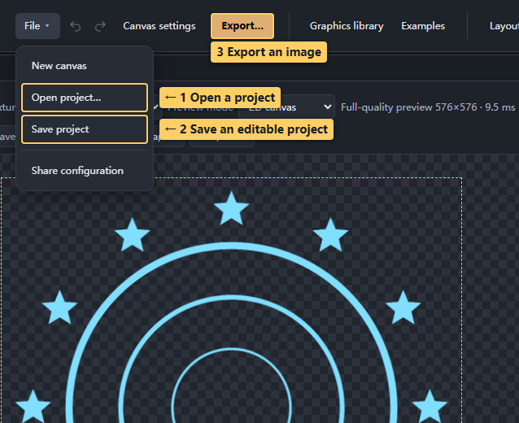
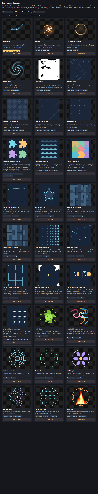
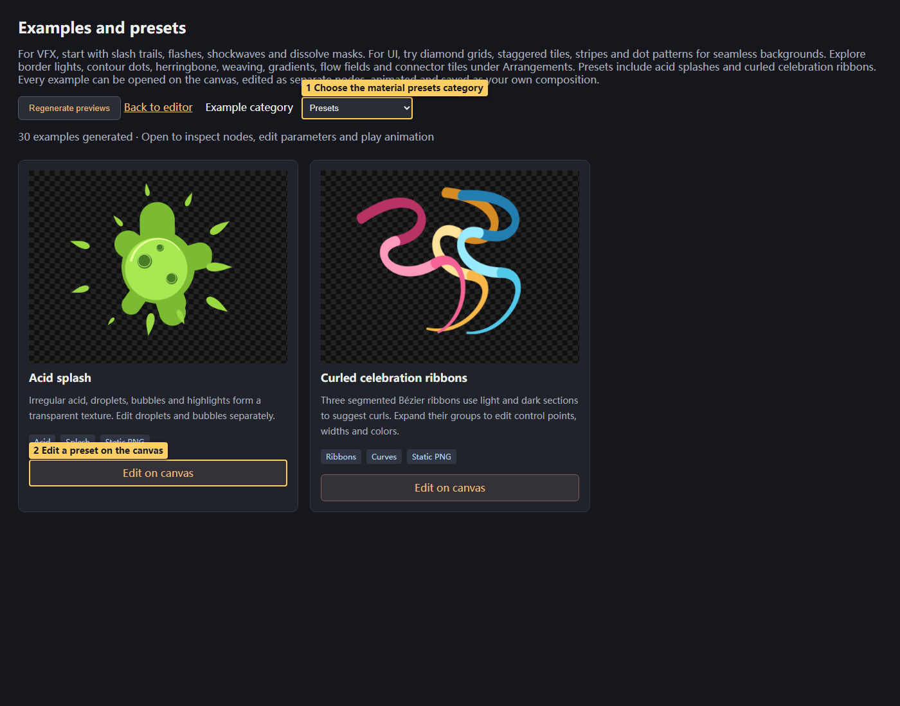

# 01 · Quick start

<!-- doc-language -->
[简体中文](01-quick-start.md) · [English](01-quick-start.en.md)
<!-- /doc-language -->

[Manual contents](README.en.md) · Next: [Graphics library and graphics list](02-graphics-library.en.md)

## 1. Open the editor

Visit the [online editor](https://breezymomo.github.io/MomoTextureForge/). See [Development and deployment](development.en.md) for local/offline use. A first visit starts with an empty canvas. To explore a prepared scene, download the [summoning-circle example](examples/summoning-circle.json) and use **File → Open project**.

> Callouts: 1 Open the graphics library; 2 Select a node; 3 Switch texture channel; 4 Edit the selected node.

- **Toolbar:** canvas name, File, undo/redo, canvas settings, export, graphics and help. Narrow windows move Canvas settings into File and Examples into the menu beside Graphics library.
- **Far left:** full-height graphics list with reusable copies.
- **Second column:** node tree. Select an instance or group to decide what the inspector edits.
- **Center:** composite preview, texture channels, 2D/3D modes, canvas tools and playback.
- **Right:** selected node's shape, color, transform/layout, animation and compositing. No node means no node parameters.

Open **Appearance** to choose a palette, control style, tab shape, appearance mode and density independently. Advanced settings customize four interaction colors. Changes preview across the workspace; Save remembers all choices and Cancel or Esc restores the previous settings. Preferences stay in this browser without changing artwork, exports or project files.

**Color scheme** offers fourteen complete palettes: Ink & Cinnabar, Celadon & Gold, Dunhuang Minerals, Ink & Jade, Bamboo Breeze, Lotus Mist, Porcelain Moon, Vermilion Palace, Indigo & Rouge, Plum & Bronze, Herbal Jade, Peach & Lake, Autumn Ochre and Verdigris & Copper. Each coordinates base, text, action, selection, navigation and parameter colors in Dark, Graphite, Light and System modes. Choosing a palette adopts its recommended colors while preserving control style, tabs and density. Legacy Tianqing, Zhusha and Dunhuang migrate to Celadon & Gold, Ink & Cinnabar and Dunhuang Minerals. Automatic colors and tabs resolve to explicit choices, retaining custom action colors.

**Control style** retains all nine styles: Standard, Refined, Airy, Minimal, Soft, Aurora, Pulse, Cinema and Candy. Neutral cards illustrate corners, borders, shadows and module structure. Changing style preserves the palette, tabs, mode, density and custom colors. The miniature workspace on the right previews the full combination.

Standard provides standard module frames and compact controls; new browsers default to Refined. Refined uses fine borders, layered surfaces and subtle shadows; Minimal quiets module frames and Soft increases corner radii. **Density** independently offers Compact and Comfortable control heights and spacing.

**Airy** is an additional selectable style. Fine separators and spacing organize parameter groups, with quieter outer frames and headings, filled input areas, and visible hover and keyboard-focus boundaries. All existing control styles remain available; new browsers still use Refined geometry. Styles share consistent SVG reset, keyframe, drag, help, node and group icons; an outline, center dot and solid diamond distinguish unanimated, animated and current-time keys. Parameter names sit above sliders, with fixed-width columns for values, reset and keyframe actions. Multiple-selection parameters use the same alignment. X/Y markers identify coordinate axes; degrees and seconds appear as subdued suffixes in the value field. Color parameters align a swatch with their HEX input.

**Tab style** offers four explicit independent shapes: Classic, Segmented, Pills and Underlined. Changing palettes or control styles preserves this choice. Dock and inspector previews share the editor’s actual tab rules.

**Custom colors (advanced)** starts collapsed. Expand it to customize action, selection, navigation and parameter colors using color pickers or HEX inputs. Backgrounds, text and borders follow the palette; interaction colors adapt for contrast while retaining custom input values. Changing appearance mode keeps custom colors. Choosing another palette adopts its defaults. **Restore palette colors** clears only the four color overrides.

Functional colors are independent of the four custom interaction colors: green marks animation badges and animated parameters, blue marks time intervals, gold marks keyframes and favorites, and red marks recording. The playhead uses a high-contrast line and top marker. Read-only intervals retain gray stripes and dashed borders. Changing the color scheme, control style or accent preserves these meanings, and the appearance preview includes these states.

While dragging a parameter module, adjacent modules smoothly make room. The new order is saved only on drop; Esc cancels. Same-level node sorting shows an insertion gap, while cross-group moves retain insertion lines and target highlights. Panel placement, section disclosures, menus, thumbnails and notifications use brief transitions; sliders, canvas manipulation and dragged objects remain immediate. Interface motion respects the system's reduced-motion preference without changing artwork animation or exports.

> Callouts: 1 Choose an appearance mode; 2 Choose a control style; 3 Set interface density; 4 Expand advanced settings to customize colors; 5 Save appearance preferences in this browser; 6 Choose a tab style independently; 7 Choose a color scheme independently.

## 2. Add your first graphic

1. Open **Graphics library**.
2. Search for “Star” or browse categories.
3. Choose **Add directly to canvas**. The library closes and selects the new node.
4. Change inspector parameters and watch the preview. Adding again creates an independent instance; undo is available.

For reusable favorites, also **Add to graphics list** and use **+ Add** from the left panel later. Direct insertion does not overwrite personal edits in that list.

> Callouts: 1 Search resources; 2 Add directly to canvas; 3 Add to the reusable list; 4 Expand details and resource management.

The library is the source, the graphics list holds reusable copies, and nodes are canvas instances. See the [library chapter](02-graphics-library.en.md).

## 3. Adjust position and size

1. Select a node and open **Transform / Layout**.
2. Start with region width, height, position and rotation under the node's occupied region.
3. For repetition, choose an arrangement, then adjust instance size and distribution.
4. Change the canvas aspect ratio with **Ratio** above the preview or in **Canvas settings**. Choose **Custom…**, enter width and height, then click **Apply ratio**; supported ratios range from 1:8 to 8:1. Pixel dimensions are chosen at export. Switching or resetting trial graphics and returning to the canvas retain the current ratio. Ratio changes made during trial editing are also saved to the original canvas.

Node region, shape radius and arranged-instance size are three different levels. If a pattern looks too small, check which level you are editing.

> Callouts: 1 Change canvas ratio above the preview; 2 Enter relative width; 3 Enter relative height; 4 Apply the ratio without changing node parameters.

For an existing custom ratio, click the adjacent edit button or choose **Custom…** again to continue editing. You do not need to select a different ratio first.

## 4. Save a project, then export an image

> Callouts: 1 Open a project; 2 Save an editable project; 3 Export an image.

- **File → Save project** writes the canvas and dependencies as a ZIP for later editing.
- **File → Share configuration** can create a link for simple built-in canvases. Custom dependencies or offline use fall back to a project file.
- **Export…** produces full-canvas images and atlases. See [Export](08-export.en.md) for format differences.

Drafts are autosaved in browser storage, but other browsers, ports and origins do not share them automatically. Save important canvases as project files.

## 5. Practice with composition examples

Open **Examples** to generate 44 compositions and material presets: nine VFX studies, four UI backgrounds, fourteen new-arrangement demonstrations, two material presets and fifteen composition exercises, including a hand-drawn heart and a comparison of all hand-drawn fill styles. Filter by category. Each card explains its construction; **Edit on canvas** opens an independent canvas whose tree can be explored layer by layer. See [Ability, ring and curtain presets](13-effect-presets.en.md) for the four complete ability effects, replaceable-unit array, rings/glow and layered curtains.

Puzzle examples show cell spacing, overflow tabs, flat outside borders and per-piece colors. Content-boundary and cross-cell examples demonstrate overflow handling.

> Callouts: 1 Open an editable composition.

| Example | What to learn |
| --- | --- |
| Slash trail | Core, noise mask, fine tails and rotational fade; 0.7-second one-shot |
| Hit flash | Layered glow, radial sparks and flash timing; 0.6-second one-shot |
| Fractured shock ring | Ring expansion, noise clipping and fade; 1-second one-shot |
| Energy vortex | Three flow arms, inverted center mask and edge fade; 3-second loop |
| Dissolve mask | Coarse/fine noise and threshold erosion; 1.5-second opaque grayscale sequence |
| Diamond grid | Outlined and small diamonds on a regular grid for panels and cards |
| Staggered diamond tiles | Light/dark diamond layers offset half a cell for shop/inventory backgrounds |
| Diagonal stripe pattern | Continuous diagonal lines and staggered dashes for tabs and technology UI |
| Dot background | Regular dots and sparse crosses for information panels |
| Rounded border lights | Evenly spaced decorations around rectangular/rounded borders |
| Star-contour dots | First child supplies a contour; other children repeat along it |
| Herringbone tiles | Alternating 2:1 bricks with repetition across the canvas edge |
| Basket weave | Alternating pairs of horizontal and vertical bricks |
| Fading decorative dots | Size, opacity and rotation gradients by position or instance index |
| Wave flow-field lines | Grid plus wave offsets, orientation and phase animation |
| Connected pipes | Candidate tile interfaces and a seed, matching neighbors and wrapped edges |
| Summoning effect | Nested groups, pulsing rings, rotation and fading shockwave |
| Radar halo | Concentric rings, radial arrangement and whole-group rotation |
| Petal badge | Ellipse orientation, radial arrangement and layered colors |
| Star spiral | Golden-angle spiral, alternating children and size randomization |
| Honeycomb shield | Hex grid, polygon outlines and a circular mask |
| Flame circle | Animated generator composited with geometry |

VFX thumbnails show roughly 30% progress; play the canvas to inspect the full motion. Slashes, flashes and shock rings use transparent one-shot exports. The vortex loops. The dissolve mask exports Height with an opaque background for material sampling; scrub to select an erosion state. Sequence duration and FPS determine its frames.

UI backgrounds are static, tileable patterns with dark-background color PNG defaults. Select an arrangement group to change rows and columns, or its inner diamonds/lines/dots to edit colors and sizes. Disable transparency to retain the background, or enable it to export only the pattern for overlay. Check seams with **Tile preview** and use texture repetition in your project instead of stretching the whole image.

The material-presets category contains acid splatter and curled celebration ribbons, both static and transparent by default. Edit droplets, bubbles, highlights, ribbon control points, widths and colors. Select the outer group and **Save selection to library** to reuse it.

> Callouts: 1 Choose the material presets category; 2 Edit a preset on the canvas.

See [Canvas and compositing](05-canvas-and-compositing.en.md) for arrangement instructions and limits.

After editing, **Save canvas to library** preserves a reusable composition; **File → Save project** preserves the source canvas.

## Check your first result

Confirm that the canvas contains a visible pattern, the intended node is selected, transparency is correct, and the saved project reopens successfully before producing final delivery files.
