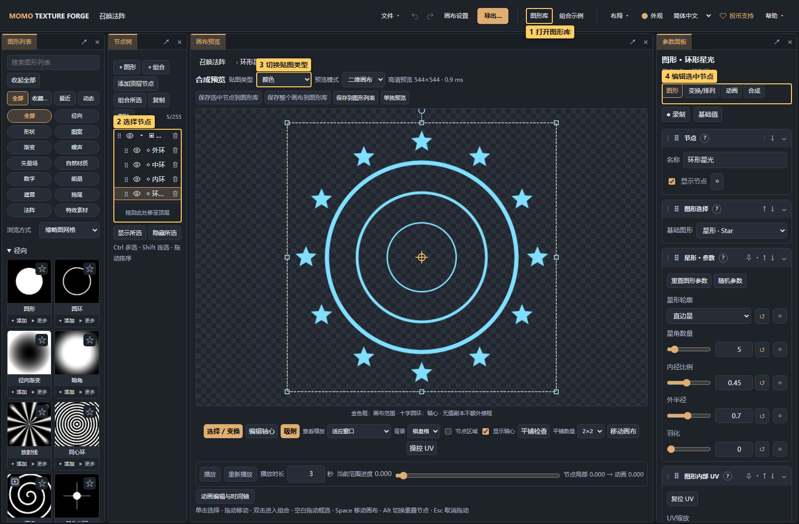
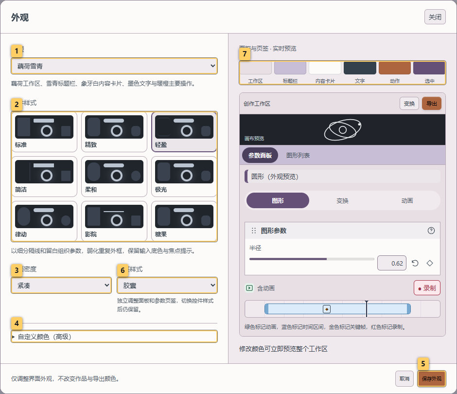
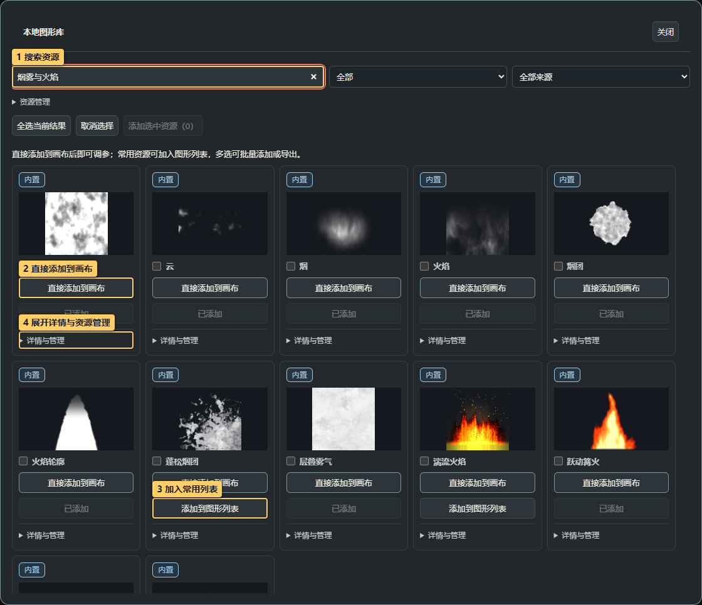
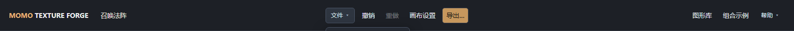
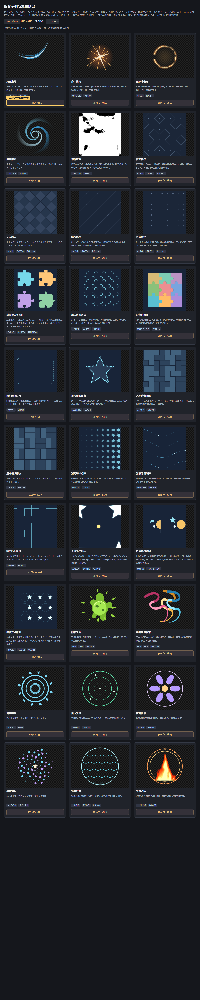
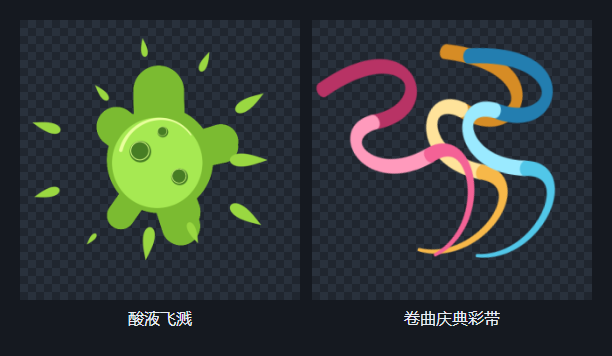

# 01 · 快速上手

<!-- doc-language -->
[简体中文](01-quick-start.md) · [English](01-quick-start.en.md)
<!-- /doc-language -->

[手册目录](README.md) · 下一篇：[图库与图形列表](02-graphics-library.md)

## 1. 打开编辑器

直接访问[在线编辑器](https://breezymomo.github.io/MomoTextureForge/)。本地启动和离线使用见[开发与部署](development.md)。初次打开是空画布；想先熟悉界面，可下载[召唤法阵示例](examples/summoning-circle.json)，通过 **文件 → 打开项目** 打开。

> 图中标记：1 打开图形库；2 选择节点；3 切换贴图类型；4 编辑选中节点。

- **顶栏**：画布名称、文件、撤销/重做、画布设置、导出、图库与帮助。
- **最左侧**：图形列表，整列浏览常用资源副本。
- **左侧第二列**：节点树。选择实例或组合，决定右侧编辑的对象。
- **中间**：合成预览、贴图类型、二维/三维切换、画布辅助工具和动画播放。
- **右侧**：选中节点的图形与颜色、变换/排列、动画、合成参数。未选节点时不显示这些参数。

顶栏 **外观** 可选择 Momo 经典深色、石墨中性、柔和浅色或跟随系统，并自定义强调色。调整时整个工作区实时预览；点 **保存外观** 记住选择，取消或按 Esc 恢复打开前的外观。外观仅保存在当前浏览器与站点，不改变作品颜色、导出结果或项目文件。

**界面风格** 可选标准、简洁或柔和：标准使用细边框和小圆角，简洁弱化模块外框，柔和增大控件与面板圆角。**界面密度** 可选紧凑或舒适，调整控件高度、参数模块、节点行和图库卡片间距。风格与密度可和任意配色组合，并随外观一起保存或取消。

> 图中标记：1 选择界面配色；2 选择界面风格；3 调整界面密度；4 自定义强调色；5 保存当前浏览器的外观偏好。

拖动参数模块时，其他模块会平滑让位；松手后才保存新顺序，按 Esc 可取消。节点同级排序显示插入占位，跨组合仍用插入线与目标高亮表达层级。面板落位、参数分组展开收起、菜单、缩略图与操作提示使用短暂过渡；滑块、画布和拖动对象即时跟手。这些界面动画遵循系统的“减少动态效果”偏好，不改变作品动画或导出结果。

## 2. 把第一个图形加到画布

1. 点右上角 **图形库**。
2. 搜索“星形”或直接浏览分类。
3. 点资源卡片的 **直接添加到画布**，图库自动关闭并选中新节点。
4. 在右侧修改参数，观察中间预览。再次添加会创建独立实例，也可以撤销。

常用资源可另外点 **添加到图形列表**，以后从左侧列表点 **＋ 添加**。直接添加不会覆盖列表中的个人修改。

> 图中标记：1 搜索资源；2 直接添加到画布；3 加入常用列表；4 编辑资源。

图库是资源来源，图形列表是常用副本，节点是画布中的实例。后续详见[图库教程](02-graphics-library.md)。

## 3. 调整位置和尺寸

1. 选中节点，切换右侧 **变换/排列**。
2. 先修改“节点占用区域”中的区域宽高、位置和旋转。
3. 图案需要重复时再选“排列方式”，调整每份实例尺寸和分布。
4. 画布比例可在预览顶部的 **比例** 下拉框快捷修改，也可从顶栏 **画布设置** 修改。选择 **自定义…** 后输入宽、高并点 **应用比例**，支持 1:8～8:1；这里设置宽高比例，像素宽高在导出时设置。切换或重置试编辑图形、返回画布都会保留当前比例；在试编辑中修改比例也会自动保存到原画布。

“节点占用区域”“图形自身半径”和“排列实例尺寸”是三个层次；图案过小先确认正在改哪一层。

## 4. 保存项目，再导出图片

> 图中标记：1 打开项目文件；2 保存可编辑项目；3 导出成品图片。

- **文件 → 保存项目**：保存当前画布 ZIP 及所需依赖，以后通过“打开项目”继续编辑。
- **文件 → 分享配置**：简单内置画布可生成链接；包含自定义资源或离线使用时会转为项目文件。
- **导出…**：输出整张画布的 PNG、图集等交付文件，[导出教程](08-export.md)说明格式区别。

浏览器自动保存草稿，但更换浏览器、端口或站点地址不会自动共享数据。重要画布应保存项目文件。

## 5. 从组合示例开始练习

顶栏点 **组合示例**，页面会自动生成 30 种组合与素材预设，包含五种特效、四种 UI 底纹、十三种新增排列、两种素材预设与六种组合练习；可用“示例分类”筛选；每张卡片说明组合方法，点 **在画布中编辑** 打开独立画布，再从节点树逐层拆解。单块拼图网格演示主体格距与凸耳越界，彩色拼图板演示平整外边和逐块配色；内容边界对照与跨格光点排列演示通用超框显示。

> 图中标记：1 打开可编辑的组合示例。

| 示例 | 可以学习 |
| --- | --- |
| 刀光拖尾 | 刀光芯、噪声遮罩、尾丝叠加与旋转淡出；0.7 秒单次序列 |
| 命中爆闪 | 柔光、放射火花与闪光的分层节奏；0.6 秒单次序列 |
| 破碎冲击环 | 圆环扩张、噪声裁切与淡出；1 秒单次序列 |
| 能量旋涡 | 三臂流线、中心反向遮罩与边缘渐隐；3 秒循环动画 |
| 溶解遮罩 | 粗细噪声叠加、色阶阈值侵蚀；1.5 秒不透明黑白序列 |
| 菱形格纹 | 描边菱形与小菱形的规则网格；面板、弹窗与卡片底纹 |
| 交错菱砖 | 深浅两层菱砖错半格排列；商店、背包与活动背景 |
| 斜纹底纹 | 连续斜线与交错短划；页签、进度条底板与科技界面 |
| 点阵底纹 | 规则小圆点与稀疏十字；信息面板与卡片背景 |
| 圆角边框灯带 | 沿矩形/圆角矩形周长等距布置装饰 |
| 星形轮廓光点 | 第一个子节点提供轮廓，后续子节点沿轮廓重复 |
| 人字镶嵌底纹 | 2:1 长砖交错转向，可跨画布边缘平铺 |
| 篮式编织底纹 | 两条横砖/两条竖砖交替成组 |
| 渐隐装饰点阵 | 按位置或序号渐变尺寸、透明度与旋转 |
| 波浪流场线阵 | 网格叠加波浪偏移、转向与相位动画 |
| 接口匹配管线 | 自定义图块接口与种子，相邻及首尾接口匹配 |
| 召唤特效 | 嵌套组合、脉冲环、旋转与冲击波淡出 |
| 雷达光环 | 同心圆、环形排列与整组旋转 |
| 花瓣徽章 | 椭圆花瓣朝向、环形排列与分层配色 |
| 星光螺旋 | 黄金角螺旋、交替子节点与尺寸随机 |
| 蜂巢护盾 | 六角网格、多边形描边与圆形遮罩 |
| 火焰法阵 | 动态生成器与几何图形合成 |

新增特效卡片是进度约 30% 的静态预览，打开画布后点击播放查看完整变化。刀光、爆闪、冲击环默认透明输出且关闭循环导出；旋涡默认循环。溶解遮罩默认使用“高度”输出并关闭透明背景，得到供材质采样的黑白图，可拖动时间进度选取不同侵蚀程度。序列帧按所选时长与帧率导出。

UI 底纹为静态图，默认导出深色背景的颜色 PNG，四边可重复平铺。打开后选择对应排列组合，在“变换/排列”修改网格行列数；选择内部菱形、线条或圆点修改颜色与尺寸。导出时关闭透明背景会保留底色；开启透明背景可只保留纹样叠加到项目的底色上。用画布下方“平铺检查”检查修改后的接缝，导入项目后以重复纹理方式铺满区域，避免把整张底纹强行拉伸。

“素材预设”保留酸液飞溅与卷曲庆典彩带两种静态素材，默认透明输出。打开后可分别修改液滴、气泡、反光和彩带控制点、线宽、配色；选中最外层组合后用“保存选中节点到图形库”收为自己的资源。

新增排列的详细操作与限制见[画布、排列与合成](05-canvas-and-compositing.md)。

图案修改后，可用 **保存整个画布到图形库** 复用组合，或 **文件 → 保存项目** 保留源结构。

## 第一张图的验收

确认画布内有图案、选中的节点正确、背景透明设置符合需求、保存的项目能重新打开，再制作正式导出文件。
