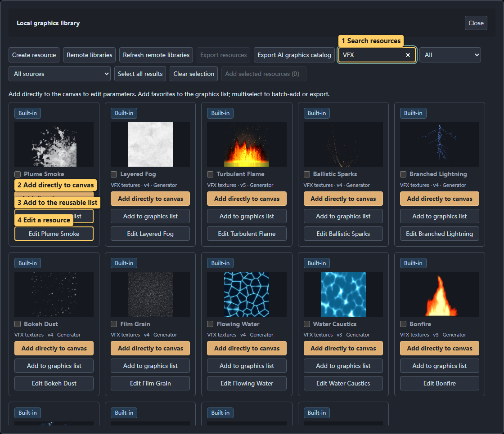
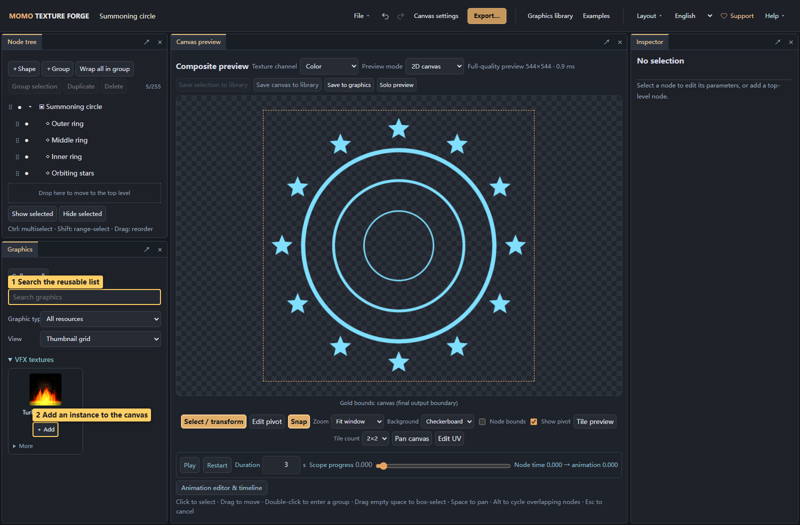

# 02 · Graphics library and graphics list

<!-- doc-language -->
[简体中文](02-graphics-library.md) · [English](02-graphics-library.en.md)
<!-- /doc-language -->

[Manual contents](README.en.md) · Previous: [Quick start](01-quick-start.en.md) · Next: [Images and SVG](03-images-and-svg.en.md)

## 1. Find and add a resource

The graphics list automatically receives all built-in graphics on first initialization. Existing browsers receive missing built-ins once on upgrade, preserving existing resources, versions and personal edits. Built-ins are deduplicated by resource identity. Later intentional removals, including an empty list, stay removed after refresh. New/open canvases continue sharing this list; initialization does not draw every built-in on the canvas.

Thumbnail grids automatically add or remove columns based on available panel width, with a minimum card width of about 120px. Widen the panel for three, four or more columns; narrow panels fall back to one. View → List remains a single column.

Pending thumbnails show a loading spinner until the image is ready. Failed previews show an indicator with details on hover; you can still view or add the graphic.

Loaded cards and thumbnails are reused. Favoriting, canvas parameter edits, renaming, language changes, and filtering do not reload existing previews. Updating graphic content redraws only that graphic’s thumbnail.

When the search field contains text, **×** appears on the right. Click it to clear the query and continue typing; the current browse mode and category filters stay selected.

Browse **All / Favorites / Recent / Animated**, regardless of whether a resource is an image, formula, or composition. Recent contains up to 24 previewed or added graphics, most recently used first. Animated includes time-based graphics, keyframe animation, and UV motion, with a play icon in the upper-left corner of each card and a localized tooltip. Graphic categories remain multiselect: any selected category matches, combined with the active browse mode and search. All or deselecting the last category clears the category restriction. Language changes retain selection; filters never change graphic content.

Use **☆ / ★** in the upper-right corner of a card to favorite or unfavorite it; **Favorites count** in the first row shows only favorite graphics. Favorites and recent usage stay in this browser across reloads and are not included in projects or resource packages. Built-in favorites still saved by the legacy editor migrate automatically.

> Callouts: 1 Search resources; 2 Add directly to canvas; 3 Add to the reusable list; 4 Edit a resource.

1. Open **Graphics library** in the toolbar. Search names, categories or tags; the screenshot searches for the effects category.
2. Filter by source and type to distinguish built-in, local and remote resources.
3. Choose **Add directly to canvas**. The library closes and the inspector selects the new node. Formulas, generators, images and compositions share this entry point.
4. For frequent reuse, also choose **Add to graphics list**. Multiple selected resources can be added together. Use **+ Add** in the left panel to insert instances later.

Batch add shows processed/total counts and the current resource name, then saves the list once. **Cancel** stops further processing and keeps completed resources; unprocessed and failed items remain selected for retry. Undo reverses the whole addition. Matching versions are skipped; newer versions still require separate confirmation.

Direct insertion uses the card's currently selected version and creates an independent instance each time. Undo/redo is supported; personal changes in the graphics list are retained. Remote packs download when needed. Save **File → Save project** to back up the canvas and its custom-resource dependencies.

> Callouts: 1 Search the reusable list; 2 Switch All, Favorites, Recent, or Animated; 3 Select graphic categories; 4 Add an instance to the canvas.

“Added” means the resource is already in the graphics list, not that a node exists on the canvas. Instances can be adjusted independently without changing the library original.

If an older list contains retired graphics or missing dependencies, the editor backs up the original data, sets unreadable entries aside and restores the remaining resources. The upper-right notification offers details and an original backup download including currently available custom dependencies. Do not clear browser data first. Recovery notifications describe unreadable entries found during the current load. Once the list is restored, retained historical backups do not repeat old warnings on reload; newly encountered failures still trigger a warning. Errors and warnings remain until dismissed.

## 2. Trial editing and saving copies

- A library card's **Edit [name]** opens the resource editor. Changes to built-in resources are normally saved as your own new resource.
- Click a graphics-list **thumbnail** to trial-edit it. **Return to canvas** restores the original canvas; **Add to canvas** creates an instance.
- **Update graphics** in trial editing explicitly replaces the list copy. Existing canvas instances retain their content. Save a new copy if you need both versions.
- **More → Rename** in the list changes the list entry and the initial names of future instances. Existing instances and library originals retain their names.

## 3. Save a composition from the canvas

Check the scope before choosing a save action above the preview:

| Action | Scope |
| --- | --- |
| Save selection to library | Selected node and its children as a reusable resource |
| Save canvas to library | Entire canvas as one composition resource |
| Save as graphic | A new reusable graphics-list copy |
| Update graphic | The linked list copy; existing instances are not replaced automatically |
| File → Save project | Current canvas and required resources |

A saved composition can be added to other canvases like a basic shape. Use it for coordinated rings, stars or decorations.

## 4. Export resources and restore backups

1. Select resources in the library.
2. Choose **Export resources** to download an official ZIP with dependencies.
3. In the destination browser, select it through **Graphics library → Create resource → Import files**.
4. Inspect the preview, import into the library and add to the graphics list as needed.

An ordinary image ZIP, screenshot collection or AI Skill ZIP is not a resource pack. If `manifest.json` is missing, first check which kind of file you selected.

## 5. Versions and deletion

- Library versions, reusable list copies and canvas instances have separate editing scopes.
- Removing a list entry does not delete its library original. Creating a new canvas does not clear the reusable list.
- A project contains canvas dependencies, not the entire graphics list. To transfer reusable items, save them into the library and export resources.
- See [Remote libraries](09-remote-libraries.en.md) for downloading, updating and handling multiple sources with the same resource ID.

Technical references: [Local graphics library](../LOCAL_GRAPHICS_LIBRARY.en.md) · [Resource-pack format](../RESOURCE-PACK.en.md).
