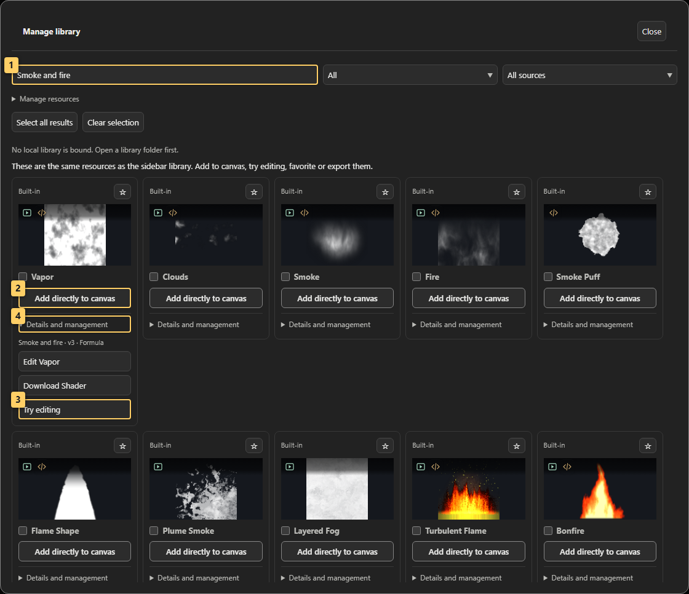
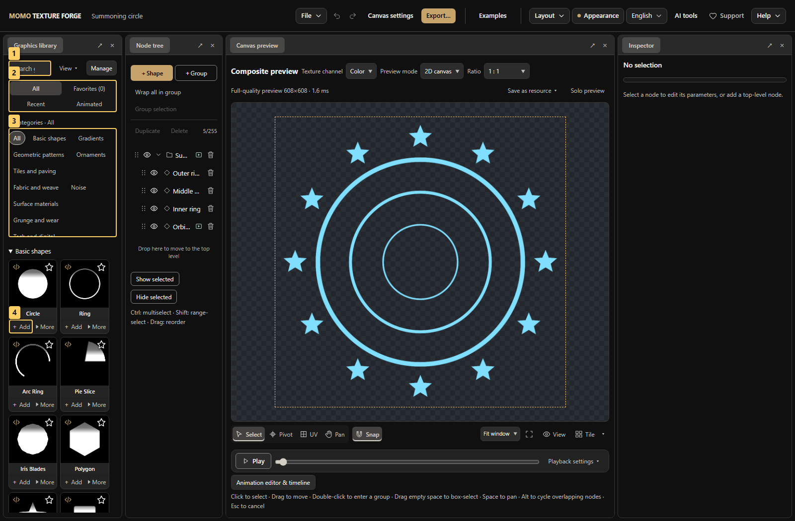

# 02 · Graphics library and resource management

<!-- doc-language -->
[简体中文](02-graphics-library.md) · [English](02-graphics-library.en.md)
<!-- /doc-language -->

[Manual contents](README.en.md) · Previous: [Quick start](01-quick-start.en.md) · Next: [Images and SVG](03-images-and-svg.en.md)

## 1. Find and add a resource

Search, category and source filters stay at the top. Expand **Manage resources** for creation, remote subscriptions, resource export and AI catalogs. Card editing/version actions are in details or More menus.

The sidebar and manager share the same built-in, local and subscribed remote resources. New resources appear immediately after saving or importing. Opening a canvas does not clear the library.

Thumbnail grids automatically add or remove columns based on available panel width, with a minimum card width of about 120px. Widen the panel for three, four or more columns; narrow panels fall back to one. View → List remains a single column.

Pending thumbnails show a loading spinner until the image is ready. Failed previews show an indicator with details on hover; you can still view or add the graphic.

Loaded cards and thumbnails are reused. Favoriting, canvas parameter edits, renaming, language changes, and filtering do not reload existing previews. Updating graphic content redraws only that graphic’s thumbnail.

When the search field contains text, **×** appears on the right. Click it to clear the query and continue typing; the current browse mode and category filters stay selected.

Browse **All / Favorites / Recent / Animated**, regardless of whether a resource is an image, formula, or composition. Recent contains up to 24 previewed or added graphics, most recently used first. Animated includes time-based graphics, keyframe animation, and UV motion, with a play icon in the upper-left corner of each card and a localized tooltip. Graphic categories remain multiselect: any selected category matches, combined with the active browse mode and search. All or deselecting the last category clears the category restriction. Language changes retain selection; filters never change graphic content.

The built-in library has 17 categories based on appearance and use. The library and left list share the same categories and order:

- **Basic shapes, Gradients**: circle and polygon outlines, and linear, radial or spherical value transitions.
- **Geometric patterns, Ornaments**: stripes, grids and dots, or decorative flowers, spirals and knots.
- **Tiles and paving, Fabric and weave, Surface materials, Grunge and wear**: brick and flooring, woven surfaces, wood/stone/metal/paper, or rust/scratches/splashes.
- **Noise, Tech and digital**: procedural noise and grain, or scanlines, glitches, HUDs and circuits.
- **Light and particles, Energy and impact, Smoke and fire, Water and caustics, Ribbons and trails**: find effects by their purpose, with formulas and generators together. Add the Animated filter for moving graphics only.
- **Flow and data maps, Masks and dissolve**: flow direction, normals and displacement, or erosion, edges and dissolve masks.

Built-ins already in the list appear under the current catalog categories without clearing storage or adding them again. Resource IDs, favorites, personal parameters, existing nodes and saved content stay unchanged. Custom and imported resources retain their own categories.

Use **☆ / ★** in the upper-right corner of a card to favorite or unfavorite it; **Favorites count** in the first row shows only favorite graphics. Favorites and recent usage stay in this browser across reloads and are not included in projects or resource packages. Built-in favorites still saved by the legacy editor migrate automatically.

> Callouts: 1 Search resources; 2 Add directly to canvas; 3 Try editing a resource; 4 Expand details and resource management.

1. Open **Graphics library** in the toolbar. Search names, categories or tags, such as “Smoke and fire”, “Water and caustics” or a specific graphic name.
2. Filter by source and type to distinguish built-in, local and remote resources.
3. Choose **Add directly to canvas**. The library closes and the inspector selects the new node. Formulas, generators, images and compositions share this entry point.
4. The sidebar and manager show the same resources. Favorite resources or open Details and management for trial editing, editing and export. No add-to-list step is required.

Select multiple resources to export their complete packages and dependencies. No separate add-to-list step is required.

Direct insertion uses the card's currently selected version and creates an independent instance each time. Undo/redo is supported; existing canvas instances retain their contents. Remote packs download when needed. Save **File → Save project** to back up the canvas and its custom-resource dependencies.

> Callouts: 1 Search the library; 2 Switch All, Favorites, Recent, or Animated; 3 Select graphic categories; 4 Add an instance to the canvas.

Resources can create multiple independent canvas instances. Management actions update the library and leave existing instances unchanged.

If an older list contains retired graphics or missing dependencies, the editor backs up the original data, sets unreadable entries aside and restores the remaining resources. The upper-right notification offers details and an original backup download including currently available custom dependencies. Do not clear browser data first. Recovery notifications describe unreadable entries found during the current load. Once the list is restored, retained historical backups do not repeat old warnings on reload; newly encountered failures still trigger a warning. Errors and warnings remain until dismissed.

## 2. Trial editing and saving copies

- A library card's **Edit [name]** opens the resource editor. Changes to built-in resources are normally saved as your own new resource.
- Click a graphics-list **thumbnail** to trial-edit it. **Return to canvas** restores the original canvas; **Add to canvas** creates an instance.
- **Save changes** publishes a personal resource version. **Save as new resource** keeps an independent result. Built-in and remote edits become personal copies. Existing canvas instances are unchanged.
- **More → Rename resource** updates a personal resource; built-in and remote resources are saved as personal copies. Existing instance names remain unchanged.

## 3. Save a composition from the canvas

Check the scope before choosing a save action above the preview:

| Action | Scope |
| --- | --- |
| Save selection to library | Selected node and its children as a reusable resource |
| Save canvas to library | Entire canvas as one composition resource |
| Save as new resource | A new independent library resource |
| Save changes | A new personal resource version; existing instances are unchanged |
| File → Save project | Current canvas and required resources |

A saved composition can be added to other canvases like a basic shape. Use it for coordinated rings, stars or decorations.

## 4. Export resources and restore backups

1. Select resources in the library.
2. Choose **Export resources** to download an official ZIP with dependencies.
3. In the destination browser, select it through **Graphics library → Create resource → Import files**.
4. Inspect the preview, import into the library; it appears in the sidebar immediately.

An ordinary image ZIP, screenshot collection or AI Skill ZIP is not a resource pack. If `manifest.json` is missing, first check which kind of file you selected.

## 5. Versions and deletion

- The sidebar and manager share one library; canvas instances are independent.
- Deleting a saved resource cleans up its current-folder files and updates both views, retaining canvas instances. Built-ins and remote server originals cannot be deleted here.
- Projects contain canvas dependencies, not the entire library. Export library ZIPs or copy the folder library to transfer resources.
- See [Remote libraries](09-remote-libraries.en.md) for downloading, updating and handling multiple sources with the same resource ID.

## 6. Folder libraries and migration

Personal resources come from the local folder you have opened. You can create with built-in graphics without a folder. Before creating or saving personal resources, the tool asks you to open a library folder or renew its permission.

1. In desktop Chrome / Edge, open **Graphics library → Resource management → Library folder**, select **Open library folder…** and grant read/write access.
2. Select **Open this library** for a folder with `index.json`, or name a new library and select **Create library**.
3. The graphics list immediately shows that folder's personal resources. Opening another folder shows its library without copying or merging the previous one.
4. Creating, importing and publishing versions write directly to the current folder. **Close library** only removes the connection. **Delete resource** also removes its ZIPs, thumbnails and historical versions; files still referenced by other library entries are preserved. Changing, closing or deleting library resources leaves existing canvas copies unchanged.

At startup, personal resources, remote downloads or lists saved by an older browser version trigger an upgrade dialog. Open a local library and the tool automatically saves complete packages and dependencies, verifies every package by reading it back, then removes the migrated browser resources and old list. Failure or cancellation keeps unmigrated originals for a later retry. Personal parameters, colors, effects, animation, names and aliases are preserved. Identical resources are reused; content conflicts stop the operation with an explanation.

If a browser resource is older than the folder version, the folder continues using its newer version. The older package is saved on disk under its original version before its browser copy is removed. Migration excludes the canvas and unsaved edits; save those as projects. Unreadable legacy entries retain their original data and a warning, rather than being deleted as migrated.

Use **Library folder → Clean unused files** to scan leftover packages, thumbnails and old versions. Scanning deletes nothing. Review names, paths, counts and sizes before selecting **Permanently delete these files**. Only generated files unreferenced by the current index are removed; other files are kept. Changes to files or the index require a new scan. Locked files or permission errors leave a list of remaining files and reasons, with a retry action. Canceling does not restore completed deletions.

The editor remembers the folder. Use **Authorize connection** if permission expires, or open another library folder. Clearing browser data does not delete disk resources; select the same folder again to read them. Back up the entire library folder or export resource ZIPs.

Technical references: [Local graphics library](../LOCAL_GRAPHICS_LIBRARY.en.md) · [Resource-pack format](../RESOURCE-PACK.en.md).
