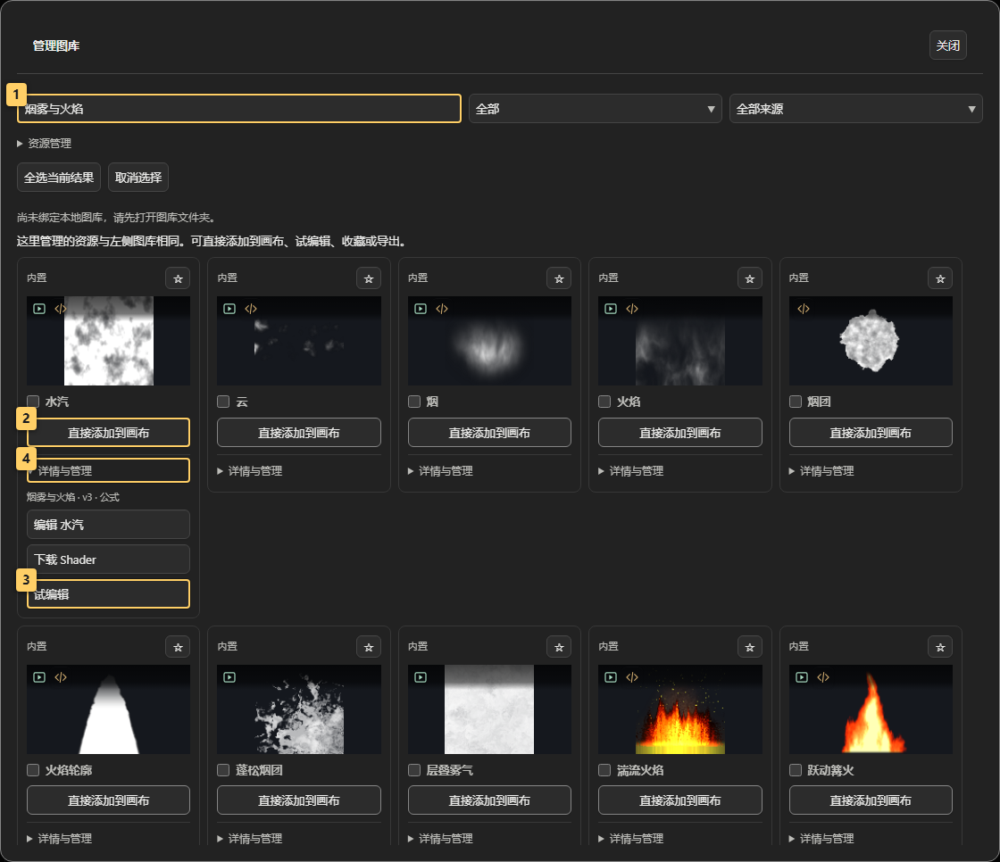
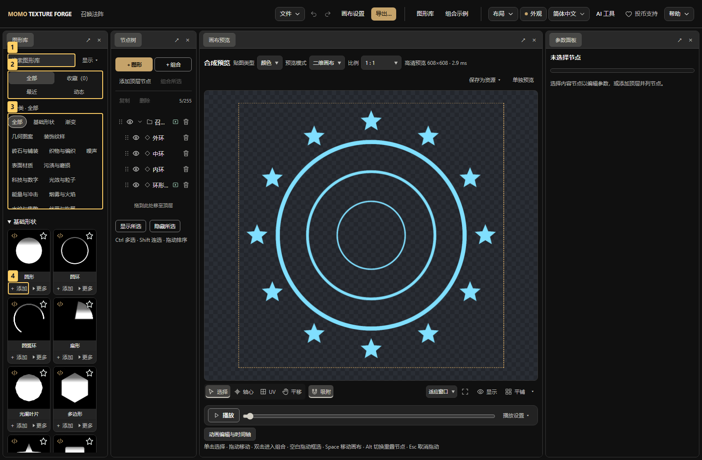

# 02 · 图库与资源管理

<!-- doc-language -->
[简体中文](02-graphics-library.md) · [English](02-graphics-library.en.md)
<!-- /doc-language -->

[手册目录](README.md) · 上一篇：[快速上手](01-quick-start.md) · 下一篇：[图片与 SVG](03-images-and-svg.md)

## 1. 找到资源并添加

搜索、分类与来源筛选常驻图库顶部。创建资源、远程订阅、导出资源和AI目录等操作收在 **资源管理** 中，展开后选择；卡片的编辑与版本操作在详情或更多菜单中。

左侧与管理窗口共用同一批内置、本地和远程资源。保存或导入后立即可用，无需加入列表；新建或打开画布不会清空图库。

缩略图网格按面板可用宽度自动增加或减少列数，卡片最小宽度约120px；加宽面板可显示三列、四列或更多，窄面板会退为一列。“浏览方式 → 列表”继续使用单列。

未生成或未加载完成的缩略图显示转圈占位，加载成功后显示图片；预览失败显示提示图标，悬停可查看原因，仍可查看或添加图形。

已加载的卡片和缩略图会复用。收藏、调整画布参数、重命名、切换语言或筛选不会让已有预览重新加载；更新图形内容时只重画对应的缩略图。

搜索框有内容时，右侧显示 **×**，点击即可清空关键词并继续输入；当前浏览入口和分类筛选会保留。

列表按 **全部 / 收藏 / 最近 / 动态** 筛选，不区分图片、公式或组合。“最近”包含预览过或添加到画布的图形，按最近使用顺序显示，保留最近 24 个；“动态”包含随时间变化的图形、关键帧动画和 UV 滚动，并在卡片左上角显示播放图标；悬停说明随界面语言切换。图形分类仍可多选，同组匹配任意选中项，并与当前入口和搜索框共同筛选。点分类“全部”或取消最后一个选项可恢复不限；切换语言保留筛选，筛选不修改图形内容。

内置图库按外观和用途分成 17 类，图库和左侧列表使用相同的分类与顺序：

- **基础形状、渐变**：圆形、多边形等轮廓，以及线性、径向、球形等明暗过渡。
- **几何图案、装饰纹样**：条纹、网格、点阵等规则图案，以及花窗、螺旋、结纹等装饰。
- **砖石与铺装、织物与编织、表面材质、污渍与磨损**：分别查找砖瓦地板、织物编织、木石金属纸张、锈蚀刮痕泼溅。
- **噪声、科技与数字**：查找程序噪声与颗粒，或扫描线、故障、HUD、电路等图形。
- **光效与粒子、能量与冲击、烟雾与火焰、水纹与焦散、丝带与拖尾**：按效果查找，公式与生成器放在同类中；只看会动的图形时叠加“动态”筛选。
- **流场与数据图、遮罩与溶解**：查找流向、法线、置换等数据图，以及侵蚀、边缘与溶解遮罩。

已加入列表的内置图形会按当前目录显示在新分类中，无需清缓存或重新添加；资源 ID、收藏、个人参数、已有节点和保存内容保持不变。自建和导入资源仍使用自己的分类。

点击卡片右上角的 **☆ / ★** 收藏或取消收藏；第一排的 **收藏 数量** 只显示收藏的图形。收藏和最近使用记录保存在当前浏览器，刷新后保留；不写入作品或资源包。旧版仍保存在本机的内置图形收藏会自动迁入。

> 图中标记：1 搜索资源；2 直接添加到画布；3 试编辑资源；4 展开详情与资源管理。

1. 顶栏打开 **图形库**，按名称、分类或标签搜索，例如“烟雾与火焰”“水纹与焦散”或具体图形名称。
2. 按来源和类型筛选，区分内置、本地自建和远程资源。
3. 点金色的 **直接添加到画布**，图库自动关闭，右侧显示新节点参数。公式、生成器、图片和组合使用同一入口。
4. 左侧图库与此窗口显示同一批资源，无需加入列表。点星形按钮收藏；展开 **详情与管理** 可试编辑、编辑资源或导出。

多选用于批量导出资源。导入或保存成功后，资源自动出现在左侧图库；收藏、最近、搜索和分类控制展示范围。

直接添加使用卡片当前选中的版本，每次创建独立实例，支持撤销/重做；图库资源与已有实例分别保存。远程资源会在需要时下载当前卡片的资源包。自定义资源的依赖随画布保存，可通过 **文件 → 保存项目** 备份。

> 图中标记：1 搜索图库；2 切换全部、收藏、最近或动态；3 多选图形分类；4 添加实例到画布。

同一资源可添加多个实例并分别调整。管理窗口中的操作直接作用于图库，已有画布实例保持原样。

旧版本列表中若有已下架或依赖缺失的图形，编辑器会先保留原始备份，再隔离无法读取的条目，恢复其余资源。右上角的提示可展开原因或下载包含当前自定义依赖的原始备份；不要先清空浏览器数据。恢复提醒只针对本次新发现的无法读取条目；列表恢复后，保留历史备份不会让刷新重复弹出旧提醒，再次遇到坏条目仍会提示。错误和需要处理的提示会持续显示，点右上角的关闭按钮可收起。

## 2. 试编辑和另存

- 图库卡片的 **编辑 名称** 打开资源编辑器。内置资源修改后通常另存为自己的资源。
- 左侧图库中点 **缩略图** 进入试编辑；**返回画布** 回到原画布，**添加到画布** 才创建实例。
- 个人资源试编辑后点 **保存更改** 发布新版本；需要保留两份时点 **另存为新资源**。内置和远程资源的修改另存为个人资源，已有画布实例保持原样。
- 左侧 **更多 → 重命名资源** 修改个人图库资源；内置或远程资源会另存副本。已有画布实例的名称保持原样。

## 3. 保存画布上的组合

预览区提供几个保存入口，先确认范围：

| 入口 | 保存范围 |
| --- | --- |
| 保存选中节点到图形库 | 当前节点及其子节点，成为可复用资源 |
| 保存整个画布到图形库 | 将整张画布存成一个组合资源 |
| 另存为新资源 | 在图库建立独立资源 |
| 保存更改 | 发布个人资源新版本，已有画布实例保持原样 |
| 文件 → 保存项目 | 保存当前画布与它依赖的资源 |

组合保存后可像基础图形一样加入其他画布。一个组合适合保存一套相互配合的圆环、星光或装饰。

## 4. 导出资源和导入备份

1. 在图库勾选要分享的资源。
2. 点 **导出资源** 下载正式 ZIP，包含资源与依赖。
3. 在目标浏览器的 **图形库 → 创建资源 → 导入文件** 选择该 ZIP。
4. 检查预览，再导入图库；资源会立即出现在左侧。

普通图片 ZIP、截图合集和 AI Skill ZIP 都不是资源包。遇到“缺少 manifest.json”，先检查选错了哪一种文件。

## 5. 版本与删除

- 图库版本、常用列表副本和画布实例有各自的修改范围，不是全局联动。
- 删除已保存资源会清理当前图库文件夹中的文件，两处视图同步更新，已有画布保持原样。内置和远程服务器原件不能删除；新建画布不会清空图库。
- 项目文件只包含画布依赖，不备份整个图库。转移资源可导出图库 ZIP 或复制文件夹图库。
- 远程资源下载、更新和同 ID 不同来源的规则见[远程图库教程](09-remote-libraries.md)。

## 6. 文件夹图库与迁移

个人资源以当前打开的本地文件夹为准。未绑定时可以使用内置图形创作；创建或保存个人资源前，工具会先引导打开图库文件夹，权限失效时先重新授权。

1. 在桌面 Chrome / Edge 打开 **图形库 → 资源管理 → 图库文件夹**，点 **打开图库文件夹…** 并授权读写。
2. 已有图库读取 `index.json`，点 **打开此图库**；新文件夹填写名称，再点 **创建图库**。
3. 图形列表立即显示此文件夹里的个人资源。换成另一个文件夹，就显示另一个图库，不自动复制或合并原图库。
4. 创建、导入和保存新版本都直接写入当前文件夹。**关闭图库** 只解除连接；**删除资源** 会同时清理对应的资源 ZIP、缩略图和历史版本；其他图库条目仍在引用的文件保留。更换、关闭或删除图库资源都不改变已有画布中的独立副本。

打开工具时，如果检测到旧版保存在浏览器中的个人资源、远程下载或旧列表，会自动弹出升级提示。打开本地图库后，程序自动保存完整资源包和依赖，逐项回读验证，再清理已迁移的浏览器资源和旧列表。失败或取消时，未完成迁移的原数据保留，下次打开可重试。个人参数、颜色、效果、动画、名称和别名会保留；相同资源复用，内容冲突会停止并显示原因，不能覆盖另一份内容。

旧浏览器版本早于文件夹里的版本时，文件夹仍使用新版；旧包按原版本号保存到磁盘，校验后清理浏览器副本。迁移不包含当前画布和未保存编辑，请另外保存项目。无法读取的旧条目仍会保留原始数据并提示处理，不会被当作已迁移而删除。

**图库文件夹 → 清理未使用文件** 可扫描过去留下的资源包、缩略图和旧版本。扫描不会删除文件；先核对名称、路径、数量和大小，再点 **永久删除以上文件**。只处理工具生成、且当前目录没有引用的文件，其他文件保留。文件或目录变化后必须重新扫描。删除遇到锁定或权限错误时，窗口列出剩余文件和原因，处理后可以重试；取消清理不会恢复已经删除的文件。

重新打开时会尝试读取已记住的文件夹。权限失效时点 **重新授权连接**；也可以打开其他图库文件夹。清理浏览器数据不会删除磁盘资源，再次选择同一文件夹即可读取。需要备份时，复制整个图库文件夹或导出资源 ZIP。

资源包与存储的技术说明：[本地图形库](../LOCAL_GRAPHICS_LIBRARY.md) · [资源包格式](../RESOURCE-PACK.md)。
