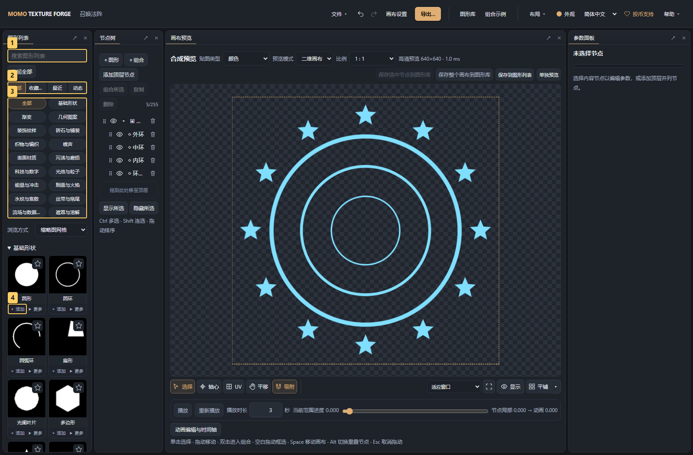

# 02 · 图库与图形列表

<!-- doc-language -->
[简体中文](02-graphics-library.md) · [English](02-graphics-library.en.md)
<!-- /doc-language -->

[手册目录](README.md) · 上一篇：[快速上手](01-quick-start.md) · 下一篇：[图片与 SVG](03-images-and-svg.md)

## 1. 找到资源并添加

图形列表首次初始化会自动加入全部内置图形；已有浏览器升级到此版本时也只补齐一次，保留原有资源、版本和个人修改。同一内置资源不重复加入，之后主动移除的条目（包括清空整个列表）不会因刷新而恢复。新建或打开画布仍共用此列表，不会把内置图形自动绘制到画布上。

缩略图网格按面板可用宽度自动增加或减少列数，卡片最小宽度约120px；加宽面板可显示三列、四列或更多，窄面板会退为一列。“浏览方式 → 列表”继续使用单列。

未生成或未加载完成的缩略图显示转圈占位，加载成功后显示图片；预览失败显示提示图标，悬停可查看原因，仍可查看或添加图形。

已加载的卡片和缩略图会复用。收藏、调整画布参数、重命名、切换语言或筛选不会让已有预览重新加载；更新图形内容时只重画对应的缩略图。

搜索框有内容时，右侧显示 **×**，点击即可清空关键词并继续输入；当前浏览入口和分类筛选会保留。

列表按 **全部 / 收藏 / 最近 / 动态** 筛选，不区分图片、公式或组合。“最近”包含预览过或添加到画布的图形，按最近使用顺序显示，保留最近 24 个；“动态”包含随时间变化的图形、关键帧动画和 UV 滚动，并在卡片左上角显示播放图标；悬停说明随界面语言切换。图形分类仍可多选，同组匹配任意选中项，并与当前入口和搜索框共同筛选。点分类“全部”或取消最后一个选项可恢复不限；切换语言保留筛选，筛选不修改图形内容。

内置图库按外观和用途分成 17 类，图库和左侧列表使用相同的分类与顺序：

- **基础形状、渐变**：圆形、多边形等轮廓，以及线性、径向、球形等明暗过渡。
- **几何图案、装饰纹样**：条纹、网格、点阵等规则图案，以及花窗、螺旋、结纹等装饰。
- **砖石与铺装、织物与编织、表面材质、污渍与磨损**：分别查找砖瓦地板、织物编织、木石金属纸张、锈蚀刮痕泼溅。
- **噪声、科技与数字**：查找程序噪声与颗粒，或扫描线、故障、HUD、电路等图形。
- **光效与粒子、能量与冲击、烟雾与火焰、水纹与焦散、丝带与拖尾**：按效果查找，公式与生成器放在同类中；只看会动的图形时叠加“动态”筛选。
- **流场与数据图、遮罩与溶解**：查找流向、法线、置换等数据图，以及侵蚀、边缘与溶解遮罩。

已加入列表的内置图形会按当前目录显示在新分类中，无需清缓存或重新添加；资源 ID、收藏、个人参数、已有节点和保存内容保持不变。自建和导入资源仍使用自己的分类。

点击卡片右上角的 **☆ / ★** 收藏或取消收藏；第一排的 **收藏 数量** 只显示收藏的图形。收藏和最近使用记录保存在当前浏览器，刷新后保留；不写入作品或资源包。旧版仍保存在本机的内置图形收藏会自动迁入。

> 图中标记：1 搜索资源；2 直接添加到画布；3 加入常用列表；4 编辑资源。

1. 顶栏打开 **图形库**，按名称、分类或标签搜索，例如“烟雾与火焰”“水纹与焦散”或具体图形名称。
2. 按来源和类型筛选，区分内置、本地自建和远程资源。
3. 点金色的 **直接添加到画布**，图库自动关闭，右侧显示新节点参数。公式、生成器、图片和组合使用同一入口。
4. 想留作常用资源时，另点 **添加到图形列表**；多选可批量加入列表，以后从左侧点 **＋ 添加**。

批量添加时会显示进度和当前资源名称，准备完成后统一保存。点 **取消** 可停止后续处理，已处理好的资源仍会加入列表，未处理或失败的项保留勾选，方便重试；整次添加可撤销。已有相同版本会跳过，新版本仍需单独确认更新。

直接添加使用卡片当前选中的版本，每次创建独立实例，支持撤销/重做；不覆盖图形列表中的个人修改。远程资源会在需要时下载当前卡片的资源包。自定义资源的依赖随画布保存，可通过 **文件 → 保存项目** 备份。

> 图中标记：1 搜索常用列表；2 切换全部、收藏、最近或动态；3 多选图形分类；4 添加实例到画布。

“已添加”表示常用列表中已经有此资源，不代表画布中已经有节点。添加多个实例可以分别调整；它们不会自动改动图库原件。

旧版本列表中若有已下架或依赖缺失的图形，编辑器会先保留原始备份，再隔离无法读取的条目，恢复其余资源。右上角的提示可展开原因或下载包含当前自定义依赖的原始备份；不要先清空浏览器数据。恢复提醒只针对本次新发现的无法读取条目；列表恢复后，保留历史备份不会让刷新重复弹出旧提醒，再次遇到坏条目仍会提示。错误和需要处理的提示会持续显示，点右上角的关闭按钮可收起。

## 2. 试编辑和另存

- 图库卡片的 **编辑 名称** 打开资源编辑器。内置资源修改后通常另存为自己的资源。
- 图形列表中点 **缩略图** 进入试编辑；**返回画布** 回到原画布，**添加到画布** 才创建实例。
- 试编辑中的 **更新到图形列表** 是明确覆盖列表副本的操作，已有画布实例保持原样；需要保留两个版本时另存。
- 左侧列表 **更多 → 重命名** 修改列表条目及以后加入实例的名称，既有实例和图库原件保持原名。

## 3. 保存画布上的组合

预览区提供几个保存入口，先确认范围：

| 入口 | 保存范围 |
| --- | --- |
| 保存选中节点到图形库 | 当前节点及其子节点，成为可复用资源 |
| 保存整个画布到图形库 | 将整张画布存成一个组合资源 |
| 另存到图形列表 | 建立新的常用资源副本 |
| 更新到图形列表 | 更新当前关联的副本，已有实例不自动替换 |
| 文件 → 保存项目 | 保存当前画布与它依赖的资源 |

组合保存后可像基础图形一样加入其他画布。一个组合适合保存一套相互配合的圆环、星光或装饰。

## 4. 导出资源和导入备份

1. 在图库勾选要分享的资源。
2. 点 **导出资源** 下载正式 ZIP，包含资源与依赖。
3. 在目标浏览器的 **图形库 → 创建资源 → 导入文件** 选择该 ZIP。
4. 检查预览，再导入图库、添加到图形列表。

普通图片 ZIP、截图合集和 AI Skill ZIP 都不是资源包。遇到“缺少 manifest.json”，先检查选错了哪一种文件。

## 5. 版本与删除

- 图库版本、常用列表副本和画布实例有各自的修改范围，不是全局联动。
- 从图形列表移除条目不删除图库原件；新建画布不会清空常用列表。
- 项目文件只包含画布依赖，不备份整个图形列表。转移常用资源时先保存到图库，再导出资源。
- 远程资源下载、更新和同 ID 不同来源的规则见[远程图库教程](09-remote-libraries.md)。

资源包与存储的技术说明：[本地图形库](../LOCAL_GRAPHICS_LIBRARY.md) · [资源包格式](../RESOURCE-PACK.md)。
