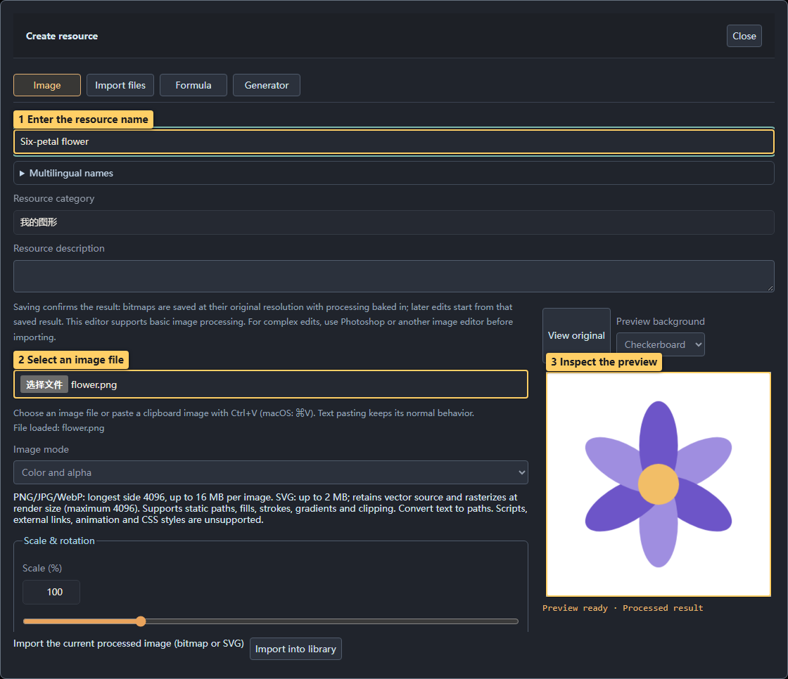
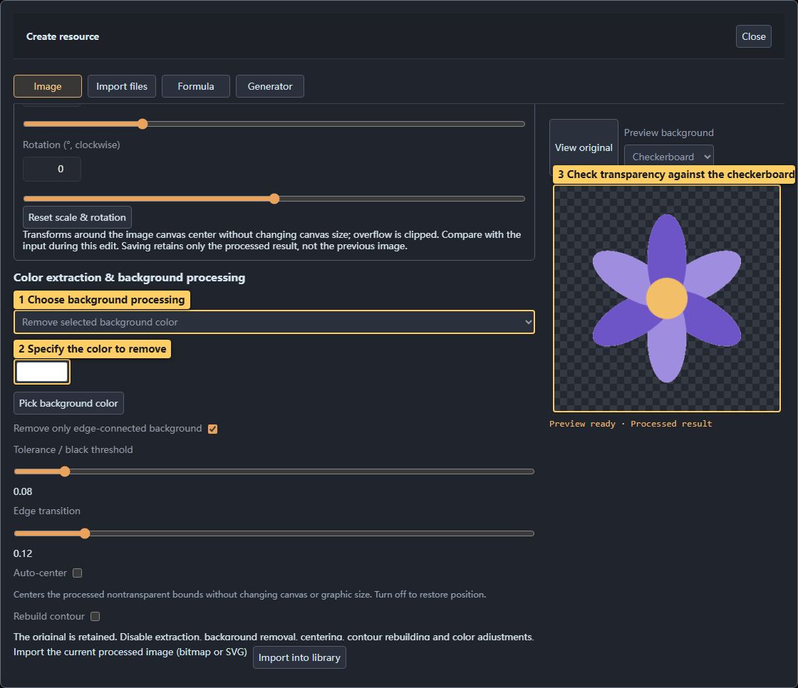

# 03 · Images and SVG

<!-- doc-language -->
[简体中文](03-images-and-svg.md) · [English](03-images-and-svg.en.md)
<!-- /doc-language -->

[Manual contents](README.en.md) · Previous: [Graphics library](02-graphics-library.en.md) · Next: [Formulas and generators](04-formulas-and-generators.en.md)

## 1. Upload or paste an image

> Callouts: 1 Enter the resource name; 2 Select an image file; 3 Inspect the preview.

1. Open **Graphics library → Create resource → Image**.
2. Enter a resource name, category and description.
3. Choose a PNG/JPG/WebP or static SVG under **Image file**, or paste an image with Ctrl+V / Cmd+V.
4. Wait for a successful preview and check the image and display mode.

Bitmaps support a longest side of 4096 pixels and 16 MB per file. SVG supports up to 2 MB and is rasterized at the rendering size. Static paths, fills, strokes, gradients and clipping are supported. Scripts, external links, animation and CSS styles are unsupported; convert text to paths first.

## 2. Remove a background or extract one color

> Callouts: 1 Choose background processing; 2 Specify the color to remove; 3 Check transparency against the checkerboard.

The screenshot demonstrates **Remove a specified color** on a white-background flower:

1. Select that processing mode.
2. Set the background color to white, or use the background eyedropper on the original preview.
3. Start with a small tolerance and inspect petal details and edges. Transition controls preserve softer edges.
4. Confirm transparency using the checkerboard, then compare with **View original**.

Other processing modes:

| Mode | Purpose |
| --- | --- |
| Keep original | Preserve the background |
| Extract a specified color | Keep matching pixels within tolerance and make other pixels transparent |
| Remove a specified color | Remove matching colors; edge connectivity limits the affected region |
| Black-background effect to transparency | Suppress dark backgrounds in fire and light effects while retaining bright details |

## 3. Center, rotate and recolor

- **Auto center** moves the pattern using the bounds of the processed nontransparent pixels; it does not resize it.
- **Scale & rotation** operates within a fixed image canvas. Enlarging or rotating can clip the result.
- **Adjust colors** can tint the image or replace a particular color. Tolerance and transition define the affected range; preserve semitransparency for soft edges.
- **Rebuild contour** reshapes blurred edges; it cannot recover unknown photographic detail.

## 4. Convert to SVG paths

Enable **Convert to SVG paths**. Adjust alpha threshold, denoising, smoothing, detail retention and sampling size while inspecting the anchor count and contour. This extracts single-color outlines and holes. Gradients, soft edges and multiple colors are simplified; it is unsuitable for preserving detailed photos.

Reduce sampling or detail if there are too many paths. Simplify SVG files above 2 MB or keep a bitmap. More than 50,000 anchors triggers a complexity notice.

## 5. Save, insert and set aspect ratio

1. Confirm the result and choose **Import into library**.
2. Add it to the graphics list, then use **+ Add** to insert it.
3. **Shape → Image fit** preserves the source aspect ratio by default. Choose stretch only when deformation is intended.
4. **Image mode** distinguishes original color and alpha, luminance mask and alpha mask. Choose original color to see the image's actual colors.

You can compare the original while editing. **Saving a processed bitmap bakes it into the final transparent PNG and saves the result only.** The original source and full processing history are not retained with that result; keep your source separately. SVG retains its vector paths.

Color images can also supply height and normals. See [Normals](07-normal-and-material.en.md).
