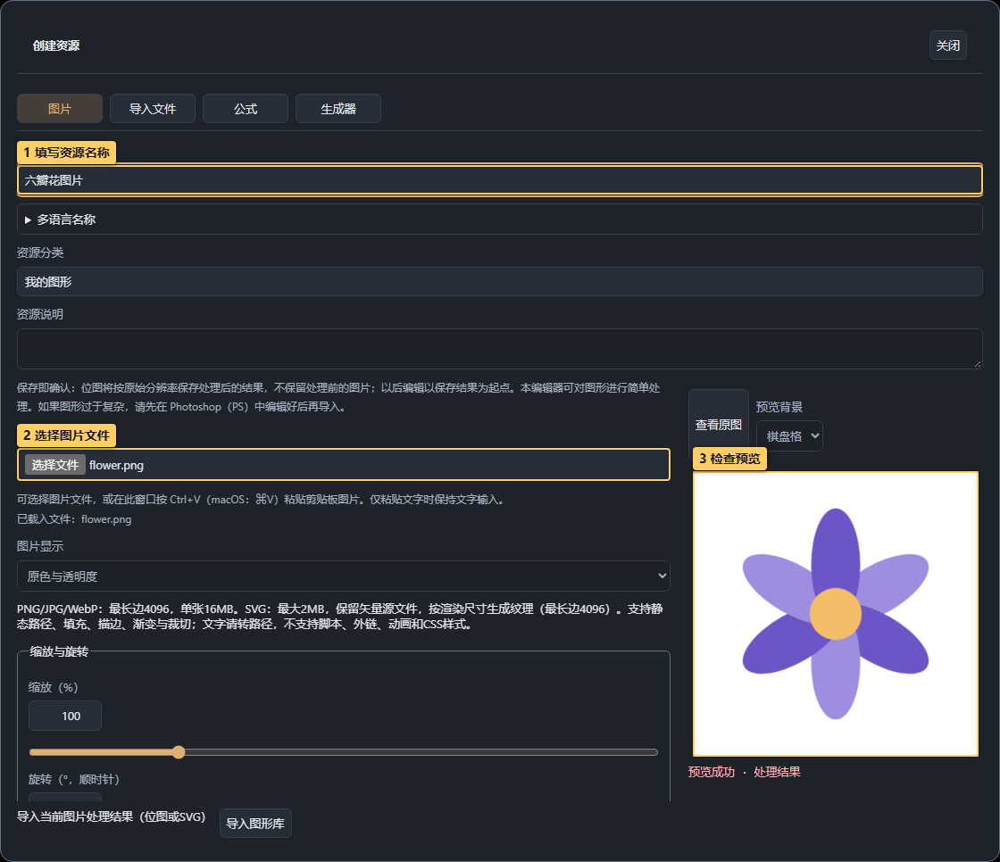
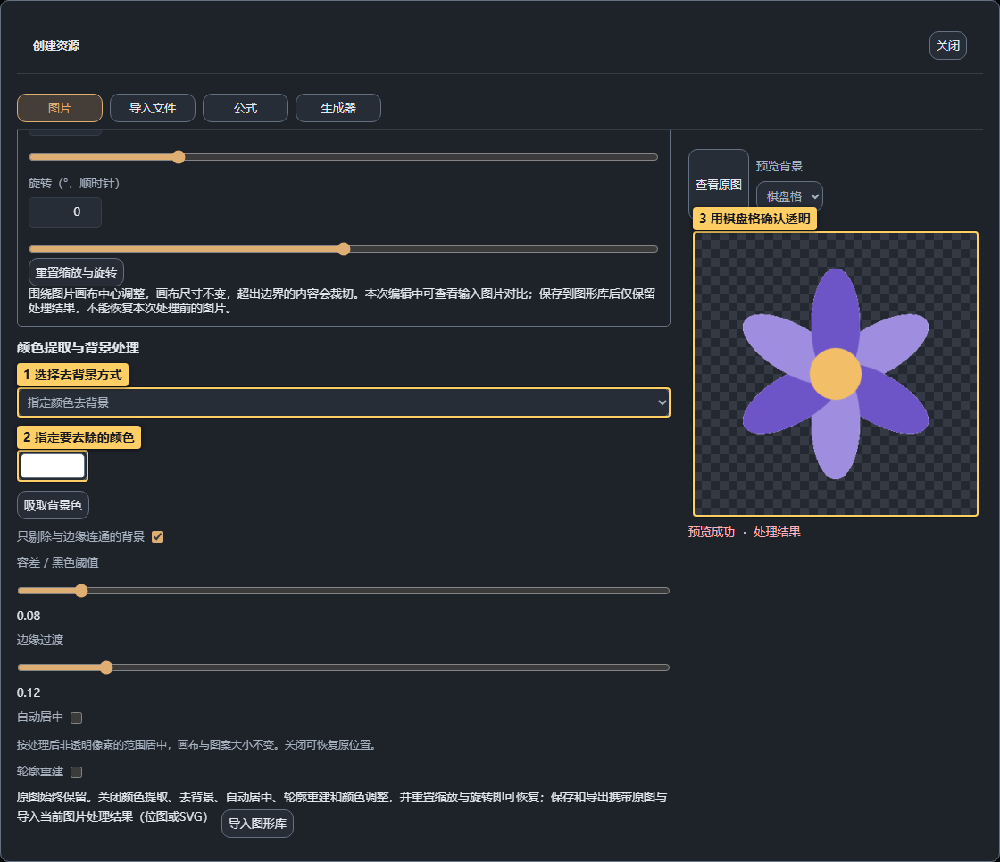

# 03 · 图片与 SVG

<!-- doc-language -->
[简体中文](03-images-and-svg.md) · [English](03-images-and-svg.en.md)
<!-- /doc-language -->

[手册目录](README.md) · 上一篇：[图库](02-graphics-library.md) · 下一篇：[公式与生成器](04-formulas-and-generators.md)

## 1. 上传或粘贴图片

> 图中标记：1 填写资源名称；2 选择图片文件；3 检查预览。

1. **图形库 → 资源管理 → 创建资源 → 图片**。
2. 填“资源名称”“资源分类”和说明。
3. 在“图片文件”中选择 PNG/JPG/WebP 或静态 SVG；也可按 Ctrl+V / Cmd+V 粘贴剪贴板图片。
4. 等待“预览成功”，确认右侧图片和显示模式。

位图最长边 4096、单张 16MB；SVG 最大 2MB，按实际渲染尺寸采样。静态 SVG 支持路径、填充、描边、渐变与裁切；不支持脚本、外链、动画或 CSS 样式，文字请先转路径。

## 2. 去掉背景或提取一种颜色

> 图中标记：1 选择去背景方式；2 指定要去除的颜色；3 用棋盘格确认透明。

截图中用白底六瓣花演示 **指定颜色去背景**：

1. “处理方式”选“指定颜色去背景”。
2. 背景颜色设为白色，或用吸取背景色在预览原图上取色。
3. 从较小容差开始调，观察花瓣细节与边缘；过渡用于保留柔边。
4. 用棋盘格确认背景已经透明，再点“查看原图”比较。

其他处理方式：

| 方式 | 用途 |
| --- | --- |
| 保留原图 | 不去背景 |
| 提取指定颜色 | 保留选中颜色和容差内的像素，其余变透明 |
| 指定颜色去背景 | 去除匹配颜色；边缘连通选项限制处理范围 |
| 黑底特效转透明 | 火焰、光效等黑底素材，压掉暗背景，保留亮部 |

## 3. 居中、旋转和改色

- **自动居中**依据处理后非透明像素的范围移动图案，不自动改变图案大小。
- **缩放与旋转**在固定图片画布中调整，放大或旋转可能造成裁切。
- **调整颜色**可统一着色或替换指定颜色，容差和过渡决定替换范围；“保留半透明”适合柔和边缘。
- **轮廓重建**重新整形模糊边缘，不能恢复照片真实细节。

## 4. 转成 SVG 路径

在图片页启用 **转为 SVG 路径**：调透明度阈值、去毛刺、平滑、细节保留与采样最长边，观察锚点数量和轮廓。它提取单色轮廓并保留孔洞，渐变、柔边和多色会简化；精细照片不适合用此方式保留原画。

路径过多时降低采样或细节。超过 2MB 的 SVG 需简化或保留位图；超过 50000 锚点会提示复杂度。

## 5. 保存、加入画布与设置比例

1. 确认处理结果后点 **导入图形库**。
2. 从图库添加到图形列表，再 **＋ 添加** 到画布。
3. 节点右侧 **图形 → 图片比例** 默认保持原图比例；需要主动变形时选随区域拉伸。
4. **图片显示**区分原色与透明度、亮度遮罩、透明度遮罩；需要看实际颜色时选原色。

图片编辑草稿中可以对比原图。**保存有处理的位图时会固化成最终透明 PNG，只保存结果**，处理前的原图与恢复参数不随成品保存。请自行保留原文件。SVG 保留矢量路径。

原色图片也可转换高度与法线，步骤见[法线教程](07-normal-and-material.md)。
