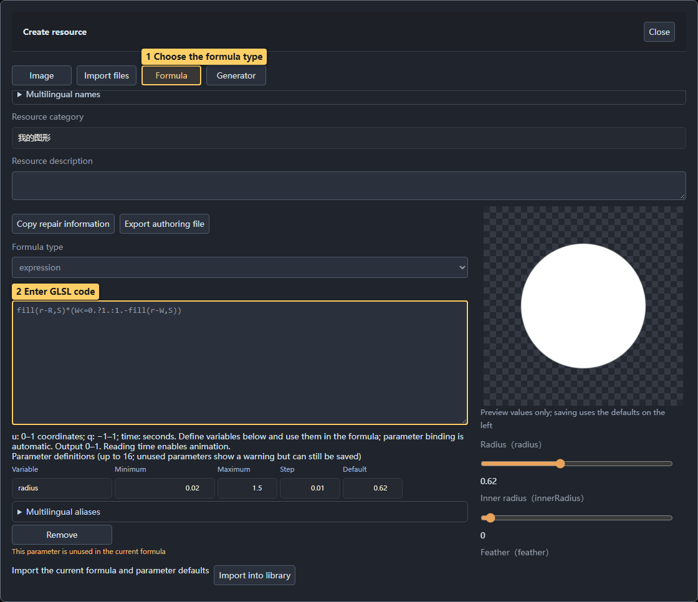
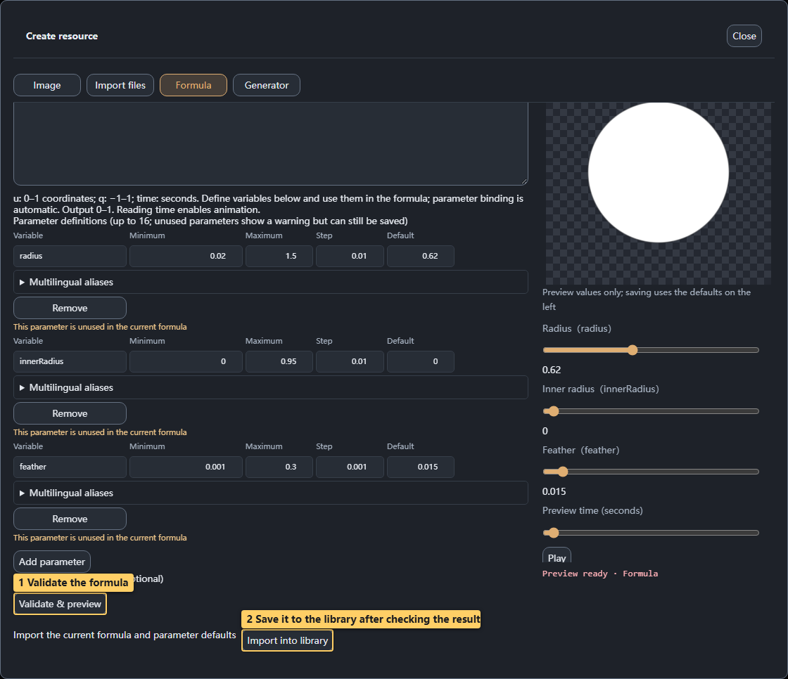
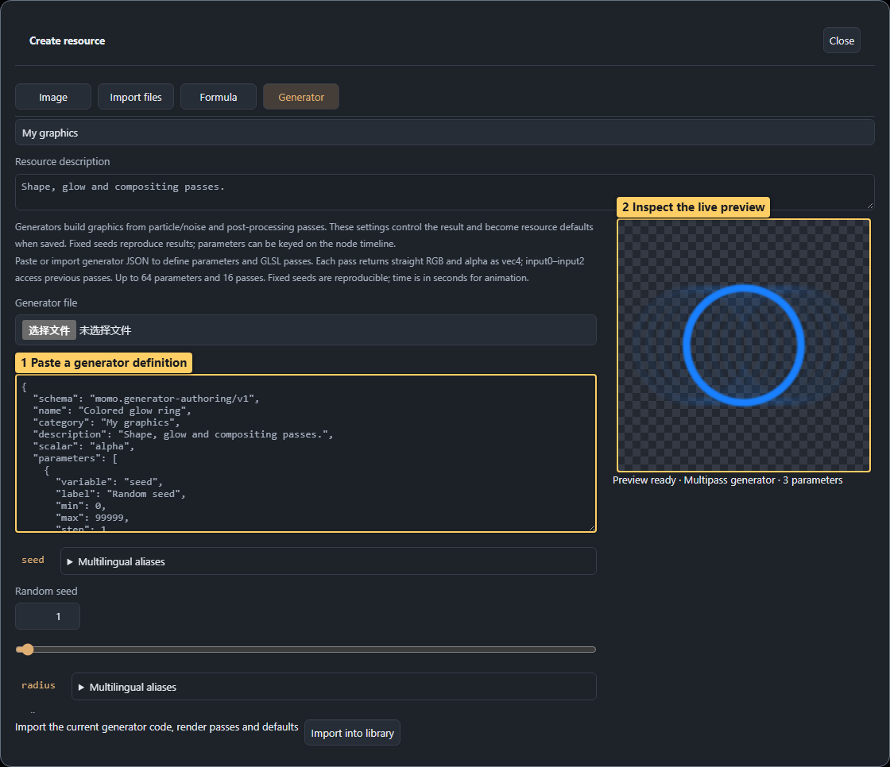
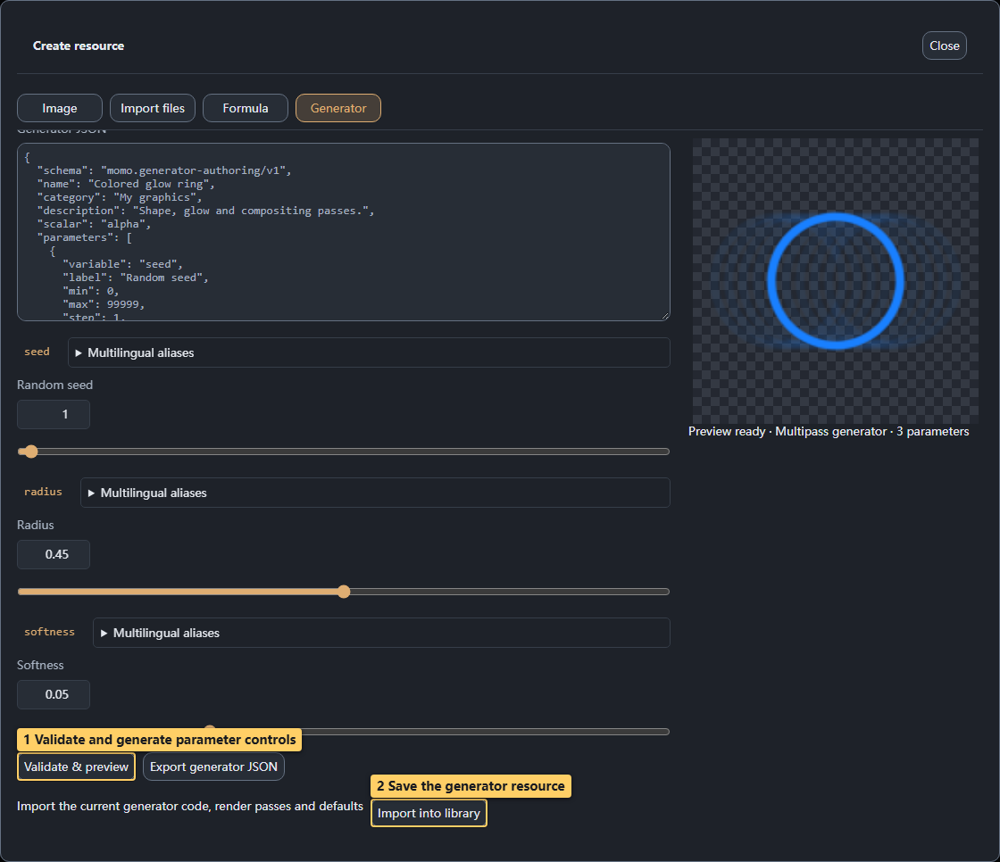
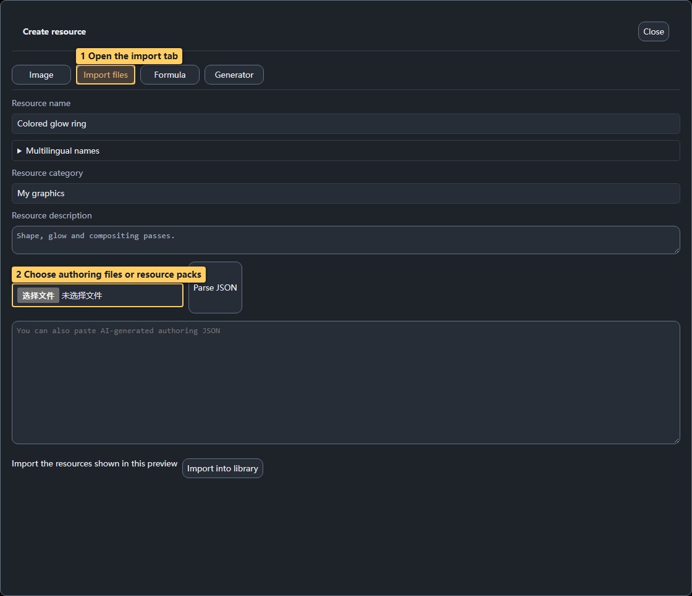

# 04 · Formulas and generators

<!-- doc-language -->
[简体中文](04-formulas-and-generators.md) · [English](04-formulas-and-generators.en.md)
<!-- /doc-language -->

[Manual contents](README.en.md) · Previous: [Images and SVG](03-images-and-svg.en.md) · Next: [Canvas and compositing](05-canvas-and-compositing.en.md)

## 1. Choose an authoring method

| Type | Suitable content |
| --- | --- |
| Image / SVG | Existing artwork, complex images and outlines |
| Formula | Shapes, noise and parameterized textures expressed as scalar values |
| Generator | Native RGBA, smoke/fire/lightning, multipass rendering and postprocessing |
| Composition | Reusable arrangements, blending and animation of existing nodes |

You can enter your own formula or generator definition without choosing a template. Built-in resources are also useful for learning and experimentation.

## 2. Create a custom formula

> Callouts: 1 Choose the formula type; 2 Enter GLSL code.

1. Open **Graphics library → Manage resources → Create resource → Formula** and enter a name.
2. Choose `expression` or `body`, then enter GLSL.
3. Define display aliases, formula variables, ranges, steps and defaults. Use the same variables in the formula; up to 16 parameters are supported.
4. Choose **Validate & preview**. Check defaults, endpoints and intermediate values.
5. For motion, use `time` in seconds and scrub the preview time.
6. After a successful preview, choose **Import into library**.

> Callouts: 1 Validate the formula; 2 Save it to the library after checking the result.

`u` ranges from 0 to 1; `q` ranges from −1 to 1. Trial values on the right affect only the preview. A saved formula uses the defaults on the left. “Parameter not used in the current formula” is guidance, not necessarily a compilation failure.

If you do not know GLSL, use the [Authoring Skill](10-ai-and-help.en.md) to request importable JSON rather than editing internal slot numbers.

## 3. Adjust a built-in generator

> Callouts: 1 Scrub time to inspect motion; 2 Inspect the generated image; 3 Save your version.

1. Search the library for fire, smoke or the Smoke and fire category. Lightning is under Energy and impact; sparks are under Light and particles.
2. Open **Edit Turbulent Flame**, for example, and wait for the preview.
3. Adjust width, height, smoke, particles or noise while inspecting color and alpha.
4. Scrub **Preview time (seconds)** or play the animation. Where available, setting animation speed to zero freezes built-in motion.
5. **Save as new graphic** preserves your version for insertion into the canvas.

Generators expose different parameters. If a smoke setting seems ineffective, first make sure smoke amount/intensity is nonzero and inspect a time where smoke is visible.

## 4. Enter your own generator definition

> Callouts: 1 Paste a generator definition; 2 Inspect the live preview.

1. Open **Create resource → Generator**.
2. Paste a complete definition into **Generator JSON** or select a `.generator.json` file.
3. Choose **Validate & preview** and check the generated controls and image.
4. Parameter edits update the preview and saved defaults. Compilation failures retain the last successful frame; fix the error before saving.
5. Export generator JSON to continue editing the code, or export an official resource ZIP with dependencies.

> Callouts: 1 Validate and generate parameter controls; 2 Save the generator resource.

Up to 64 parameters and 16 GLSL rendering steps are supported. Each step can read up to three textures from previous steps. `time` is measured in seconds. There is no cross-frame simulation or arbitrary user JavaScript. See the [generator specification](../skills/texture-forge-author/references/generator-guide.en.md) for the format, examples and validation workflow.

## 5. Import JSON or an official resource pack

> Callouts: 1 Open the import tab; 2 Choose authoring files or resource packs.

In **Create resource → Import files**, select one or more authoring JSON files, or paste and parse JSON. A single item can be previewed and edited; multiple items can be selected for batch import. Official resource ZIPs use the same entry point.

Parsing does not save the resource. Inspect the preview and choose **Import into library**. Skill ZIPs and ordinary image archives are not resource packs.
