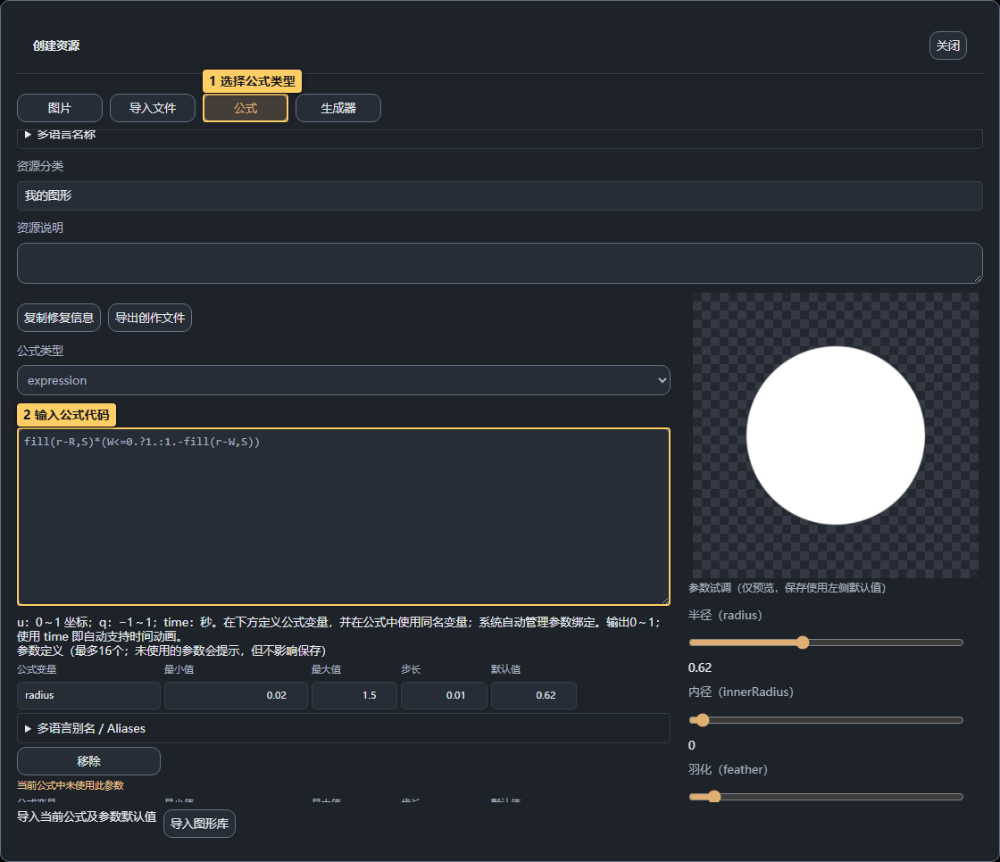
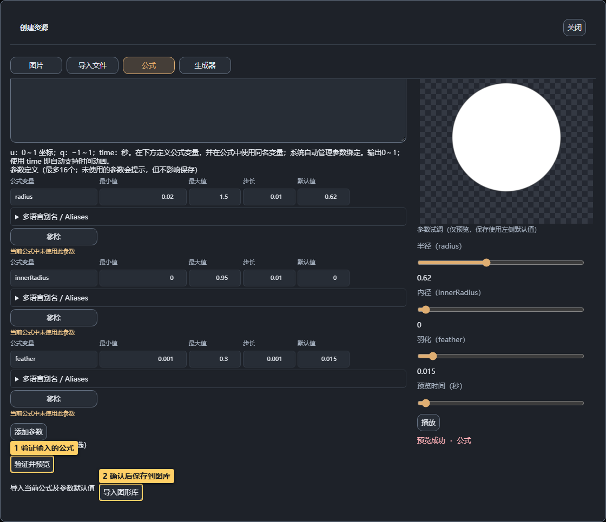
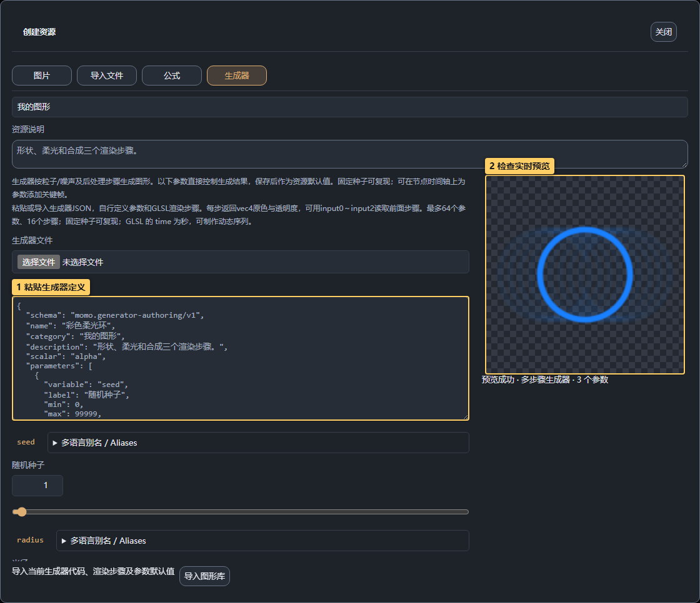
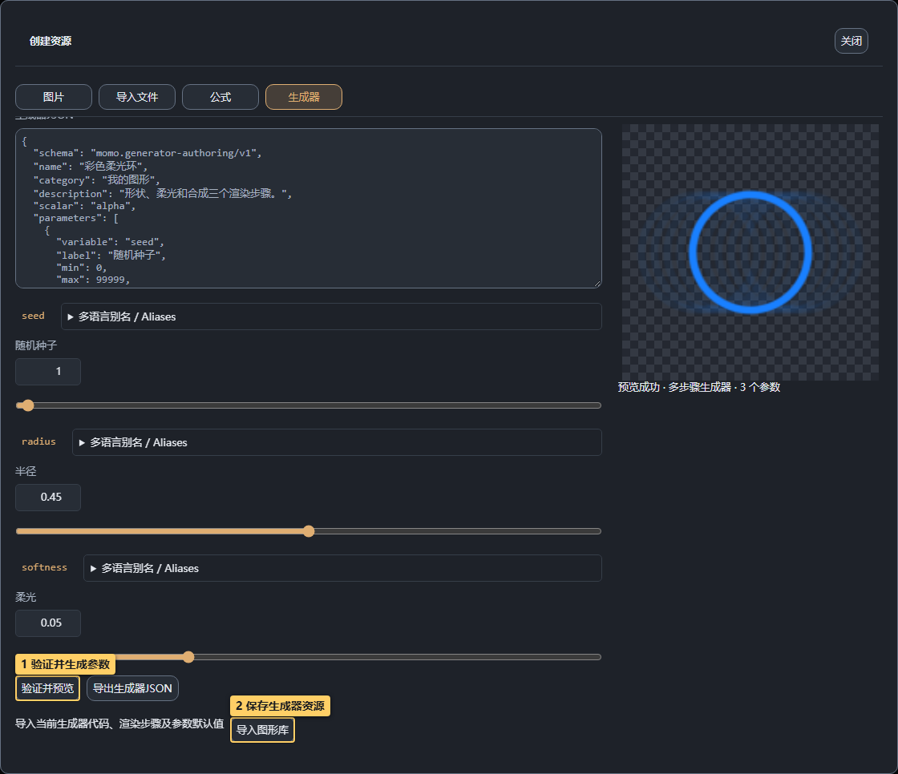
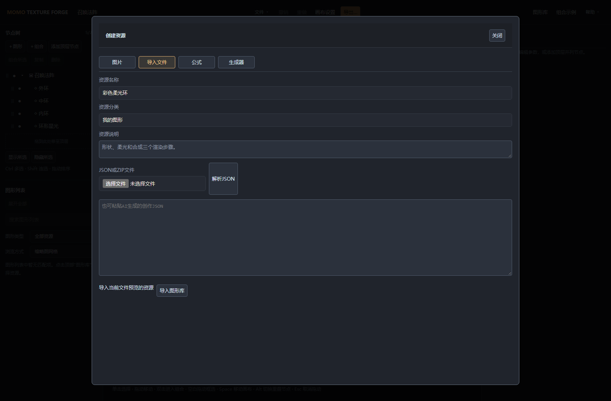

# 04 · 公式与生成器

<!-- doc-language -->
[简体中文](04-formulas-and-generators.md) · [English](04-formulas-and-generators.en.md)
<!-- /doc-language -->

[手册目录](README.md) · 上一篇：[图片与 SVG](03-images-and-svg.md) · 下一篇：[画布与合成](05-canvas-and-compositing.md)

## 1. 先选合适的创作方式

| 类型 | 适合制作 |
| --- | --- |
| 图片 / SVG | 已经画好的素材、复杂美术图和轮廓 |
| 公式 | 单个图形、噪声、可用标量表达的参数化纹理 |
| 生成器 | 原生 RGBA、烟雾/火焰/闪电、多步骤渲染与后处理 |
| 组合 | 复用现有节点的排列、合成与动画结构 |

用户可以输入自己的公式或生成器定义，创建入口不要求挑选模板。已有内置资源可作为学习和试调对象。

## 2. 自定义公式

> 图中标记：1 选择公式类型；2 输入公式代码。

1. **图形库 → 资源管理 → 创建资源 → 公式**，填写资源名称。
2. 选表达式 `expression` 或函数体 `body`，在 GLSL 公式区输入代码。
3. 在参数行设置显示名称、公式变量、范围、步长和默认值；公式中使用相同变量名，最多 16 项。
4. 点 **验证并预览**，检查默认值、参数两端与中间值。
5. 需要运动时使用 `time`（秒），在预览区拖动时间检查。
6. 预览成功后 **导入图形库**。

> 图中标记：1 验证输入的公式；2 确认后保存到图库。

`u` 是 0～1 坐标，`q` 是 −1～1 坐标。右侧参数试调只影响预览，公式保存使用左侧默认值；“当前公式中未使用此参数”是提醒，不等同于编译失败。

不熟悉 GLSL 时可用[创作 Skill](10-ai-and-help.md)，让 AI 提供可导入 JSON，而不是手改内部槽位编号。

## 3. 调整内置生成器

> 图中标记：1 拖动时间查看运动；2 观察生成结果；3 保存自己的版本。

1. 在图库搜索“火焰”“烟雾”或“烟雾与火焰”分类；闪电在“能量与冲击”，火花在“光效与粒子”。
2. 点 **编辑 湍流火焰**等入口，等预览成功。
3. 调整宽度、高度、烟气、粒子或噪声相关参数，观察右侧颜色和透明度。
4. 拖动 **预览时间（秒）**，或播放检查运动；提供“动画速度”的生成器设为 0 可定格。
5. **保存为新图形**保留自己的版本，再添加到画布。

不是所有生成器都显示相同参数。某项烟气参数看不出区别时，先确认烟气数量/强度不为 0，再在有烟气的时间位置观察。

## 4. 输入自己的生成器定义

> 图中标记：1 粘贴生成器定义；2 检查实时预览。

1. **创建资源 → 生成器**。
2. 在 **生成器JSON** 中粘贴完整定义，或选择 `.generator.json`。
3. 点 **验证并预览**，检查显示出的参数与图像。
4. 试调参数会更新生成器预览及保存默认值；编译失败时保留上次成功画面，修复后才能保存。
5. 导出生成器 JSON 便于继续改代码，导出资源 ZIP 则携带资源与依赖。

> 图中标记：1 验证并生成参数；2 保存生成器资源。

支持最多 64 个参数、16 个 GLSL 渲染步骤；每步读取前面步骤的最多三个纹理。`time` 为秒，没有跨帧模拟或任意用户 JavaScript 执行。格式、可复制示例和验证方法见[生成器规范](../skills/texture-forge-author/references/generator-guide.md)。

## 5. 导入 JSON 或正式资源包

> 图中标记：1 切换导入页；2 选择创作文件或资源包。

在 **创建资源 → 导入文件** 选择一个或多个创作 JSON，或粘贴创作 JSON 并解析；单项可预览编辑，多项勾选后批量导入。正式资源 ZIP 也从这里导入。

解析成功不等于已经保存：看过预览后仍需点“导入图形库”。Skill 下载 ZIP 和普通图片压缩包不属于此处的资源包。
