# 05 · Canvas, arrangement and compositing

<!-- doc-language -->
[简体中文](05-canvas-and-compositing.md) · [English](05-canvas-and-compositing.en.md)
<!-- /doc-language -->

[Manual contents](README.en.md) · Previous: [Formulas and generators](04-formulas-and-generators.en.md) · Next: [Animation](06-animation.en.md)

Open the [summoning-circle example](examples/summoning-circle.json) and select the radial-stars node to reproduce the arrangement interface in this chapter.

## 1. Select nodes, group and enter children

- Click a node or canvas graphic to select it. Ctrl/Cmd-click toggles multiple selections; Shift selects a range; drag empty canvas space for box selection.
- **+ Group** creates a container. Ctrl/Cmd+G groups siblings. Groups let you move, rotate and repeat coordinated decorations together.
- Double-click a group to enter it; use the path above the preview to return.
- Drop in the center of a group row to reparent, or near a row’s upper/lower edge to reorder. Later nodes composite over earlier content.
- Alt-click cycles overlapping candidates; Esc cancels the current drag.

### Rename, delete and create groups in the node tree

Double-click a node name or press **F2** to rename it inline. **Enter** saves, **Esc** cancels, and leaving the field saves a valid name. Each row’s trash icon deletes that node; deleting a group also removes its children. Other selected nodes stay intact. Renaming and deletion support undo.

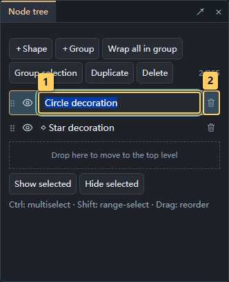

> Callouts: 1 Double-click or press F2 to rename; Enter saves, Esc cancels; 2 Delete this row’s node; undo is available.

Drag onto the center of a graphic row to show a virtual group marked **Preview**, listing the dragged nodes and target graphic. The preview explains why: **graphics cannot contain ordinary child nodes; groups can**. Release over that target to create the group. Move away or press **Esc** to cancel. Previewing does not edit the project or undo history, receive pointer events, or shift the underlying rows. Multiple nodes can be dragged together; selected descendants of selected ancestors are moved only once. A parent cannot be moved into its own descendants.

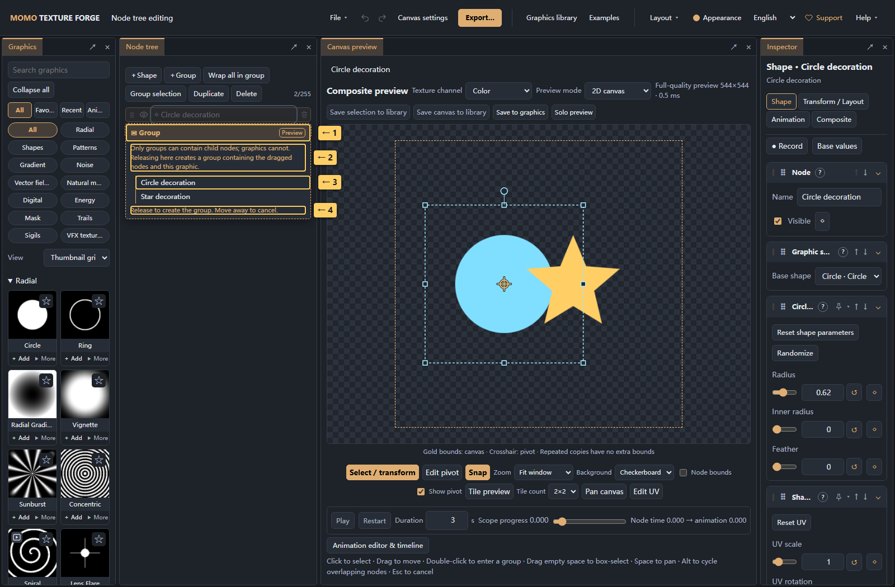

> Callouts: 1 Virtual group; the project is unchanged; 2 Why a group is needed for ordinary child nodes; 3 Preview the nodes that will be grouped; 4 Release to group; move away or press Esc to cancel.

The new group retains the existing nodes and parameters. One undo reverses grouping. Existing groups accept center drops directly; upper/lower edges still reorder nodes.

### Collapsible Inspector modules

The inspector has four tabs: **Shape**, **Transform / Layout**, **Animation**, and **Composite**. Shape and coloring share **Shape**: graphic selection, parameters, UV, opacity, node colors, levels, inversion and channel curves are separate modules. There is no additional quick-color area above the tabs. Built-in and custom graphics keep their specific parameters together under “Graphic name · Parameters,” using the existing parameter list.

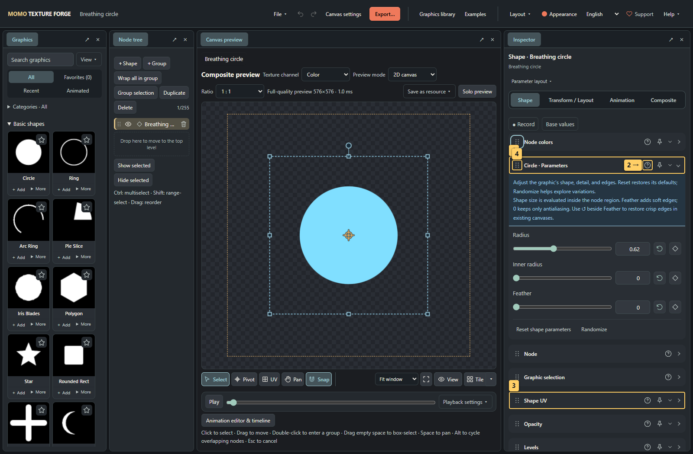

> Callouts: 1 Graphic-specific parameters share one module; 2 Click the question mark for help; 3 Click the header to expand or collapse UV; 4 Drag the handle or use arrows to reorder modules.

Click a module header to expand or collapse it, or **?** to show or hide help. These controls are independent: help does not expand parameters, and help remains available while parameters are collapsed. Collapsing changes only panel visibility; parameters and animation remain active. Common modules retain expansion across nodes; graphic-specific parameter modules remember each graphic type separately. Preferences stay in this browser across language changes and reloads, outside project files and undo history.

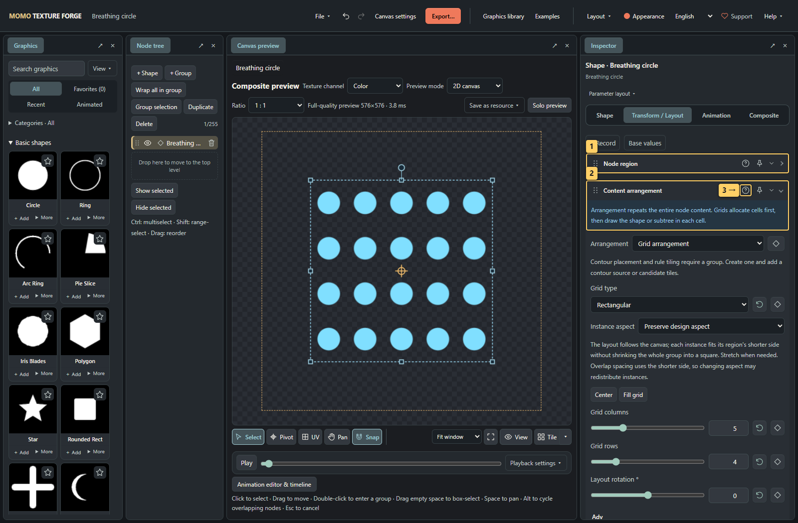

> Callouts: 1 Collapse common region settings separately; 2 Arrangement parameter module; 3 Help stays hidden until requested.

Drag the **⠿** handle beside a module title, or use **↑ / ↓**, to change module order within the tab. Order is saved per tab in this browser, shared between single and batch editing, and retained across nodes, languages and reloads. Temporarily unavailable modules return to their saved positions. Ordering changes panel layout only, leaving compositing/filter order, project files and undo history unaffected.

Sliders, number inputs, resets, and keyframe buttons remain available inside modules. Multiselection uses the same module presentation with the existing batch-editing rules.

### Batch editing, alignment and even distribution

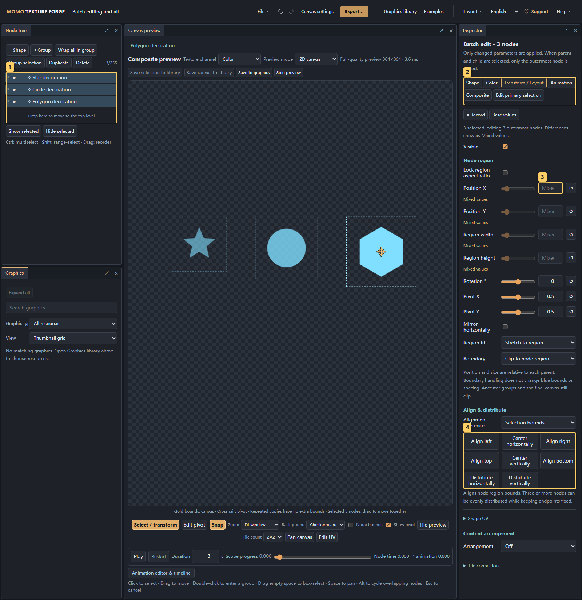

> Callouts: 1 Ctrl/Cmd-select nodes; 2 Existing tabs remain available; 3 Change mixed values together; 4 Alignment and distribution.

1. Ctrl/Cmd-select nodes or box-select on empty canvas. The inspector switches to **Batch editing**.
2. Use the same **Shape**, **Transform / Layout**, **Animation**, and **Composite** tabs. Different values show **Multiple values**; mixed checkboxes show a dash. Only adjusted fields are overwritten. Choose **Edit primary selection** for individual edits, then return to batch mode.
3. Under **Transform / Layout → Alignment & distribution**, choose Selection bounds or Canvas and align left/right/top/bottom or center horizontally/vertically.
4. With at least three nodes, distribute horizontally or vertically with equal edge-to-edge gaps. The outer nodes stay fixed. Insufficient space permits overlap.

Alignment uses rotated node-region bounds, not tightly cropped opaque pixels. Visible single-instance nodes under different parents can be aligned. Hidden nodes or nodes replicated by parent arrangements cannot be directly aligned; select the containing group instead.

Batch changes affect only outermost selected nodes, avoiding double edits when parents and children are both selected. Aspect-locked nodes update the other dimension. Out-of-range results cancel the whole operation. Each operation, including a continuous slider gesture, supports a single undo and autosaves.

| Tab | Batch-editable settings |
| --- | --- |
| Shape | Matching graphics’ specific parameters; compatible UV, polar and motion settings; opacity, color source, solid/gradient fills, stops, levels and inversion |
| Transform / Layout | Position, dimensions, pivot, mirror, fit, boundary handling, arrangement and its random/gradient/flow settings, tile interfaces, alignment and distribution |
| Animation | Parent interval, loops/ping-pong, outside visibility, source progress, fixed progress and parameter-animation switch |
| Composite | Blending, contour, image filters and compatible masks |

Mixed shapes do not expose the primary shape's exclusive parameters. Shared tabs remain usable. UV does not affect groups, so mixed group selections explain this limitation. Rule tiling, contour arrangements and group-only coloring require all selected items to be groups. Unify differing arrangement/density types before editing dependent fields. Each group keeps its own children; candidates and contour sources are not generated automatically.

Color edits preserve unmodified modes and stops. For common colors, select **Custom coloring**, then solid or gradient. Applying a palette replaces stops together. Equal stop counts allow per-stop batch edits; otherwise apply a palette or restore individual two-color endpoints first. Independent child colors and parent-wide recoloring retain their existing behavior.

In ordinary editing, a field controlled by any selected animation cannot be batch-edited directly. **Record** writes keys at each node's current local progress; **Base values** retains its tracks. Edit individual keys, curves and time-remapping curves through **Edit primary selection**. Multicolor stops do not record keys.

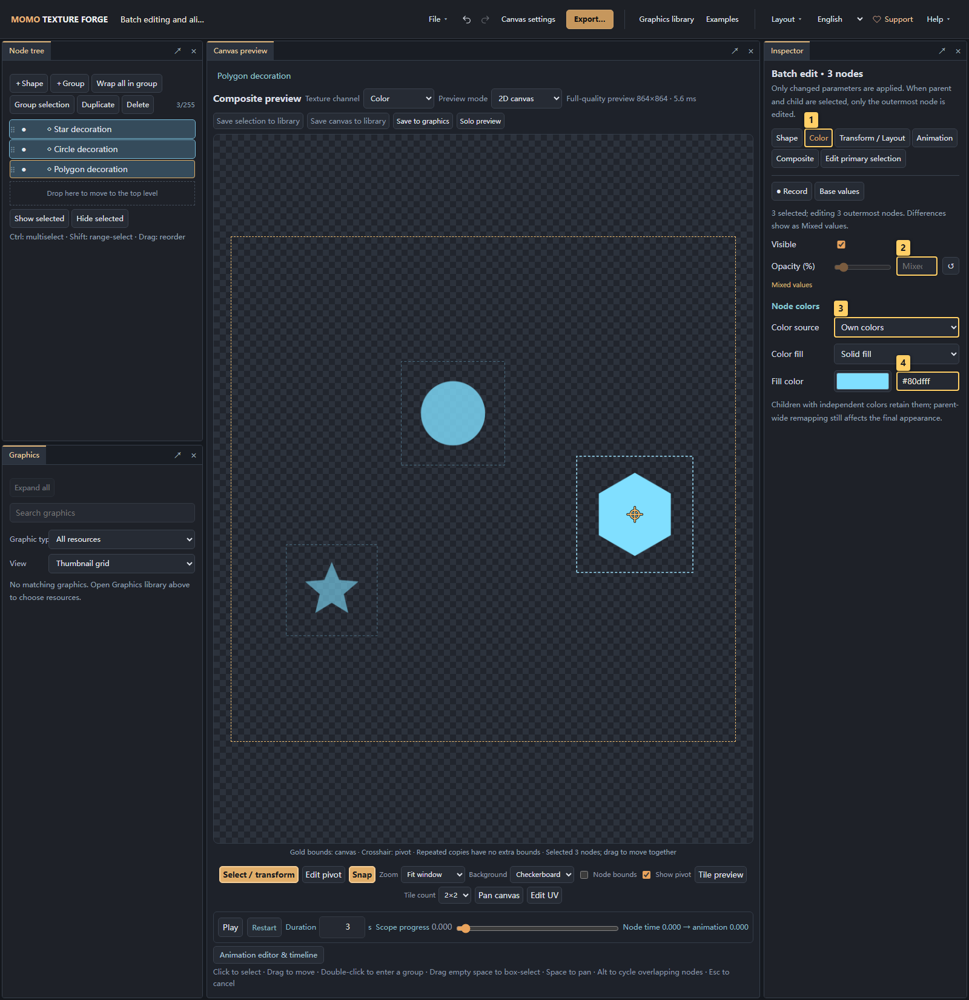

> Callouts: 1 Edit colors in the Shape tab; 2 Batch opacity; 3 Custom or inherited coloring; 4 Change only fill color.

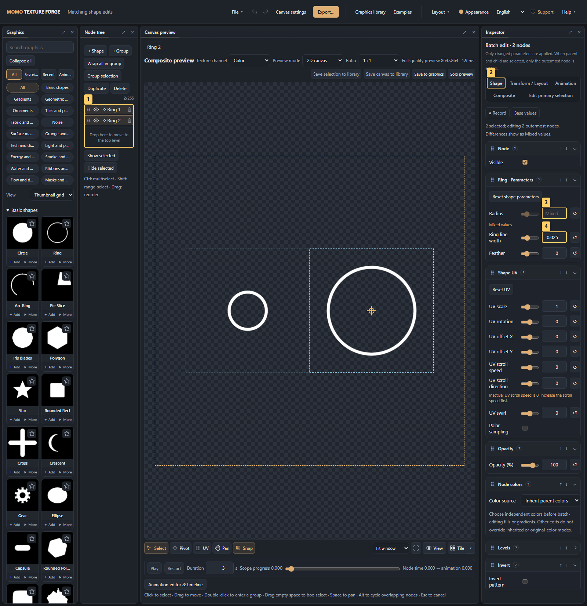

> Callouts: 1 Select matching shapes; 2 Shape tab; 3 Mixed radii; 4 Batch ring width.

## 2. Node region and graphic size

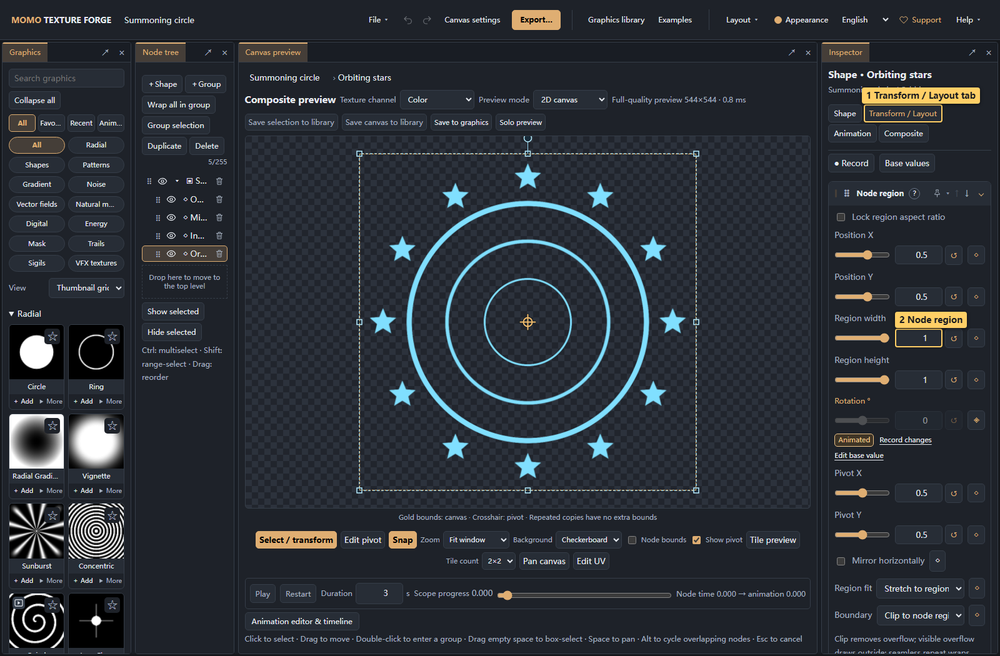

> Callouts: 1 Transform / Layout tab; 2 Node region.

These are distinct levels:

1. **Node region:** position, dimensions, rotation and pivot within the parent region.
2. **Shape parameters:** radius, line width and feathering of the pattern inside that region.
3. **Instance size:** the size of each repeated item in an arrangement.

Spatial values use normalized coordinates; rotations use degrees. If a wide canvas distorts a shape, inspect image fit, region fit and instance aspect ratio at the relevant level.

Canvas tools support moving, rotating and pivot editing. Shift locks movement axes or snaps rotation to 15°. Alt temporarily disables snapping. Hold Space to pan the view.

## 3. Choose an arrangement

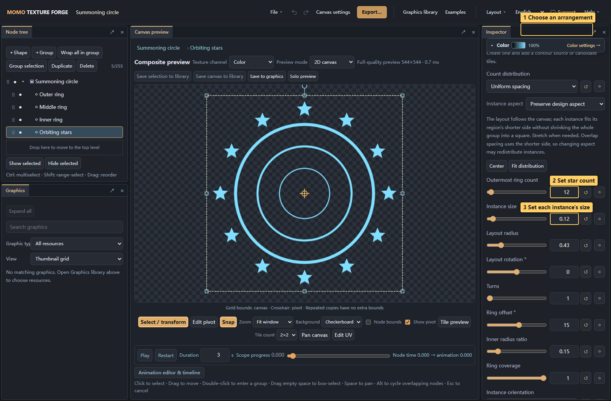

> Callouts: 1 Choose an arrangement; 2 Set star count; 3 Set each instance's size.

| Arrangement | Main settings |
| --- | --- |
| Grid | Rows/columns, rectangular/diagonal/hex grid and instance size |
| Random scatter | Target count, radius, seed and spacing; actual count may be lower |
| Radial | Count, rings, layout radius, inner-radius ratio and orientation |
| Spiral | Golden-angle or regular spiral, divergence/turns and center opening |
| Along path | Bézier controls, count or spacing, orientation and end scale |
| Symmetry | Copies, angle offset and rotation/mirroring |
| Border | Rectangle/rounded rectangle dimensions, corner radius, path offset, count or spacing |
| Along graphic contour | First group child supplies alpha contour; later children decorate it |
| Herringbone / weave | Herringbone or basket pattern and repeat-block rows/columns |
| Rule tiling | Candidate child tiles with declared edge interfaces |

A shape repeats itself; an arranged group repeats the entire group by default.

### Ribbon and trail textures

Search the **Graphics library** for “Folded ribbon strands”, “Refractive membrane” or “Particle strands” and add it to the canvas. All three generate transparent horizontal strips for ribbon, energy trail and gauze surface textures. A 4:1 or 8:1 canvas is a useful starting point.

Choose a **Trail style preset** in the graphic parameters module, then adjust the controls:

- **Folded ribbon strands:** continuous strands gather into folds. Presets: Moonlit silk, Cyan energy and Drifting wisps.
- **Refractive membrane:** a continuous sheet with separate interior opacity, edge width/brightness, crease brightness, membrane tint and edge color. Presets: Ice blue membrane, Violet gold sheen and Moonlit veil. Inherited colors retain its original palette; node colors can override it.
- **Particle strands:** independently phased strands, with width and opacity variation controlled by Strand variation. Presets: Soft white strands, Blue flowing strands and Dusty wisps.

Styles also set the palette; use the shared node color, opacity, channel curves and image filters for further adjustments. Strand and membrane edge widths are relative to graphic height, with automatic subpixel coverage, so preview and export preserve their proportions.

**Evolution speed** supports forward and reverse motion; 0 holds the shape still. UV scrolling remains available for texture flow. **Horizontal seamless** rounds wave and distortion frequencies to whole cycles and disables end fading to join the horizontal edges. This controls spatial tiling and does not guarantee identical first and last animation frames. Parameters support keyframes, shortcut pins, undo and project/resource saves. Export through the existing transparent PNG and sequence workflows.

### Bezier paths: expanded and multisegment editing

Bezier Ribbon and Along path arrangements share a path editor. Choose **Expand editor** for a larger window. Zoom with the wheel or plus/minus buttons, drag empty space to pan, and use **Fit all** to reveal every point. View changes do not edit the artwork. Point coordinates range from −8 to 8, beyond the edges of the original small viewport.

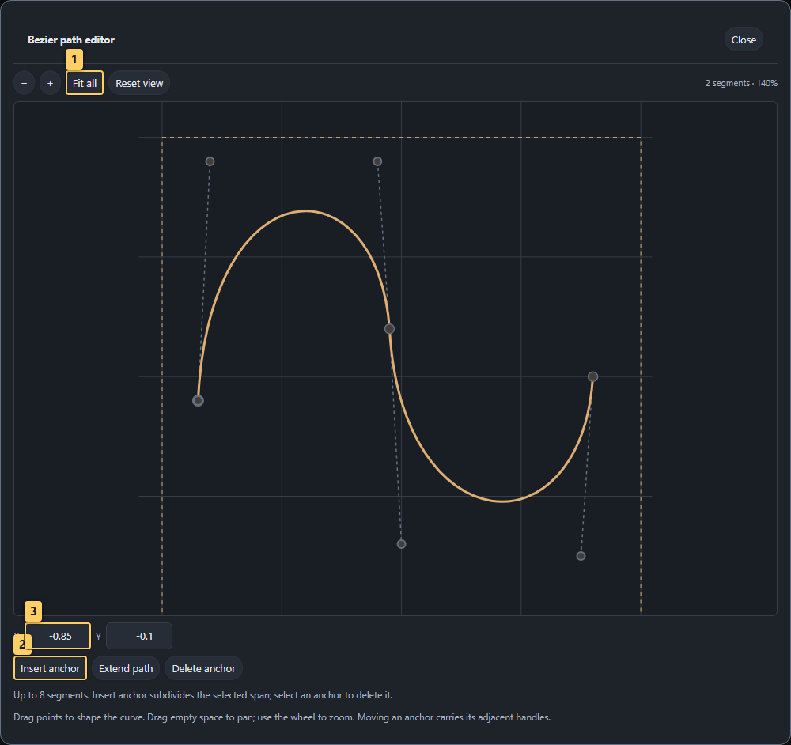

> Callouts: 1 Fit all points; wheel to zoom and drag empty space to pan; 2 Insert an anchor to subdivide a span, or extend the path; 3 Select an anchor or handle and enter exact coordinates.

**Insert anchor** subdivides the selected span while initially preserving its shape. **Extend path** adds a span from the endpoint. Each span is cubic, neighboring spans share an anchor, and a path supports up to eight spans. Moving an anchor carries its adjacent handles; handles can also move independently. Select a point to enter exact X/Y values. Select an anchor to delete it; at least one span remains.

Path edits support undo, save and export. Ribbon widths and draw progress apply to the entire path; Along path arrangements sample all spans by count or spacing. Points and their surrounding hit areas use a move cursor and highlight on hover. Empty space uses a hand cursor, changing to a grabbing hand while panning; locked points show a prohibited cursor. Grabbing near a point’s edge preserves the initial pointer offset to prevent jumps.

Points support parameter recording. Adding or deleting anchors is disabled while recording or when point keyframes exist, so tracks cannot silently target different points. Moving points and navigating the view remain available.

### New arrangements and examples

Grid, diagonal grid, hex packing and rule tiling support up to 16×16 cells. Herringbone/weave supports 8×8 repeat blocks, up to 512 bricks. Ordinary radial/scatter layouts allow 128 instances; advanced layouts, borders and contours allow 512. Multiple rings and paired mirrored layouts share a total-instance budget. Ring count reaches 32; spiral turns and wave-field repetitions reach 24; seeds range from 1 to 99,999. Layout radius/path scale reaches 2, and inner/outer or start/end scale multipliers reach 4. Defaults remain unchanged.

Dense layouts cost more rendering time. Spacing/density constraints can reduce actual count, and rule tiling retains a search budget. Instances are not separate nodes; **Expand to independent nodes** still observes the 256-node canvas limit.

Open **Examples → Category → New arrangements**, select an outer node and inspect **Transform / Layout**. Puzzle boards also allow per-piece edits.

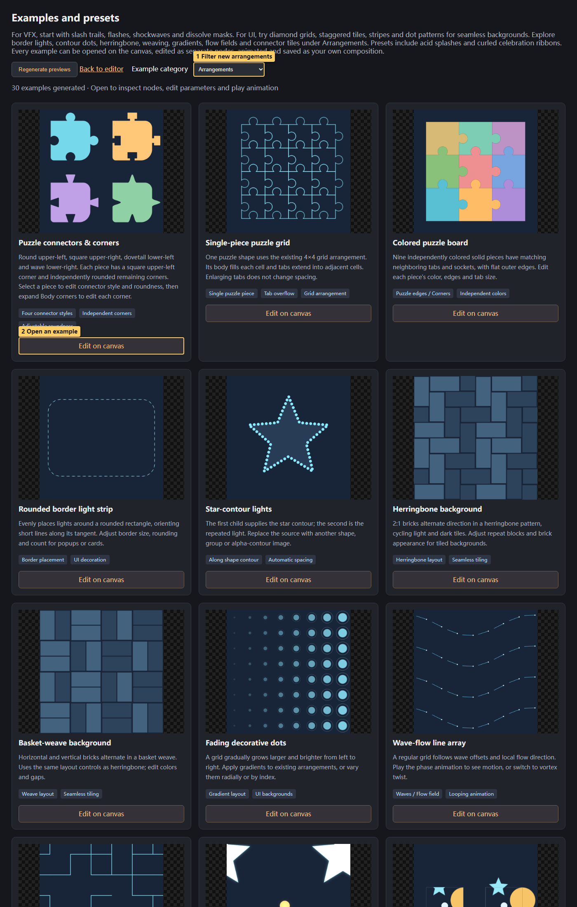

> Callouts: 1 Filter new arrangements; 2 Open an example.

| Example | Main controls |
| --- | --- |
| Seamless halo continuation | Child overflow, parent repeat, contour/blur/Bloom and tile inspection |
| Content-boundary comparison | Left/right group boundary handling: clip versus overflow |
| Cross-cell light dots | Outer overflow and inner star Bloom; independent cell spacing and rows/columns |
| Puzzle connectors and corners | Per-piece connector style/roundness and body corners |
| Single-piece puzzle grid | Edge tabs/sockets, connector size and grid dimensions using body spacing |
| Colored puzzle board | Flat outside edges, inner connectors and independent colors |
| Rounded border lights | Border dimensions/radius, count/spacing, offset and tangent/normal orientation |
| Star-contour dots | Replace first child with a shape/group/transparent image; later children decorate it; optional source visibility |
| Herringbone background | Repeat-block dimensions and inner brick pattern/gap |
| Basket-weave background | Basket mode, 4×4-cell repeat blocks and up to 512 bricks |
| Fading decorative dots | Gradient direction and start/end scale, opacity and rotation |
| Wave flow-field lines | Wave/vortex, amplitude, phase, orientation-following and wave count |
| Connected pipes | Right/top/left/bottom interfaces for direct children, then grid dimensions and seed |

Contour layouts read the **final alpha of the first child**, including transforms and compositing. Points follow closed outlines and holes. Alpha threshold selects the contour; normal offset moves decorations to either side. Sampling is fixed at 256×256, so very fine detail may disappear; export resolution does not rearrange instances. Opaque photos produce rectangular outlines. Remove the background or use a luminance mask to follow their subject. The source appears once; remaining children repeat together, randomly or in order.

Herringbone/weave stretches content into brick regions. For continuous edges, enable **Boundary handling → Seamless repeat** on the group and inspect **Tile preview**. Canvas aspect changes brick proportions; recheck after rotating the group.

Gradients and flow fields modify existing arrangements. Gradients affect scale, opacity and rotation horizontally, vertically, radially or by instance index and can reverse direction. Flow fields affect position/orientation. **Flow phase supports keys**; the example loops from 0 to 360°. Scatter overlap avoidance temporarily bypasses gradients/flow to protect spacing, while retaining their settings. Positional gradients can create rhythm discontinuities at tile seams.

Rule tiling chooses tiles from declared interfaces, not image analysis. Draw connectors at edge midpoints. Without repeat, outside edges close; with repeat, opposite edges also match. The example includes all 16 interface combinations. Replace/remove candidates or disable a child to exclude it. Missing endpoints/corners/blank tiles can make the layout unsatisfiable; reduce dimensions or change seed if search is exhausted. Rule tiles stretch to cells and do not apply gradient/flow variation.

### Mix different graphics inside a group

1. Make each candidate a direct child of one group.
2. Arrange the group and choose **Instance content:** entire group, one random child, or sequential cycling/modulo.
3. Change the scatter seed for random selection or reorder candidates for cycling.
4. Use **Expand to independent nodes** for individual manual adjustments; it increases node count and supports undo.

Random selection permits repeats and does not guarantee equal frequency. A child group is one candidate; descendants are not sampled independently. Disabling arrangement shows the whole group again.

### Overlap avoidance and aspect ratio

Random scatter supports **Avoid overlap** plus extra gap. It uses conservative enclosing circles, so long or concave shapes do not necessarily pack tightly. Large instances or gaps reduce actual count.

**Instance fit → Keep design aspect** protects pattern proportions. Fill grid/fill region/distribution fit controls placement coverage, independently of the whole node's region fit.

### Single puzzle pieces and overflow tabs

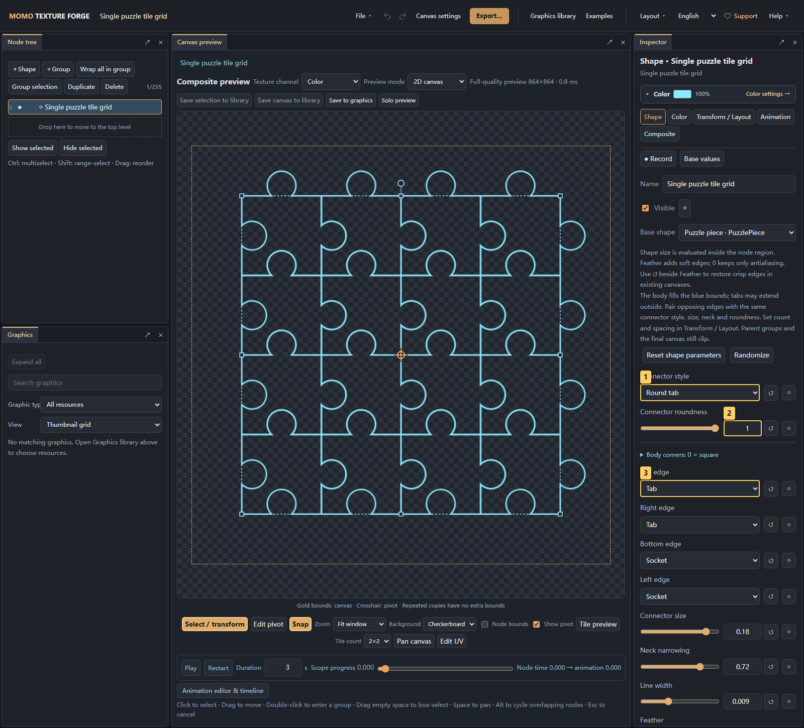

> Callouts: 1 Four connector styles; 2 Connector curvature; 3 Independent settings for four edges.

**Puzzle piece** is one body. **Connector style** offers round tabs, square clips, trapezoid dovetails and waves. Roundness controls the connector curve/corners. Top/right/bottom/left independently choose flat, tab or socket. Size, neck, line width, feathering and outline/solid mode remain shared. Built-in presets cover styles, corner/edge pieces and rounded bodies.

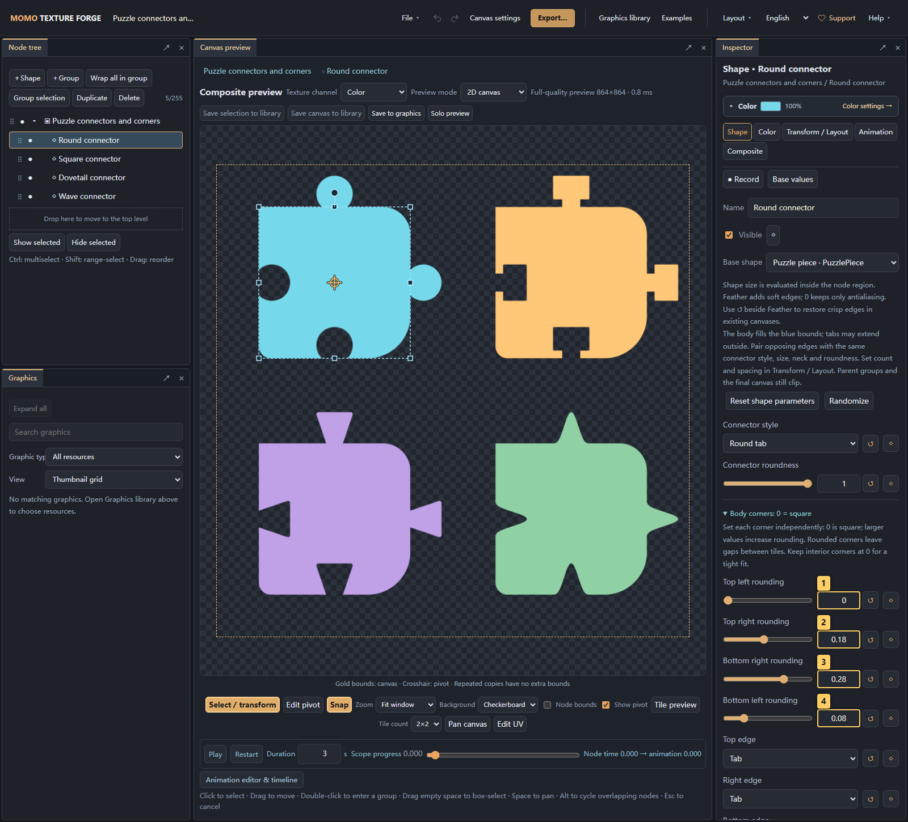

> Callouts: 1 Top-left: zero is square; 2 Top-right radius; 3 Bottom-right radius; 4 Bottom-left radius.

Expand body corners and set each to 0–0.4. Zero is a square corner; larger values round it. Sliders, numbers, undo and keyframes are supported. Rounded inner corners leave gaps, so keep touching interior corners at zero for a tight puzzle. Connector roundness and body-corner rounding are independent.

The connector/corner example places four styles side by side, each with a square top-left corner and three differing radii.

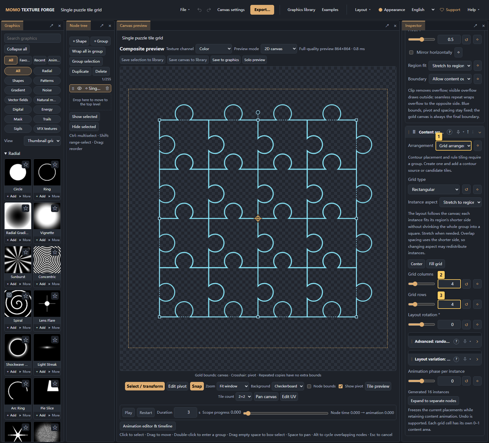

> Callouts: 1 Existing grid arrangement; 2 Columns; 3 Rows.

The body fills the blue node region, while tabs may extend outside it. Grid spacing follows the body: larger tabs do not shrink the body or push neighboring cells apart. Neighbors need complementary tab/socket edges with matching style, size, neck, roundness and orientation. Rectangular cells require stretch-to-region instance fit. Use flat edges along the outside border.

**Single-piece puzzle grid** repeats one graphic 16 times; **Colored puzzle board** uses nine independently colored pieces and flat outside edges. Puzzle pieces default to overflow; ordinary nodes default to clipping. Both use the general boundary setting below.

### Boundary handling: clip, overflow and repeat

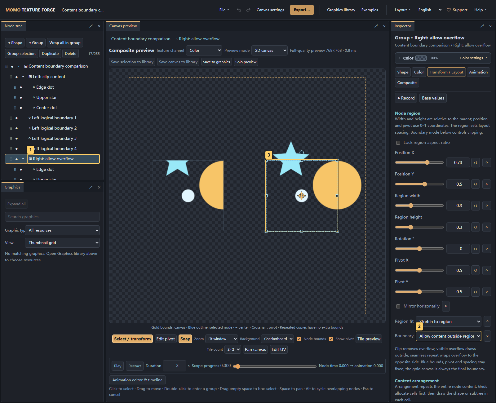

> Callouts: 1 Select the overflow group; 2 Switch boundary mode; 3 Blue frame remains the logical region.

1. Open the content-boundary comparison example and select the right-hand overflow group.
2. Under **Transform / Layout → Node region → Boundary handling**, choose **Clip to region**, **Allow overflow**, or **Seamless repeat**, which wraps outside content to the opposite side.
3. The blue frame still defines position, pivot, alignment and arrangement spacing. Extended stars, outside children, outlines, blur and Bloom can remain visible.
4. To pass through several ancestors, allow overflow on each relevant parent. Any clipping ancestor truncates content at its own region. The gold canvas remains the final export boundary.
5. In the seamless-halo example, the child allows overflow and the outer group repeats. Its upper-right star/glow continues on the opposite edges and corner. Inspect with Tile preview. Each node stores one independent boundary mode.
6. The cross-cell example uses a 3×3 grid. Outer overflow lets neighboring cells overlap; clipping cuts the rightmost star. Each graphic's own boundary setting still applies.

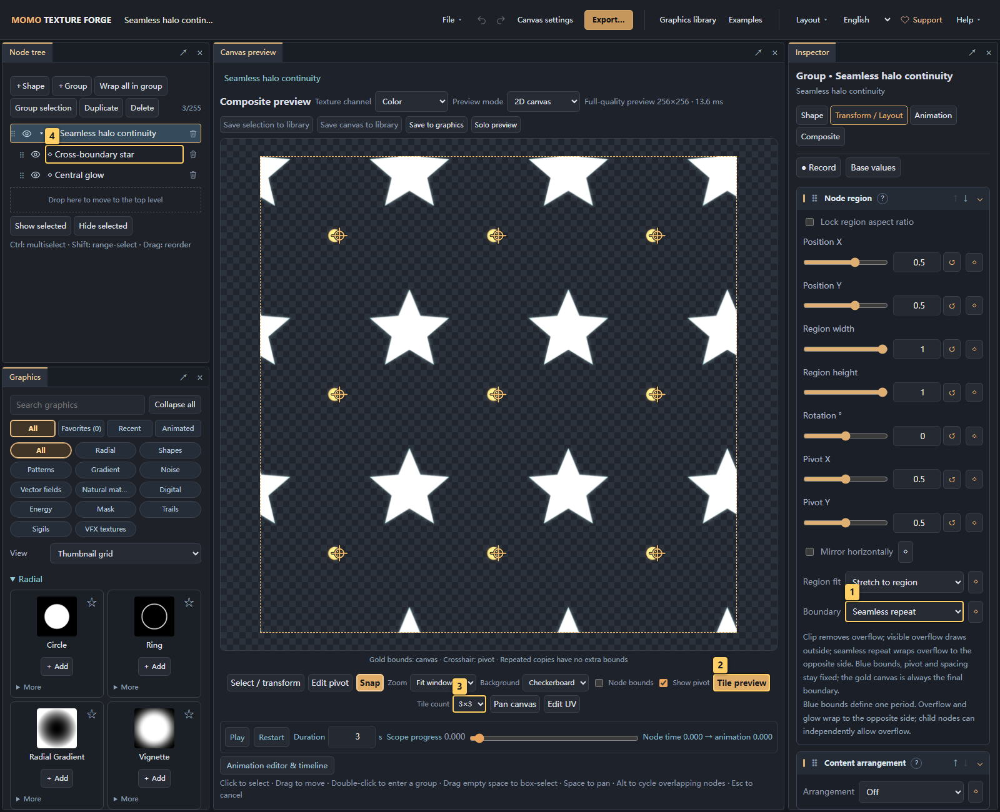

> Callouts: 1 Outer group uses seamless repeat; 2 Check edges and corners; 3 Choose 2×2, 3×3 or 4×4; 4 Child independently allows overflow.

Ordinary shapes/groups default to clip, puzzle pieces to overflow. Batch edits, undo/redo, persistence and discrete keys are supported. Visible overflow pixels can be clicked; blue bounds and handles retain their logical size. Box selection and alignment still use logical bounds.

Images, vectors and generators retain their own resource content bounds; overflow does not invent pixels beyond them. A whole child image can extend beyond its parent, and filters can expand. Masks retain their positions, bounds and inversion behavior. Seamless repeat uses the logical region as one period; allowing overflow does not enlarge that period.

## 4. Coloring, blending, masks and postprocessing

### Color controls

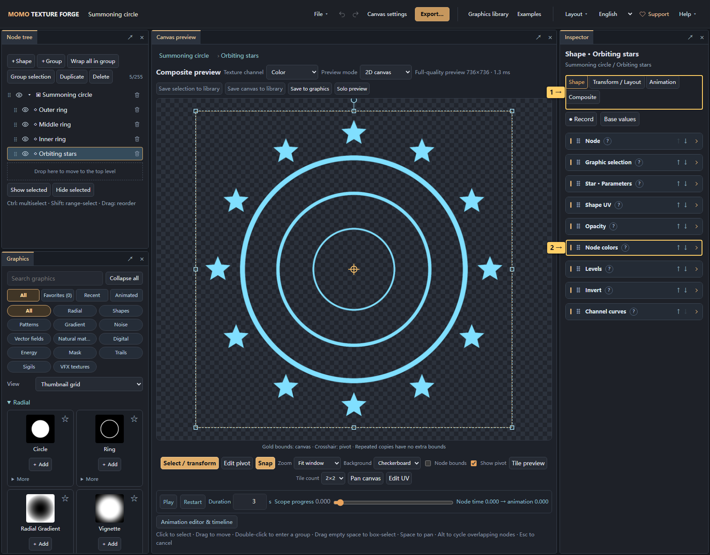

> Callouts: 1 Shape and coloring share the Shape tab; 2 Expand Node colors.

Edit geometry and coloring together in **Shape**. The **Opacity** module uses 0–1 sliders and numbers for the entire node or group; parent and child opacity multiply. It supports reset, keys, undo/redo and saving.

Open **Node colors** and use the **Color source** dropdown for inherited or custom colors. Groups also offer preserving child colors or remapping the group. **Color fill** uses a segmented control for solid or value-gradient fills. Choose custom colors before editing the local palette; inherited nodes show their source and related actions.

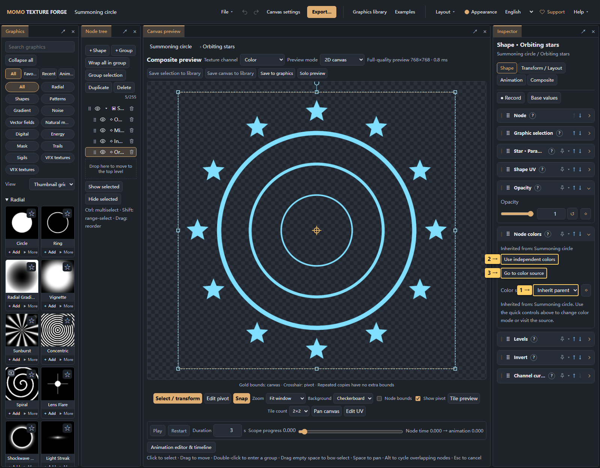

> Callouts: 1 Choose inherited or custom colors; 2 Copy the visible palette for independent editing; 3 Visit the parent palette source.

- **Inherited from [group]** identifies the source. Visit it to edit all nodes inheriting that palette.
- **Make independent** copies the visible palette locally, leaving the parent and others unchanged.
- A group preserving child colors can offer **Set colors for children**; already independent children remain unchanged.
- Images/generators preserving original colors say so explicitly. Custom coloring remaps their luminance.
- Parent-wide group recoloring identifies the final influencing group and lets you visit it.

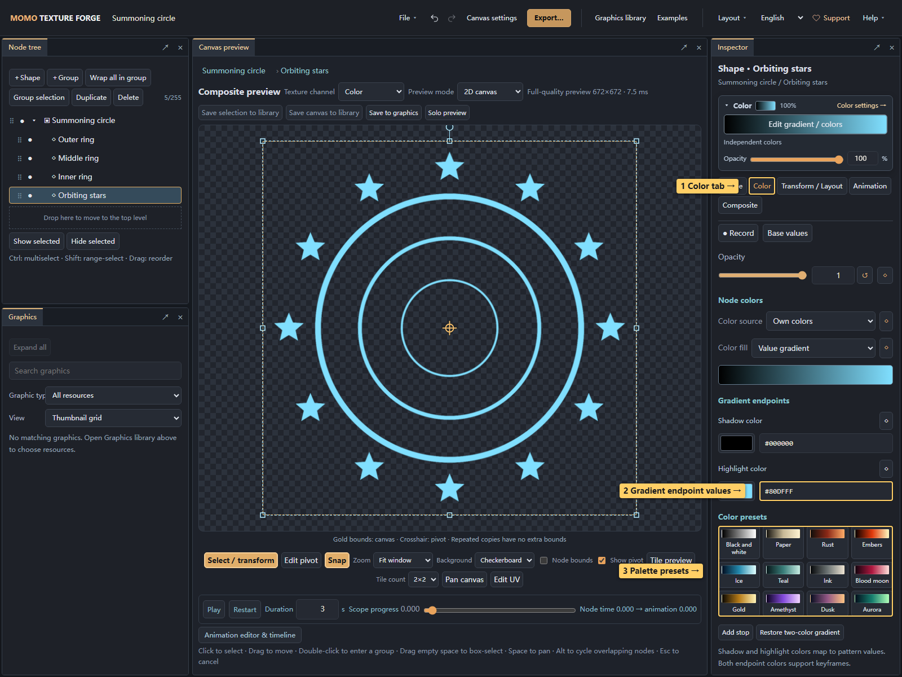

> Callouts: 1 Click the strip to add stops; drag stops to move them; 2 Edit the selected stop color; 3 Choose a built-in gradient.

**Shape → Node colors → Color fill** offers solid or value gradient. Click the strip to add a stop sampled from the current ramp. Drag stops or enter position percentages to redistribute them. Select a stop to change its color using the swatch or HEX, such as `#80DFFF` or `F80`. Keep 2–8 stops. Arrow keys nudge; Delete removes the selected stop. **Reverse gradient** mirrors stop positions, and **Built-in gradients** offers palette presets.

Multiselection preserves other stops and edits only the selected one. If stop counts differ, choose a shared preset or restore two-color gradients first. Two-color endpoints support keyframes; multicolor stops are not keyframed. Restore two colors to continue editing low/high color animation.

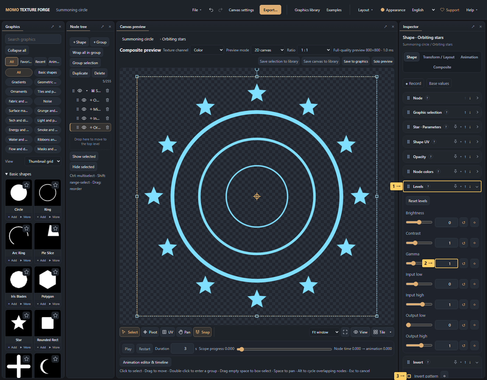

> Callouts: 1 Expand Levels for black/white points, gamma and output range; 2 Adjust gamma; 3 Invert node value and height.

**Levels** and **Invert** appear in Shape and retain the existing postprocessing data. Levels starts collapsed and includes input black/white points, gamma, brightness, contrast and output range. Invert changes node value/height to `1 − original value`, also affecting alpha derived from that value. Both support keys, undo and saving. Use **Reverse gradient** beside the strip when you only need to swap the ramp direction.

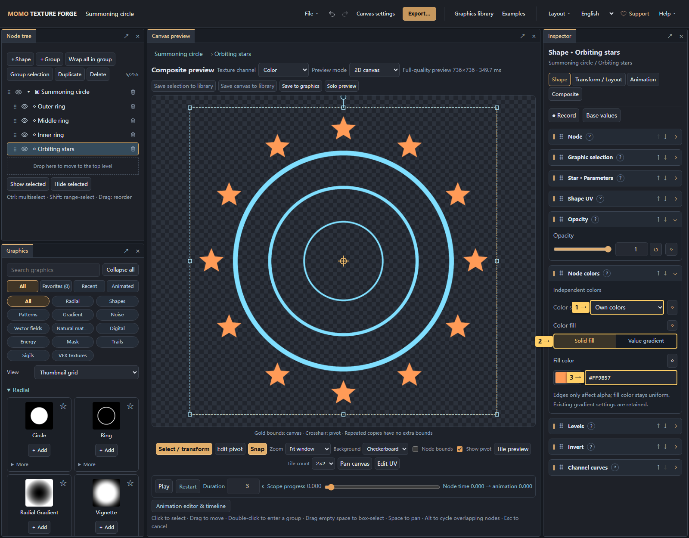

> Callouts: 1 Choose the node’s color source; 2 Choose solid or gradient; 3 Enter a hexadecimal color.

A value gradient maps low/high pattern values, not left/right canvas position. Use a spatial-gradient graphic when position-based color is required.

### Compositing and filters

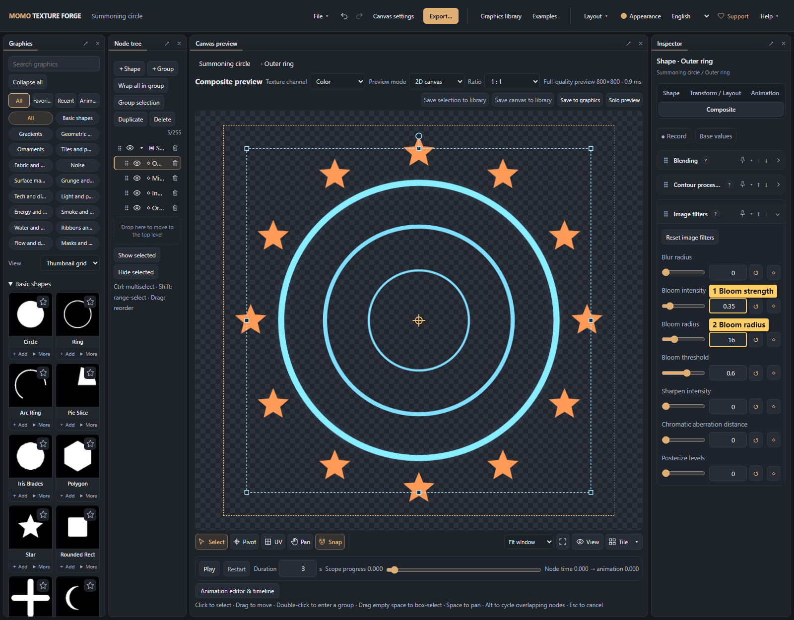

> Callouts: 1 Bloom strength; 2 Bloom radius.

1. Select a node and open **Composite** for blending, contour and filters. Opacity, palettes and gradients are in **Shape**.
2. Set a parent palette and inherit it for coordinated colors, or use independent node palettes.
3. A mask affects only previously composited content in the same group. Reorder nodes to verify its scope.
4. Adjust Levels and Invert in **Shape**. Open **Composite → Image filters** for blur, Bloom, sharpening, chromatic aberration and toon levels.

Filters support keys. Groups composite children before filtering. Radii such as blur are normalized to a 512-pixel canvas and scale with export resolution. Bloom enhances bright regions; it does not change the underlying shape radius.

## 5. UV and viewing aids

**Shape → Internal UV** changes sampling rather than node bounds. Scale, rotation, offset, scrolling, swirl and polar coordinates modify the texture. Reset UV first when investigating distortion.

Zoom, checkerboard, node bounds, pivots, solo preview and tile inspection are viewing aids. **Tile count** chooses **2×2, 3×3 or 4×4** and enables Tile preview. Toggling it preserves the chosen count. These settings do not change the canvas, project or export dimensions. Tile inspection reveals seams but does not remove them; inspect even after enabling Seamless repeat.

Shortcuts: Ctrl/Cmd+D duplicates, Delete removes, Ctrl+Z undoes and Ctrl+Shift+Z redoes. Export always uses the full canvas bounds.

## 6. Inspect effect blending on backgrounds

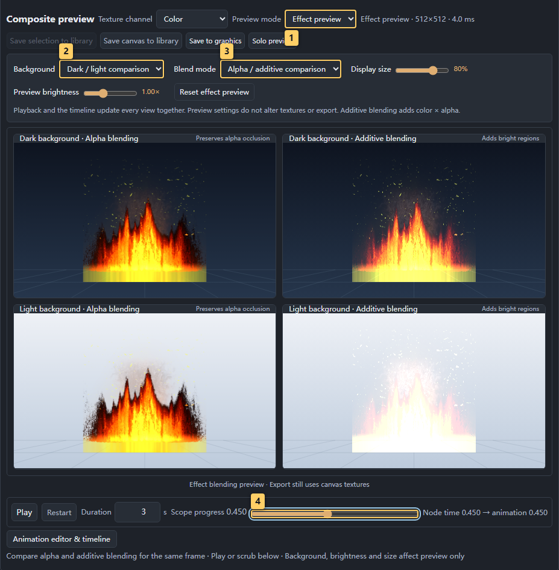

> Callouts: 1 Effect preview; 2 Background choice; 3 Compare alpha/additive; 4 Play or scrub.

1. Choose **Preview mode → Effect preview**, normally using the Color channel.
2. Select dark, light, side-by-side comparison or a custom background. Comparison displays two rows for dark/transparent-edge inspection.
3. View alpha, additive or both. Alpha retains occlusion; additive adds texture color multiplied by alpha to the background.
4. Existing playback, restart, scrubber and timeline controls update every tile with the same frame. Parameter edits update them together.
5. Display size changes coverage. Preview brightness simulates a 0–3 color multiplier. Reset restores the default dark side-by-side comparison.

Background, size, blend and preview brightness affect viewing only. They are not written to the project, node blend/opacity, export background, PNG or frame sequence. Change the actual texture in the inspector/export settings. Confirm engine-specific HDR, color-space and material behavior in the target project.

Canvas transform and UV dragging pause in effect preview; inspector edits remain available. Return to **2D canvas** for dragging, or use **3D material** for surface-lighting inspection.

## Channel curves

Select a graphic or group and open **Shape → Channel curves**. Nodes inheriting a palette can use curves too. Groups composite their children before applying curves.

- Choose **Luminance / height, Master RGB, Red R, Green G, Blue B, or Alpha**. Luminance adjusts brightness and height; RGB changes color only. Alpha changes coverage and scales the height contribution accordingly.
- Click the graph to add a point, drag or use arrow keys to move it, or enter input/output values from 0–255. Endpoint inputs stay at 0 and 255; their outputs remain editable. Internal points can be deleted. Up to 16 points use smooth cubic interpolation through the controls, with continuous tangents and no overshoot. The graph, preview and exports share the same shape. Two-point curves remain straight.
- Editing points or applying a preset enables curves. Disable temporarily, reset one channel, or reset all curves. Undo/redo, project/resource saves and exports preserve them.
- Curves run after basic brightness/levels and before contours/image filters. Color order is luminance, master RGB, then individual RGB channels; Alpha follows. Unmodified channels preserve their original values, avoiding HDR clipping when adjusting only Alpha.
- Curve shapes currently support neither keyframes nor batch edits. For multiple selected nodes, edit the primary node. These curves remap pixel values, unlike parameter curves in the animation timeline.

For softer smoke or mask coverage, adjust Alpha. To change brightness while keeping transparency, use RGB. Mapping Alpha input 0 to a nonzero output also covers previously transparent areas inside the node region.
