# 05 · 画布、排列与合成

<!-- doc-language -->
[简体中文](05-canvas-and-compositing.md) · [English](05-canvas-and-compositing.en.md)
<!-- /doc-language -->

[手册目录](README.md) · 上一篇：[公式与生成器](04-formulas-and-generators.md) · 下一篇：[动画](06-animation.md)

打开[召唤法阵示例](examples/summoning-circle.json)，选中节点“环形星光”，可以复现本章的排列界面。

## 1. 选择节点、组合与进入子级

- 单击节点或画布图形选中；Ctrl/Cmd 单击多选，Shift 连选，空白处拖动框选。
- **＋组合**新建容器；Ctrl/Cmd+G 组合同级节点。组合适合整体移动、旋转和重复一套装饰。
- 双击组合进入，使用预览上方路径导航返回。
- 节点树拖到中间改父级，拖到上下边缘调整排序；后画的节点会影响先前内容。
- Alt 单击切换重叠候选，Esc 取消当前拖动。

### 多选后批量修改、对齐与等距分布

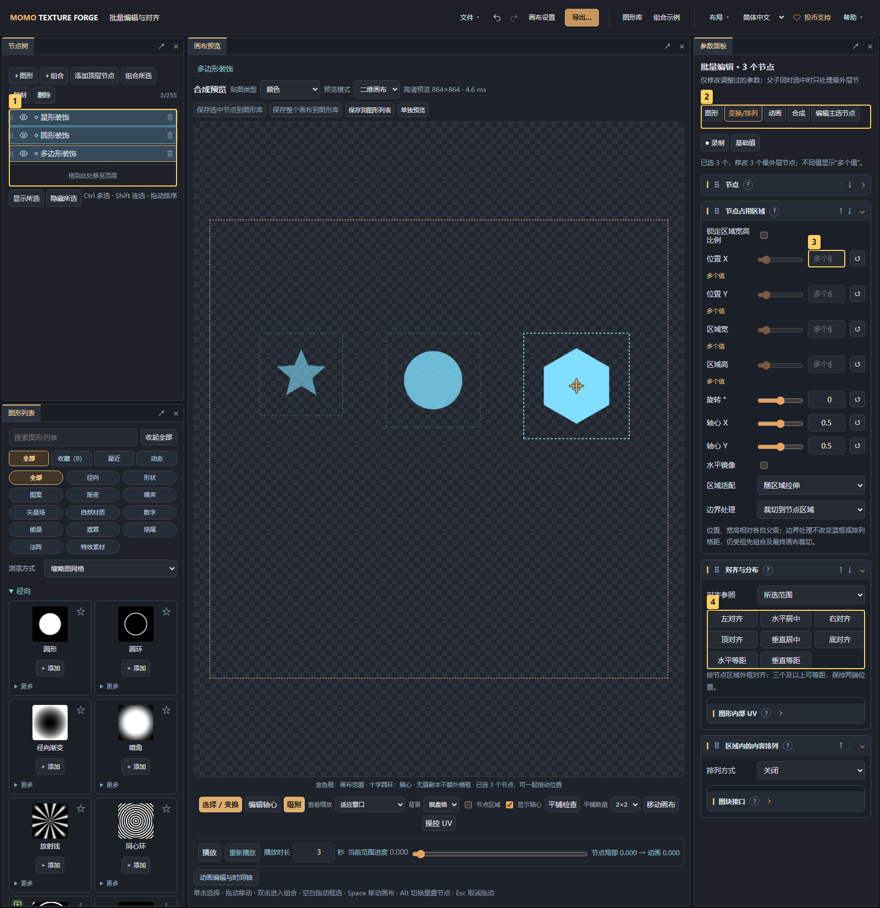

> 图中标记：1 Ctrl/Cmd 多选节点；2 多选保留原来的页签；3 多个值可统一修改；4 对齐与等距分布。

1. 按住 **Ctrl/Cmd** 选择多个节点，或在画布空白处框选；右侧自动切换为 **批量编辑**。
2. 通过原来的 **图形 / 颜色 / 变换/排列 / 动画 / 合成** 页签修改参数。不同值显示 **多个值**，复选框以横线表示不同状态；只覆盖你调整的参数。可切换 **编辑主选节点** 单独修改，再点 **返回批量编辑**。
3. 在 **变换/排列 → 对齐与分布** 选择 **所选范围** 或 **画布**，再点左/右/顶/底对齐或水平/垂直居中。
4. 至少选中三个节点可用 **水平等距 / 垂直等距**：按节点区域边缘保持相同间距，保留两端节点的位置。空间不足时允许重叠。

对齐按旋转后的节点区域外框计算，不按图案的不透明像素裁边；不同父级下可见、只有一个实例的节点也能对齐。隐藏节点或父级排列产生多个副本时不能直接对齐，请选择其外层组合。

批量修改只作用于最外层所选节点；父子同时选中不会重复修改子节点。锁定宽高比例的节点会同步改变另一边，超出参数范围则整次操作取消。每次操作及一次连续滑动都可整体撤销，修改会自动保存。

各页签的批量编辑范围：

| 页签 | 可批量修改 |
| --- | --- |
| 图形 | 全选同一种图形时的半径、线宽等专属参数；全选图形时的 UV、极坐标；全选支持内置时间的图形时可改运动设置 |
| 颜色 | 透明度、配色模式、纯色/渐变、双色端点、配色预设与多色色标 |
| 变换/排列 | 位置、宽高、轴心、镜像、适配、无缝、排列及其随机/渐变/流场参数、图块接口；包含对齐与等距分布 |
| 动画 | 在父级中的时间范围、循环/往返、前后显示、源进度、固定进度与参数动画开关 |
| 合成 | 混合方式、轮廓、色阶/反相、图像滤镜与兼容的蒙版设置 |

混选不同图形不显示主选节点的专属参数，其他共有页签保持可用。UV 不作用于组合，因此混选组合时说明原因；“规则拼接”“沿图形轮廓”和组合专属配色需要全部选中组合。排列方式或密度图案不一致时，先统一类型再编辑对应参数。每个组合保留自己的子节点，不自动生成候选图块或轮廓来源。

颜色修改保留未调整的配色模式与色标；需要统一颜色时先选 **自定义配色**，再设置纯色或渐变。选择配色预设才会统一替换色标；色标数量相同时可逐个批改，不同时可先应用预设或恢复各自双色端点。组合内独立配色的子节点、父级整体调色仍按原规则生效。

普通模式下，任一目标字段由动画控制则不能直接批改；**录制** 在各节点当前局部进度记录关键帧，**基础值** 保留原动画。关键帧、数值曲线和时间重映射曲线从 **编辑主选节点** 进入单独编辑。多色色标不录制关键帧。

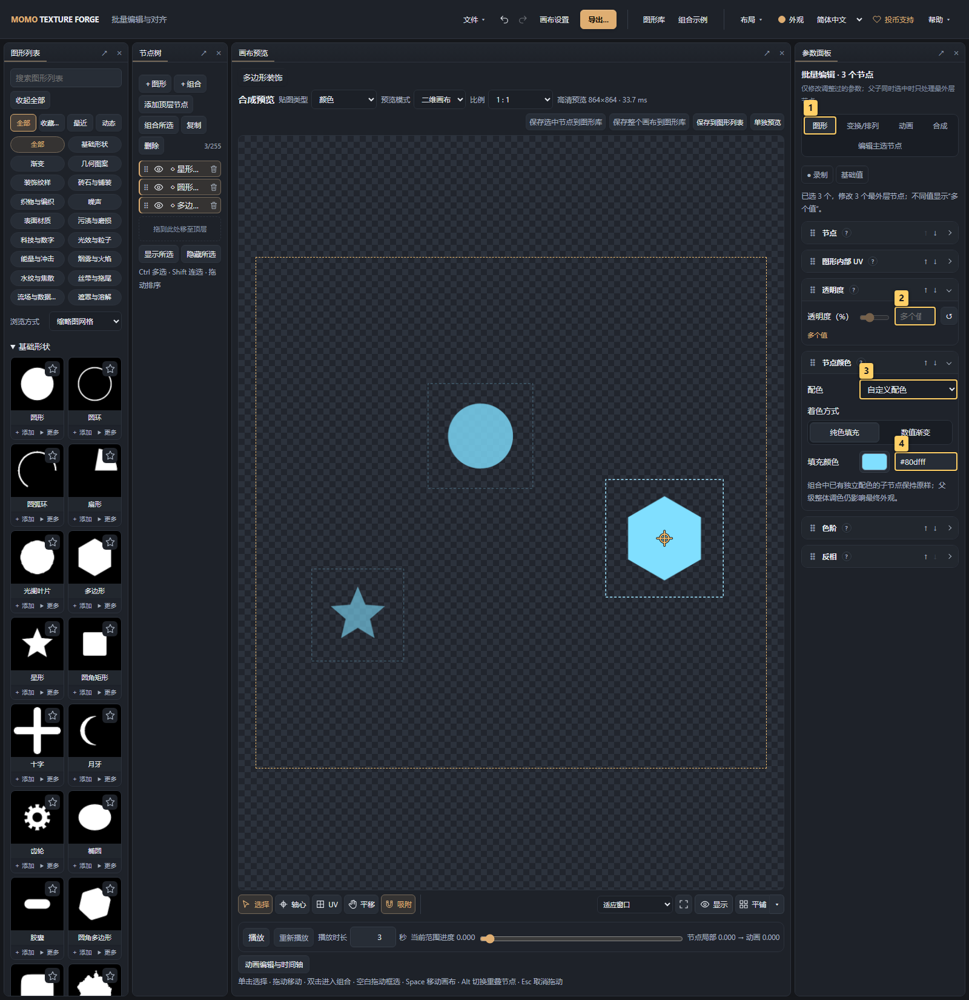

> 图中标记：1 进入颜色页签；2 批量调整透明度；3 选择自定义或继承配色；4 只统一修改填充颜色。

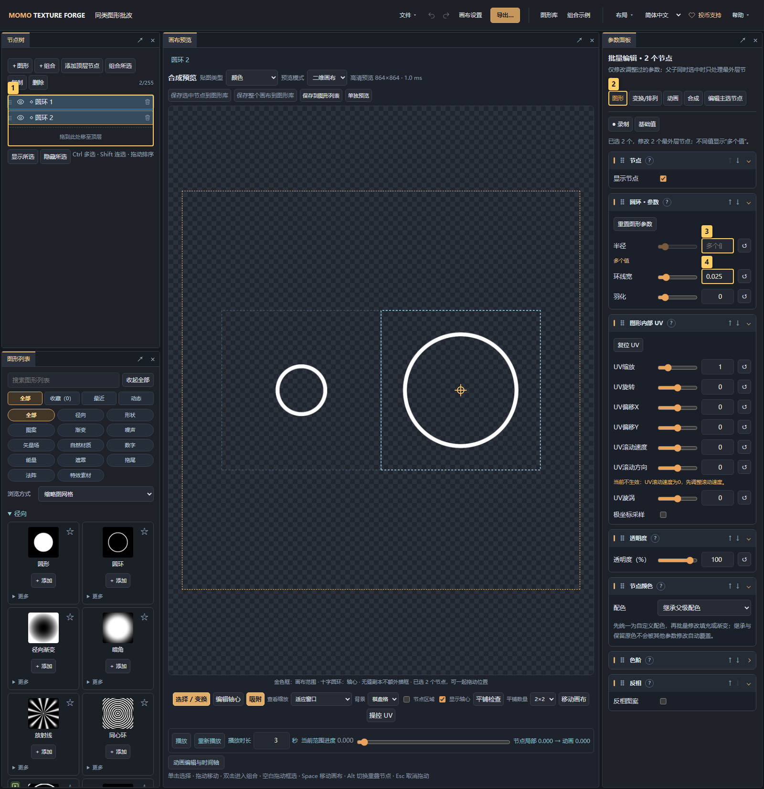

> 图中标记：1 选择同一种图形；2 进入图形页签；3 不同半径显示多个值；4 批量修改圆环线宽。

## 2. 节点占用区域与图形尺寸

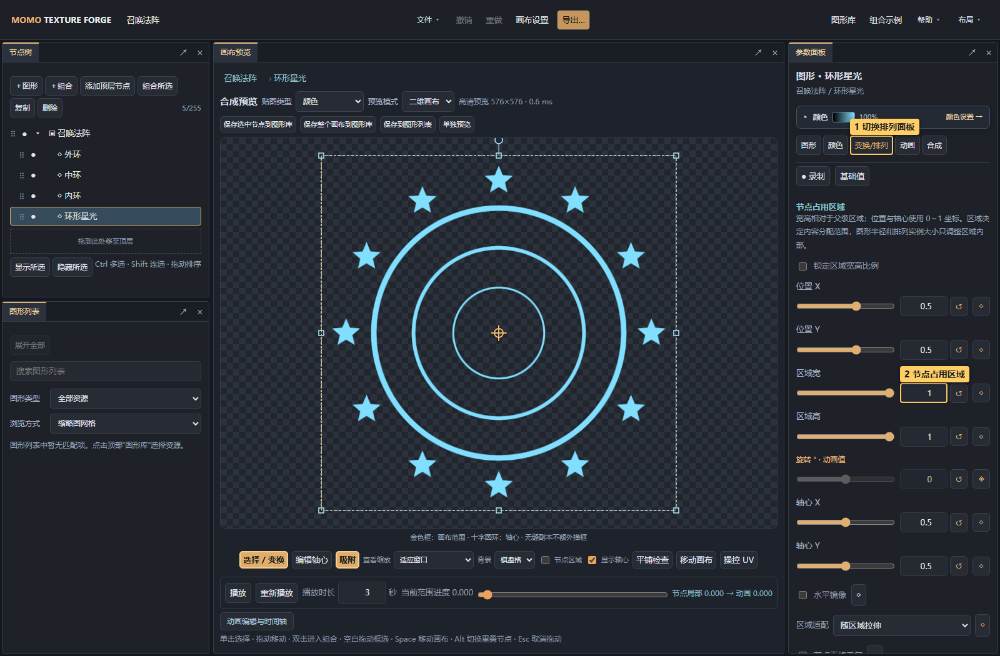

> 图中标记：1 切换排列面板；2 节点占用区域。

在右侧 **变换/排列** 调整：

1. **节点占用区域**：位置、宽高、旋转、轴心；它定义节点在父区域中的范围。
2. **图形参数**：图形自身的半径、线宽、羽化等，改变区域内部的图案。
3. **实例尺寸**：排列后的每份内容大小。

区域宽高等空间参数使用 0～1，旋转使用度。宽画布中图形被拉扁时，检查图片比例、区域适配和排列实例比例，按实际层级调整。

画布支持拖动移动、旋转和轴心编辑；Shift 移动锁轴/旋转按 15° 吸附，Alt 拖动临时关闭吸附。Space 临时平移视图。

## 3. 选择排列方式

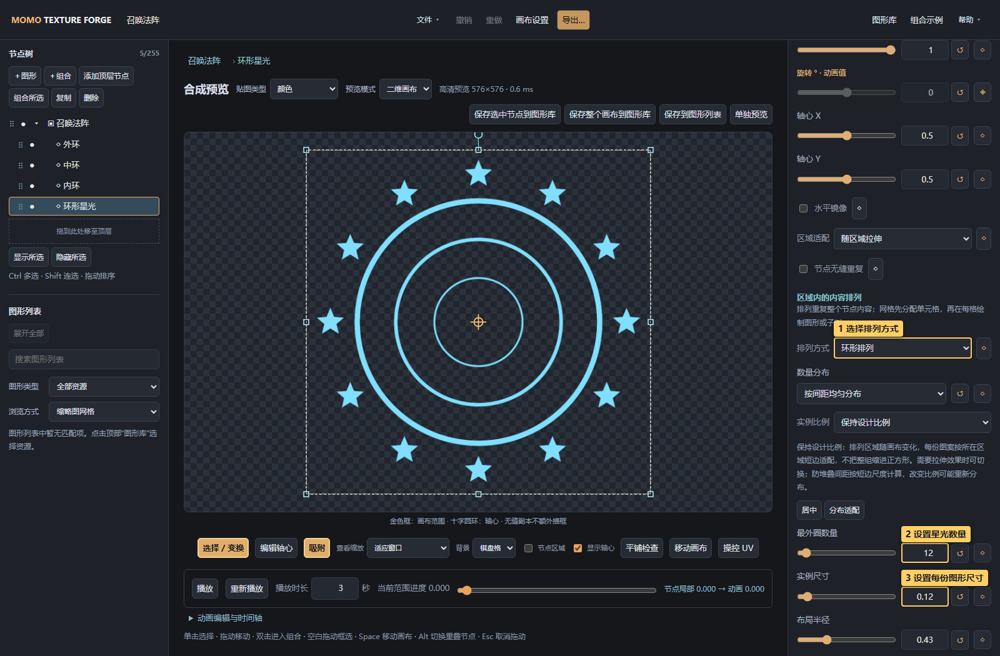

> 图中标记：1 选择排列方式；2 设置星光数量；3 设置每份图形尺寸。

| 方式 | 操作重点 |
| --- | --- |
| 网格排列 | 设置行列数、矩形/斜向/六角网格与实例尺寸 |
| 随机散布 | 设置目标数量、布局半径、种子与最小距离；实际数量可能不足目标 |
| 环形排列 | 数量、圈数、布局半径、内半径比例与朝向 |
| 螺旋排列 | 黄金角或规则螺旋，设置发散角/圈数与中心留空 |
| 沿路径 | 设置贝塞尔控制点、数量或间距、朝向与末端尺寸 |
| 对称排列 | 设置对称份数、偏角及旋转/镜像 |
| 边框排列 | 矩形/圆角矩形的宽高、圆角、沿线偏移、数量或间距 |
| 沿图形轮廓 | 组合首个子节点提供透明轮廓，后续子节点作为装饰 |
| 人字 / 编织 | 选择人字纹或篮式编织，设置重复块行列数 |
| 规则拼接 | 子节点提供候选图块并声明接口，自动选择匹配布局 |

截图的星形节点开启环形排列，每份只重复它自己的星形。选组合开启排列，则默认每份重复整个组合。

### 新增排列与示例

排列范围：网格、斜向网格、六角密排与规则拼接最多 16×16；人字/编织最多 8×8 重复块（512 份长砖）。普通环形/随机最多 128 份，高级排列、边框和轮廓最多 512 份；多圈环形与镜像成对排列按总实例数限额计算。圈数最多 32，螺旋圈数与流场波浪次数最多 24，排列/拼接种子为 1～99999。布局半径/路径缩放最多 2，内外或首尾尺寸倍率最多 4，默认参数保持不变。

密集排列会增加绘制开销。防堆叠或密度约束可能使实际数量少于目标；规则拼接仍保留搜索预算。排列实例不等于独立节点，“展开为独立节点”仍受画布 256 节点总量限制。

在顶栏 **组合示例 → 示例分类 → 新增排列** 可找到以下十个可编辑画布。打开后选择最外层节点，再切右侧 **变换/排列**；拼图板的每一块可分别选择编辑。

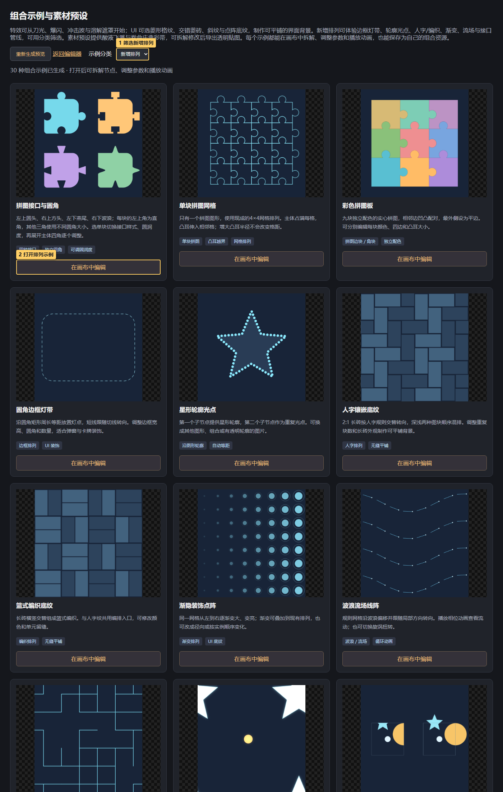

> 图中标记：1 筛选新增排列；2 打开排列示例。

| 示例 | 主要调整入口 |
| --- | --- |
| 无缝光晕接续 | 子级允许超出，外层无缝重复；可加描边、模糊和 Bloom，再开启平铺检查 |
| 内容边界对照 | 选择左右组合 → 变换/排列 → 边界处理，对比裁切和超出 |
| 跨格光点排列 | 外层组合允许超出，内部星光的合成 → Bloom；格距与行列数独立 |
| 拼图接口与圆角 | 逐块选节点，图形 → 接口样式、接口圆润度、主体四角 |
| 单块拼图网格 | 图形 → 四边凹凸、接口大小；变换/排列 → 网格行列数，按主体格距重复 |
| 彩色拼图板 | 逐块选节点，图形 → 最外侧平边与内部凹凸；颜色 → 独立配色 |
| 圆角边框灯带 | 边框宽/高、圆角半径、实例数量/沿线间距、沿线偏移；“实例朝向”决定短线沿切线或法线 |
| 星形轮廓光点 | 将首个子节点替换成图形、组合或透明图片，后续子节点替换成装饰；可关闭“显示轮廓来源” |
| 人字镶嵌底纹 | 人字 / 编织 → 人字纹；重复块行列数；进入内部调整长砖图案与留缝 |
| 篮式编织底纹 | 同一入口选篮式编织；每个重复块按 4×4 格构造，最多 512 份长砖 |
| 渐隐装饰点阵 | 展开“排列变化：渐变与流场”，设置渐变方向、尺寸倍率、透明度和旋转的起止值 |
| 波浪流场线阵 | 同一分区选波浪偏移或旋涡扭转；调整幅度、相位、跟随转向，波浪另有次数 |
| 接口匹配管线 | 规则拼接 → 图块接口配置，为每个直接子节点选择右/上/左/下接口，再调行列数与种子 |

沿轮廓排列读取**首个子节点最终透明度**，包含其变换和合成处理，按闭合边缘与孔洞布点。“轮廓透明度阈值”选择边界，“轮廓法向偏移”移动光点到边界两侧。来源固定以 256×256 采样，极细细节可能丢失；修改导出分辨率不会重排。不透明照片会沿整张图片边缘排列，要跟随其中的图案，可先去背景或在图片参数中切为亮度遮罩。来源显示一次，其余子节点按整组、随机一个或顺序循环重复。

人字纹与篮式编织按长砖区域绘制，内容随区域拉伸；需要跨四边接续时开启该组合的“边界处理 → 无缝重复”，并用“平铺检查”验证。更换画布比例会改变砖块长宽，旋转整组后仍应重新检查边缘。

渐变和流场可叠加到现有排列。渐变按横向、纵向、径向或实例序号改变每份实例；可反向。流场改变实例位置与朝向，**流场相位可录制关键帧**，示例已设置 0→360° 的循环。开启随机散布防堆叠时，渐变和流场暂不应用，避免改变尺寸/位置后破坏间距；设置会保留。位置渐变跨平铺边界可能出现节奏突变。

规则拼接依据声明的四边接口选择图块；图块需把连接点画在边中点，系统不识别图片里的实际线条。关闭无缝重复时外围接口封闭，开启时同时匹配首尾边。示例提供全部 16 种接口组合，可删减或替换候选，关闭某个子节点可将其移出候选。缺少端点、转角或空白块而无法拼接时会给出提示；搜索超限可减小行列或更换种子。为保持连接，规则拼接使用格子拉伸，且不应用渐变/流场。

### 组合里混排不同图形

1. 让不同花型成为一个组合的直接子节点。
2. 选组合并开启排列，设置 **实例内容**：整个组合、随机一个子节点、按顺序循环（取模）。
3. 随机时修改杂排种子；取模时调整节点树的候选顺序。
4. 需要逐份手工调整时，点 **展开为独立节点**，会增加节点数量，可撤销。

“随机一个子节点”允许重复，不保证每种均匀出现；子组合整体算一个候选，不会继续抽内部后代。关闭排列时重新显示整个组合。

### 防堆叠和保持比例

随机散布可启用 **防堆叠** 和额外间距。它按可见内容的保守外包圆避让，不能保证细长或凹形轮廓紧密嵌套；间距过大、实例过大时实际数量减少。

**实例比例 → 保持设计比例**保护每份图案形状；“铺满网格/铺满区域/分布适配”调整分布覆盖。它们与整个节点的区域适配不同。

### 单块拼图与凸耳越界

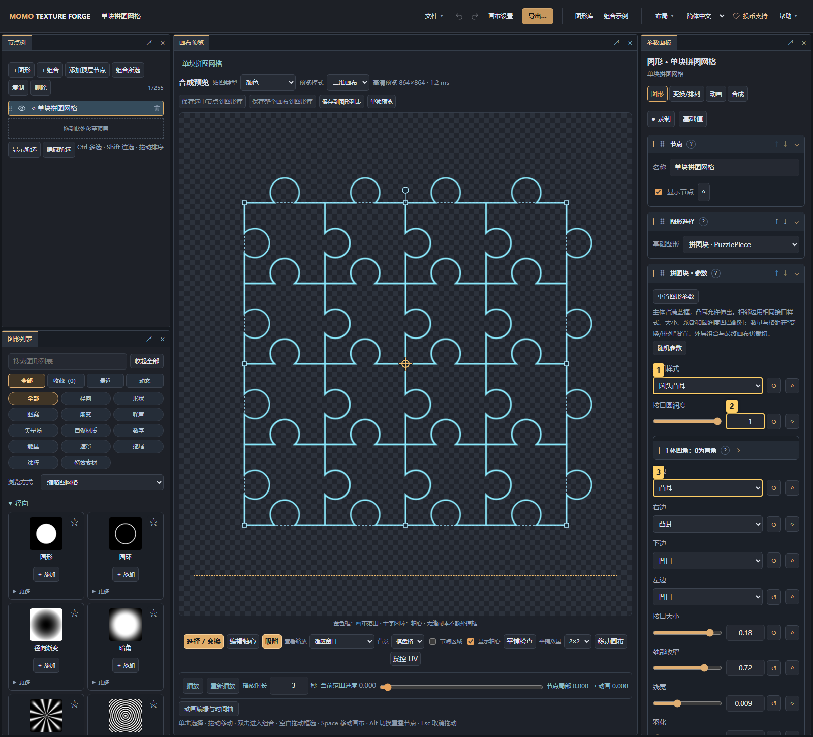

> 图中标记：1 选择四种接口造型；2 调节接口弯曲形状；3 单独设置四边凹凸。

图形列表的 **拼图块** 只有一个主体。**图形** 页签顶部的 **接口样式** 可选圆头凸耳、方头卡扣、梯形燕尾、波浪接口；**接口圆润度** 调整圆头方圆程度、卡扣／燕尾拐角及波峰曲线。上、右、下、左四边可分别设为平边、凸耳或凹口；接口大小、颈部收窄、线宽、羽化和轮廓／实心继续共用。图库提供对应样式、角块、边块和圆角主体预设。

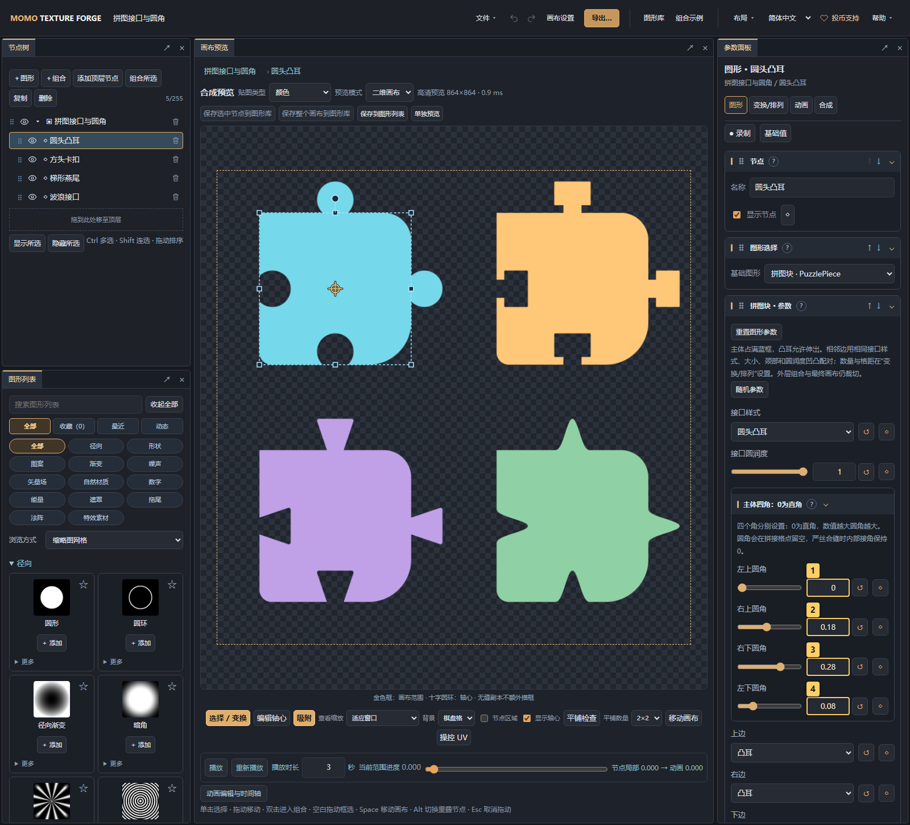

> 图中标记：1 左上角：0为直角；2 右上角圆角大小；3 右下角圆角大小；4 左下角圆角大小。

展开 **主体四角：0为直角**，左上、右上、右下、左下可分别设置0～0.4：0为直角，数值越大圆角越大，支持滑条、数值、撤销和关键帧。主体圆角会让格点留空；需要紧密拼接时，把内部相接的角保留为0。接口圆润度控制接口本身的曲线，主体四角控制块体的四个角。

**拼图接口与圆角** 示例在同一画布并排放置四种接口；每块左上角为直角，其他三个角用不同圆角值，便于对照。

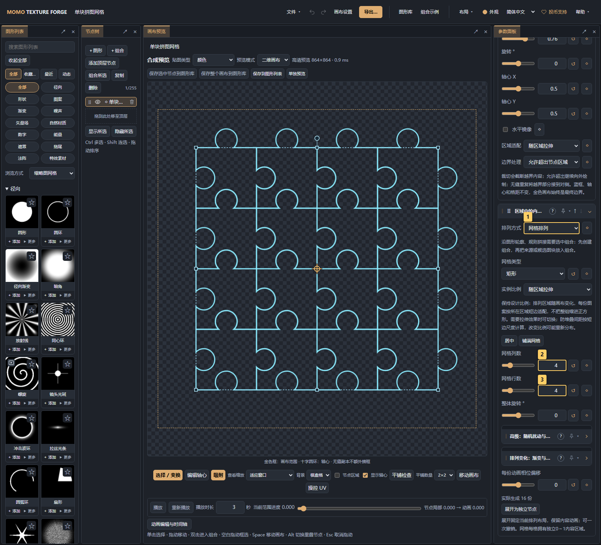

> 图中标记：1 使用现成网格排列；2 设置列数；3 设置行数。

主体占满蓝色节点区域，凸耳可以伸到蓝框之外；**变换/排列 → 网格** 按主体计算格距。增大凸耳不会缩小主体或推开邻格。相邻边要一凸一凹，接口样式、大小、颈部、圆润度保持一致，并保持对应朝向；矩形格需要把实例比例改为“随区域拉伸”。外边想平整时，将最外侧边设为平边。

**组合示例 → 新增排列** 中可打开 **单块拼图网格** 和 **彩色拼图板**。前者用一个图形排列16份；后者演示九块独立配色与外侧平边。拼图块默认允许超出节点区域；普通节点默认裁切，可通过下面的通用边界处理选项修改。

### 边界处理：裁切、允许超出、无缝重复

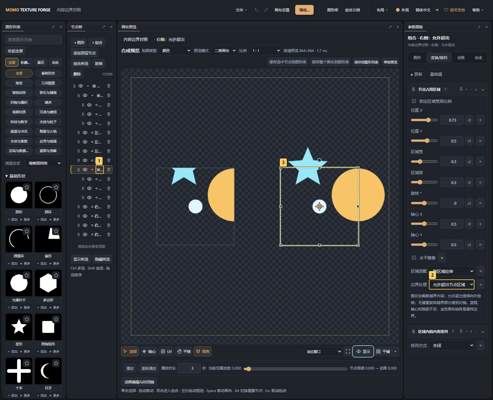

> 图中标记：1 选中允许超出的组合；2 切换三种边界模式；3 蓝框保留逻辑区域。

1. 打开 **组合示例 → 新增排列 → 内容边界对照**，选择“右侧：允许超出”。
2. 在 **变换/排列 → 节点占用区域 → 边界处理** 三选一：**裁切到节点区域** 截断越界部分；**允许超出节点区域** 继续向外显示；**无缝重复** 将越界部分接到对侧。
3. 蓝框继续表示逻辑区域，位置、轴心、对齐与排列格距保持不变；伸出的星光、移到边界外的子节点、描边及模糊/Bloom 仍可显示。
4. 需要连续穿过多层组合时，沿节点树把相关父组合也设为允许超出。任何一层仍设裁切，都在该层蓝框截断；金色画布始终是最终导出边界。
5. **无缝光晕接续** 中，子星光选择允许超出，外层组合选择无缝重复；右上角星光和泛光会接到左侧、下侧和左下角。开启 **平铺检查** 观察接续。两层的设置互相独立，同一个节点只保存一个边界模式。
6. **跨格光点排列** 演示三列三行网格。将外层组合设为允许超出后，相邻格可重叠，切回裁切时最右侧星光会被截断。每个图形自己的裁切设置仍单独生效。

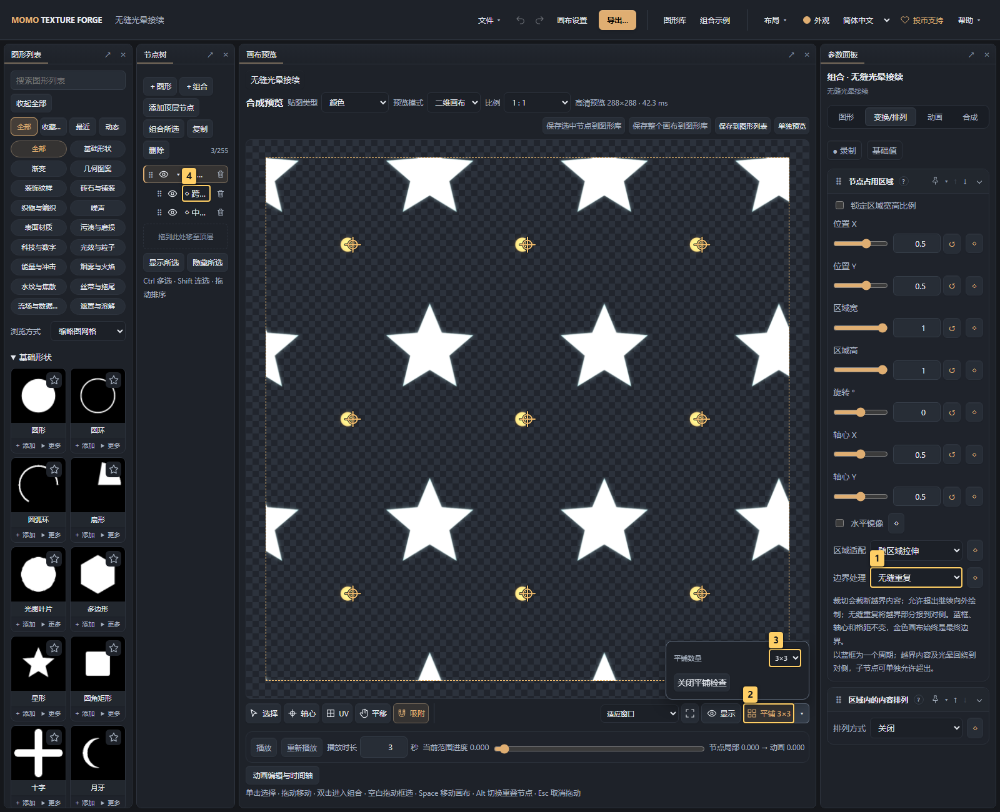

> 图中标记：1 外层组合选择无缝重复；2 检查四边及四角接续；3 选择2×2、3×3或4×4；4 子级可单独允许超出。

普通图形和组合默认裁切，拼图块默认允许超出；支持多选批量修改、撤销/重做、保存与离散关键帧。伸出区域可按可见像素点击选择，蓝框与变换手柄保持原尺寸；框选和对齐仍按逻辑区域。

图片、矢量和生成器仍使用其资源本身的内容范围，开启此选项不会补画图片外不存在的像素；可以让整个子图片超出父组合，或让滤镜扩展。遮罩继续按原来的位置、范围和反向设置作用于实际内容。边界处理 → 无缝重复以逻辑区域作为一个周期，边缘内容回绕到周期内；允许超出不会扩大平铺周期。

## 4. 配色、混合、遮罩与后处理

### 颜色入口

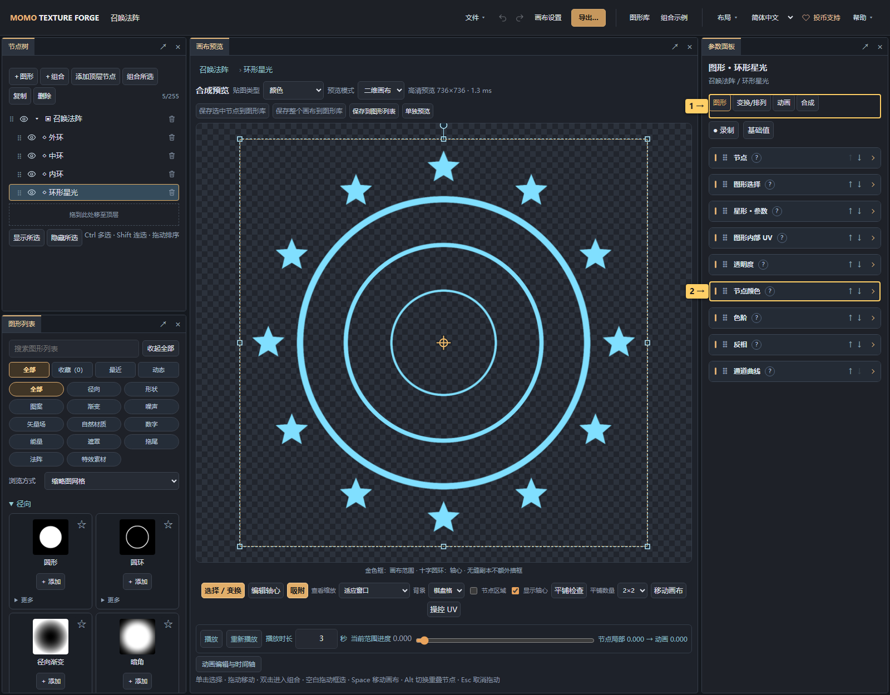

> 图中标记：1 点击展开颜色与透明度。

选中节点后，参数面板顶部常驻颜色快捷区，默认折叠为一行颜色预览与透明度摘要。点行首箭头展开，切换节点或页签时保留本次展开状态，刷新后默认折叠。展开后的渐变条或“颜色设置 →”打开独立 **颜色** 页签；纯色模式可直接点击色块修改。

**透明度**也在颜色页签顶部，滑条/数值范围0～1；展开快捷颜色区后，可用0～100%的滑条和紧凑数值调整，两处同步。纯色、渐变、继承配色或保留原色时都能调整。它控制整个节点；选中组合则控制整个组合，父子透明度相乘。支持重置、关键帧、撤销/重做和保存项目。

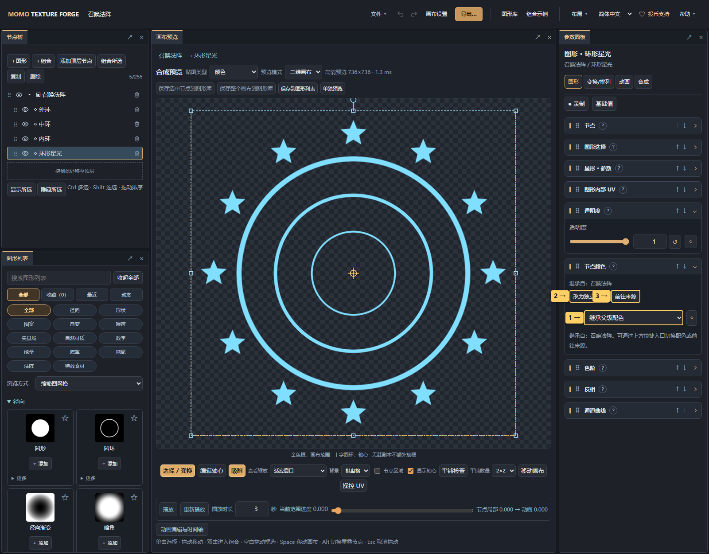

> 图中标记：1 常驻颜色快捷区；2 独立修改或前往来源。

- **继承自：某某组合** 显示实际配色来源；点 **前往来源** 编辑父级，影响继承它的节点。
- **改为独立配色** 复制当前看到的配色到此节点，再单独修改；父级和其他节点保持原样。
- 组合 **保留各子节点颜色** 时，可点 **为子节点设置配色**；已有独立配色的子节点保持原样。
- 图片或生成器保留原色时，会明确显示 **使用图片原色 / 使用生成器原色**；**自定义着色** 按亮度重新映射颜色。
- 上层组合开启 **组合统一配色** 时会提示最终受谁影响，可直接跳到该来源调整。

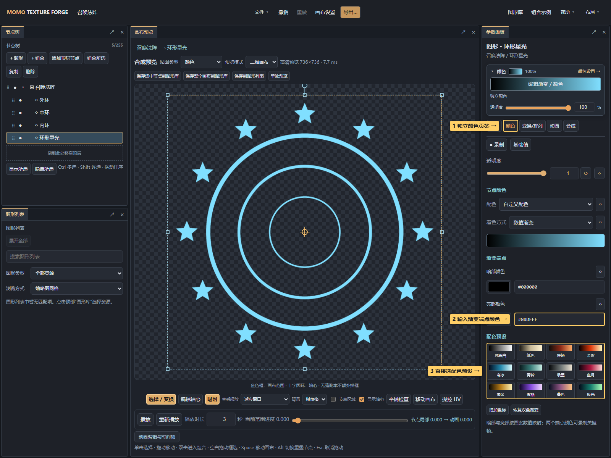

> 图中标记：1 独立颜色页签；2 输入渐变端点颜色；3 直接选配色预设。

**颜色 → 着色方式** 可选纯色填充或数值渐变。点原生色块选择颜色，也可在 HEX 框输入 `#80DFFF` 或 `F80`。渐变预设直接显示色带；添加色标后，颜色和位置直接列出，最多8个，无需再展开折叠项。多色色标不支持关键帧，恢复双色渐变后可对暗部/亮部颜色录制动画。

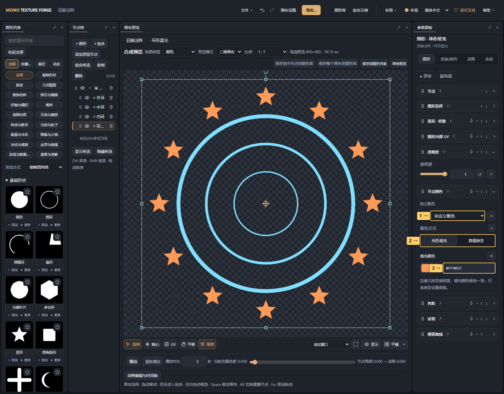

> 图中标记：1 跨页签直接改颜色；2 选择纯色或渐变；3 输入十六进制颜色。

数值渐变按图案数值从暗到亮映射，不代表从画布左到右的空间渐变。需要空间渐变时选择相应渐变图形。

### 合成与滤镜

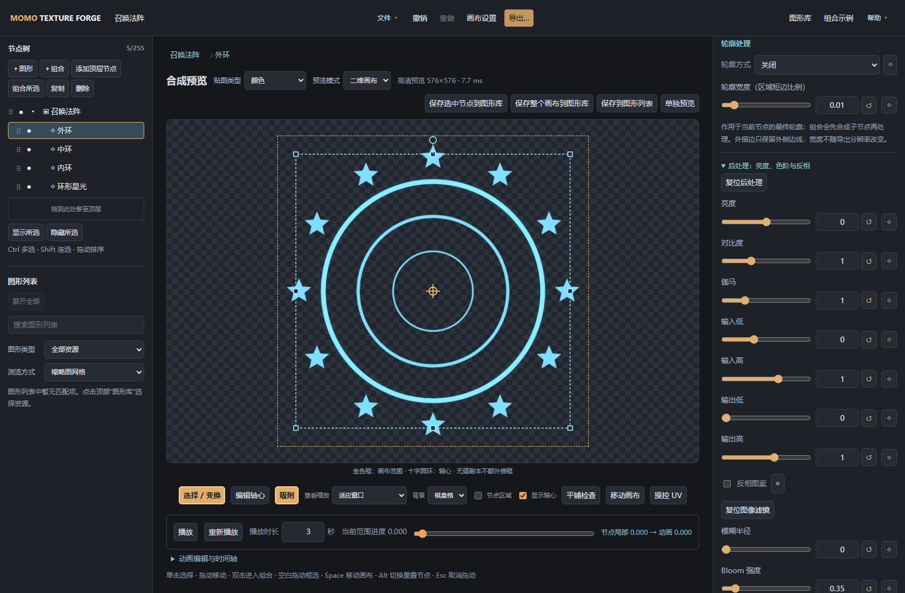

> 图中标记：1 调整泛光强度；2 调整泛光范围。

1. 选中目标节点，切 **合成**，设置混合方式、轮廓和滤镜；透明度、配色与渐变在 **颜色** 页签。
2. 需要一组统一配色时在父组合的 **颜色** 页签设置，再让子节点继承；需要独立色彩时设置节点自己的配色。
3. 遮罩只影响同组中在它之前合成的内容，调整节点顺序验证范围。
4. 展开 **后处理：亮度、色阶与反相**，可调亮度、色阶、反相、模糊、Bloom、锐化、色散和卡通色阶。

滤镜支持关键帧；组合先合成子节点再处理。模糊等半径以 512 像素画布为基准，导出时等比缩放。Bloom 增强亮部，并不等于改变原始图形半径。

## 5. UV 与查看辅助

**图形 → 图形内部 UV**改变内部采样，而不是节点边框。缩放、旋转、偏移、滚动、漩涡和极坐标用于纹理变化；怀疑采样被扭曲时先复位 UV。

查看缩放、棋盘格、节点区域、显示轴心、单独预览与平铺检查都是辅助。平铺检查可用旁边的 **平铺数量** 选择 **2×2、3×3、4×4**；选预设会开启检查，按钮可关闭或再次开启并保留所选数量。切换仅影响预览，不改变画布、项目和导出尺寸。平铺检查只显示重复接缝，不自动消除接缝；开启边界处理 → 无缝重复后仍需观察效果。

快捷键：Ctrl/Cmd+D 复制、Delete 删除、Ctrl+Z 撤销、Ctrl+Shift+Z 重做。导出始终使用整张画布的设置边界。

## 6. 在背景上检查特效混合

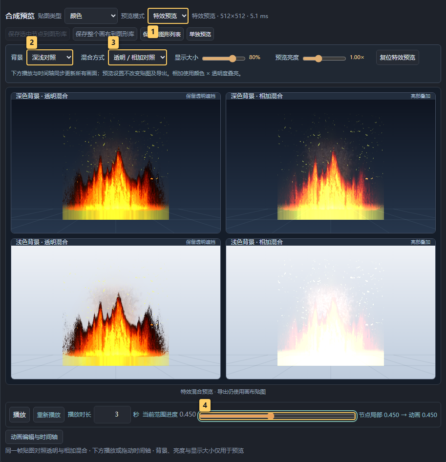

> 图中标记：1 切换特效预览；2 切换深浅背景；3 对比透明与相加混合；4 播放或定位动画。

1. 画布上方 **预览模式 → 特效预览**；通常把“贴图类型”选为颜色。
2. **背景**可选深色、浅色、深浅对照或自定义颜色。深浅对照会显示两行，方便检查暗边和透明边缘。
3. **混合**可单独查看透明、相加，或并排对比。透明混合保留遮挡，相加将贴图颜色乘透明度后与背景叠亮。
4. 用原来的 **播放、重新播放、进度滑条和时间轴** 检查运动及消散；每格使用同一帧贴图，参数编辑也会同步更新。
5. **显示大小**调整画面中的占比，**预览亮度**模拟0～3倍颜色倍率；“复位特效预览”恢复默认深色并排对照。

背景、显示大小、混合和预览亮度仅用于观看，不写入项目、不改变节点混合方式、透明度或导出背景，也不进入PNG和序列帧。要修改最终贴图，仍在参数面板和导出设置中操作。这里用于检查屏幕中的混合观感；实际项目的HDR、色彩空间与材质着色需在引擎内确认。

特效预览期间画布变换和UV拖动暂停，右侧参数仍可编辑。切回 **二维画布** 可继续拖动画布图形；**三维材质**用于检查贴到模型后的受光。
