# 05 · 画布、排列与合成

<!-- doc-language -->
[简体中文](05-canvas-and-compositing.md) · [English](05-canvas-and-compositing.en.md)
<!-- /doc-language -->

[手册目录](README.md) · 上一篇：[公式与生成器](04-formulas-and-generators.md) · 下一篇：[动画](06-animation.md)

打开[召唤法阵示例](examples/summoning-circle.json)，选中节点“环形星光”，可以复现本章的排列界面。

## 1. 选择节点、组合与进入子级

- 单击节点或画布图形选中；Ctrl/Cmd 单击多选，Shift 连选，空白处拖动框选。
- **＋组合**新建容器；Ctrl/Cmd+G 组合同级节点。组合适合整体移动、旋转和重复一套装饰。
- 双击组合进入，使用预览上方路径导航返回。
- 拖到组合行中央可移入组合；拖到行的上下边缘调整排序。后画的节点会影响先前内容。
- Alt 单击切换重叠候选，Esc 取消当前拖动。

### 在节点树改名、删除和拖放建组

双击节点名称或按 **F2** 行内改名，**Enter** 保存、**Esc** 取消，点击其他位置也会保存有效名称。每行右侧的垃圾桶只删除该行节点；删除组合会连同其子节点一起删除，不会顺带删除其他选中节点。改名与删除均可撤销。

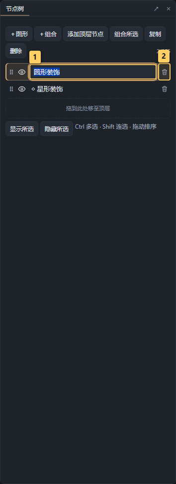

> 图中标记：1 双击名称或按 F2 改名，Enter 保存、Esc 取消；2 垃圾桶删除该行节点，支持撤销。

拖动手柄到一个图形行的中央，会出现带“预览”标记的虚拟组合，列出拖动节点和目标图形，并说明创建原因：**图形不能包含普通子节点，只有组合可以**。在该目标上松开鼠标才创建组合；移出目标或按 **Esc** 取消，预览不写入作品，也不产生撤销记录。预览不接收鼠标事件或挤动原有列表。可同时拖动多个节点，父子同时选中时只移动最外层所选节点；不能把父节点移入自己的子节点。

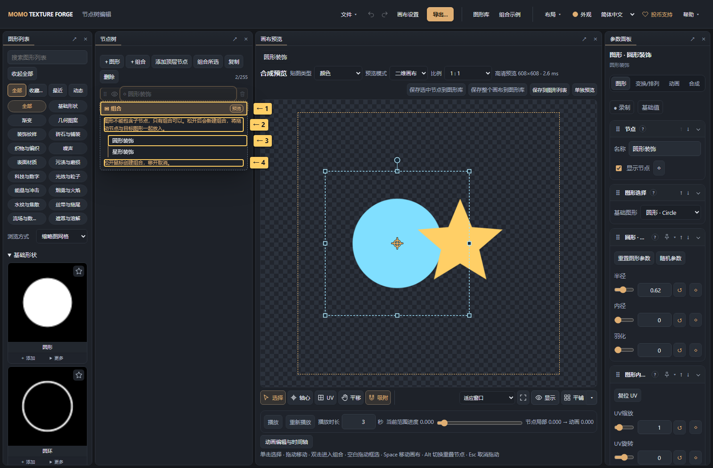

> 图中标记：1 虚拟组合，尚未修改作品；2 说明只有组合可以包含普通子节点；3 预览要放入组合的节点；4 松开创建组合，移开或 Esc 取消。

新建组合保留原节点及其参数，整次建组可一次撤销。拖到已有组合中央可直接移入，不出现建组预览；边缘拖放继续用于排序。

### 参数面板的折叠模块

参数面板有 **图形 / 变换/排列 / 动画 / 合成** 四个页签。图形与颜色已合并到 **图形** 页签：图形选择、专属参数、UV、透明度、配色、色阶、反相和通道曲线按功能显示为独立模块，顶部不再另设颜色快捷区。内置图形和自定义图形的专属参数统一集中在“图形名称 · 参数”中，直接沿用图形现有的参数列表。

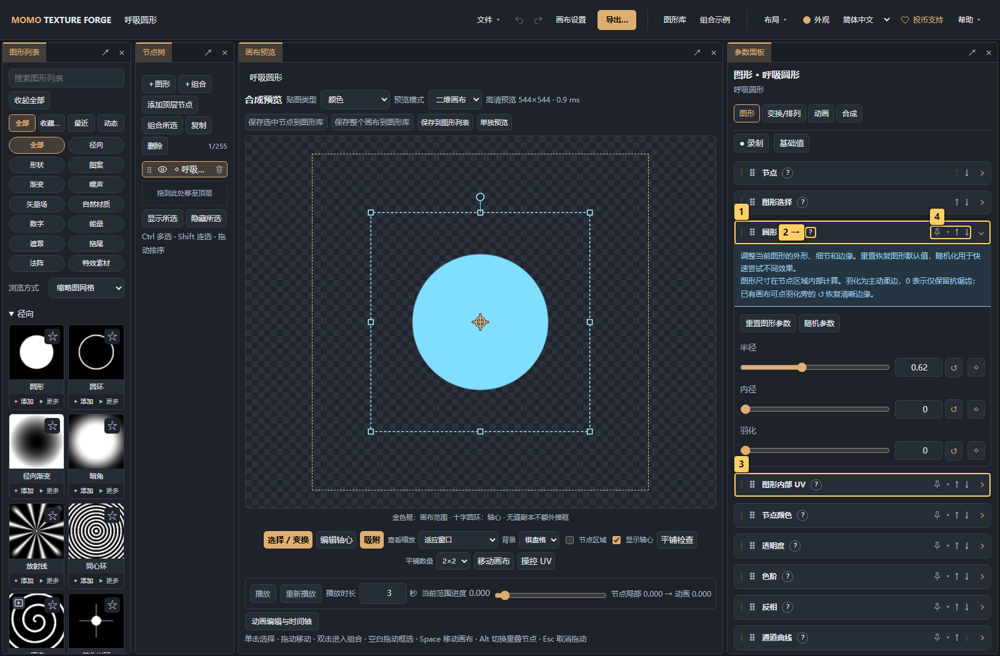

> 图中标记：1 图形专属参数集中在一个模块；2 悬停问号查看说明；3 点击标题展开或折叠 UV；4 拖动手柄调整模块顺序。

点击模块标题展开或折叠；鼠标悬停 **?** 查看浮层说明，不撑开模块或挤动参数。鼠标移入说明可继续阅读和选中文字，移开后收起；键盘聚焦也可查看，按 **Esc** 关闭，触屏点击问号查看或收起。查看说明不会展开参数，折叠参数后仍可查看说明。折叠只影响面板显示，参数与动画仍然生效。常用模块会跨节点保留展开状态，图形专属参数按图形类型单独记忆；状态保存在当前浏览器，切换语言或刷新后保留，不写入作品文件，也不占用撤销记录。

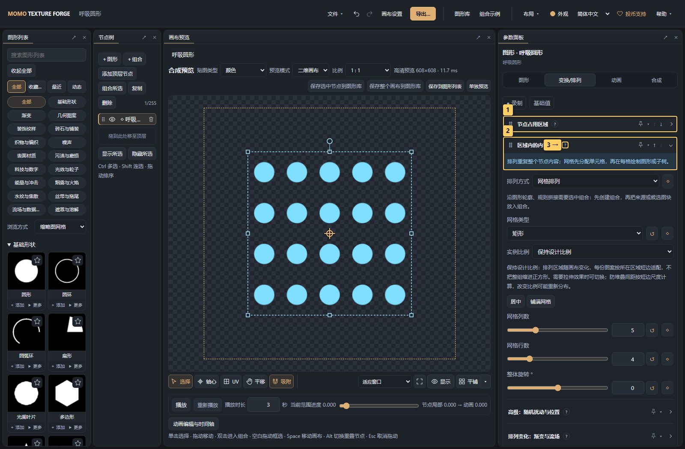

> 图中标记：1 通用区域设置可独立折叠；2 排列参数模块；3 说明默认收起，按需查看。

拖动模块标题旁的 **⠿** 手柄调整该页签内模块的顺序；也可聚焦手柄后按键盘 **↑ / ↓** 排序。顺序按页签保存在当前浏览器，跨节点、语言和刷新保留；单选与批量编辑共用顺序。暂时不适用的模块会隐藏，再出现时恢复保存的位置。排序只改变面板布局，不改变图形的合成或滤镜处理顺序，也不写入作品或撤销历史。

模块内保留原来的滑条、数值输入、重置与关键帧按钮。多选仍使用原来的批量编辑规则，并采用相同的模块样式。

### 节点后处理与执行顺序

在 **合成 → 后处理** 中点击 **添加效果**。主面板只显示当前节点已经加入的效果栈；选择器支持按中英文名称和用途搜索、一键清除，以及光影与模糊、扭曲变形、色彩映射、轮廓与材质、风格化、遮罩与消散六类筛选。窗口可拖动，添加一项后保持打开，便于连续添加。缩略图按效果选择几何细节、霓虹标志、网格、风景插画、心形或液滴等演示素材，并使用专门调好的示例参数进行真实后处理渲染。默认左侧为原图、右侧为效果，可拖动分隔线或聚焦后用方向键、Home/End对照。动态效果在悬停或键盘聚焦时播放，移开或失焦后恢复静态示例；系统开启减少动态效果时保持静态。演示不读取或覆盖节点参数，添加时仍按原有规则保留已有设置；也不改动画布。先生成可见卡片，关闭窗口释放预览资源。

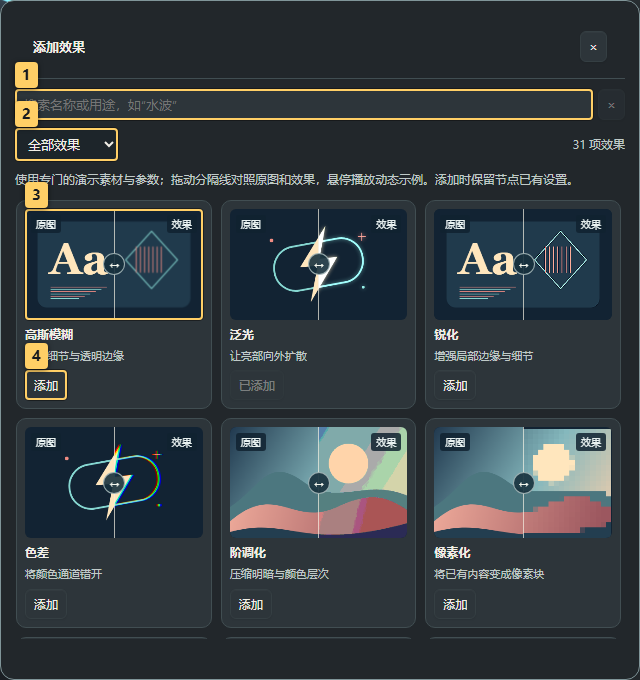

> 图中标记：1 按名称或用途搜索效果；2 按效果类别筛选；3 拖动分隔线对照原图和效果；4 添加效果，保留节点已有设置。

效果名称下显示关键参数或停用/混合状态。开关仅停用，效果仍保留在栈里；**⋯ → 效果说明** 只切换说明，不展开参数，菜单还提供参数复位与 **移出效果栈（保留设置）**。移出会停止该项，包括启用关键帧原本为开的时刻，但保留参数、关键帧与原开关状态；重新添加放到栈尾并恢复这些设置，原来停用的项仍停用。参数复位与移出是不同操作。

多选时显示各节点效果栈的并集，并标明仅部分节点已添加或启用状态不同。选择器的 **添加到全部** 只为缺少该项的节点添加，不把主选节点的数值或关键帧覆盖到其他节点；已有设置保留。移出只影响实际已加入的节点。后处理模块固定到节点树后，共用同一效果栈和添加入口。

拖动效果的 **⠿** 手柄改变真实执行顺序（也可聚焦手柄后按键盘 **↑ / ↓**），从上到下依次处理上一项的结果。分类只帮助寻找效果，不分割执行顺序。拖动时显示浮动标题和占位预览，其他效果平滑让位；松手归位，按Esc或移出面板放开可取消，取消不修改效果顺序。旧项目会根据已启用项、自定义参数与关键帧识别曾使用的效果，不丢失原有顺序和配置。

这里的效果顺序写入节点并支持撤销，与只调整界面布局的参数模块排序不同。保存图形、复制和作为组件加入画布时，参数、开关与执行顺序一起保留。组合先合成子节点，再处理整个组合；需要整体效果时，将内容放进最外层组合，不另设画布后处理。

可用效果：高斯模糊、泛光、锐化、色差、阶调化、像素化、边缘压暗、扫描线、万花筒、镜像平铺、漩涡、边缘检测、三色映射、径向遮罩、去黑底、转法线、手绘风格。泛光保留强度、半径、亮部阈值；色差可选水平/垂直/径向；阶调化分别控制暗部和亮部，亮部阶数为0时跟随暗部。边缘检测识别亮度变化，与透明轮廓描边不同。

数值与颜色参数支持现有关键帧、批量修改和快捷固定。扫描线速度为0时静止，相位可单独调整。模糊、泛光、色差、像素块、边缘线宽和法线采样步长按512像素短边基准缩放；旋转使用度。径向遮罩同时处理透明度与高度；去黑底保留已有透明度并恢复颜色。

转法线将当前高度转换成节点颜色，保留节点透明度和高度。它仍参与后续合成与颜色滤镜；导出设置中的法线模式另行从最终高度生成法线数据。基础色阶、反相、通道曲线和轮廓仍在效果列表之前执行。旧项目保留原滤镜顺序和 `postFx.*` 关键帧路径。

### 创意风格后处理

这10种创意风格与其他后处理共用节点效果栈。可从 **组合示例 → 组合练习 → 后处理风格对照** 查看原图和10种效果；另有“漫画印刷”“复古掌机”“全息故障”三个组合示例。对照从左到右、从上到下排列，选中节点后查看效果参数。

| 效果 | 主要设置与用途 |
| --- | --- |
| 印刷网点 | 圆点、方点、线条；尺寸2～64、角度、单色墨/纸色或RGB分色、散乱与种子。网点随图像明暗变化，区别于手绘轮廓内的均匀排线。 |
| 抖动限色 | Bayer 4×4、Bayer 8×8或固定噪声；RGB阶数、灰度、双色或四阶掌机配色；阶数2～16、像素单元1～24、抖动强度和种子。 |
| 故障撕裂 | 横条/竖条、条带数量2～128、触发比例、错位0～128、RGB偏移、变化频率、相位和种子。适合电子干扰。 |
| 缩放模糊 | 中心X/Y、向外/向内/双向、模糊距离0～256、内外半径和采样质量。内半径内效果最强，向外半径淡出；外半径小于内半径时在内半径处快速淡出。 |
| 油画笔触 | 四象限或沿局部边缘方向的八扇区椭圆滤波；笔触半径1～24、色块边界锐度、方向性、采样质量。适合云雾、噪声和渐变的绘画化。 |
| 浮雕斜面 | 透明度轮廓或高度为来源；斜面宽度、光照角度/仰角、凹凸强度、高光色和阴影色。生成颜色明暗，不改写高度。 |
| 铅笔线稿 | 扩展高斯差分（XDoG）；线条尺度、尺度比、边缘权重、阈值、柔和度、墨/纸色及保留底色。可提取图形内部明暗细节。 |
| 复古显像管 | 桶形弯曲、扫描线密度/强度、RGB荧光栅格、颗粒、闪烁、暗角、频率、相位和种子。 |
| 字符画 | 内置ASCII密度字符、条块或二进制0/1；字符尺寸6～64、原色/墨色、明暗反转、纸色与背景不透明度。字形不依赖系统字体。 |
| 像素排序 | 水平/垂直、亮度/色相/饱和度、升序/降序、上下阈值、透明度阈值、最长段落2～256个单元和像素单元1～24。真正重排连续区间。 |

所有新增效果都有 **混合强度0～1**，为0时直接跳过。模式相关控件按需显示，隐藏时保留原值；数值、颜色、开关、模式均支持关键帧、批量编辑和节点快捷固定。尺寸按512像素短边计，位置使用节点坐标，Y=0在下方。

印刷网点、抖动、油画、浮雕和线稿保留透明度与高度，墨/纸色不会填满透明背景。字符画只在原有内容内绘制，背景不透明度为0时字符间隙透明，并同步裁切高度。故障、缩放模糊、CRT弯曲和像素排序会同步移动或滤波颜色、透明度与高度。宽斜面、油画和高质量缩放需要更多采样；油画的低/中/高质量使用不同的固定采样密度，缩放模糊对应8/16/32次采样。

故障与CRT的变化频率为0时静止，固定种子和时间可复现；效果由时间直接计算，不依赖先前播放帧，拖动时间轴、关键帧预览和序列导出一致。随机变化不自动保证首尾无缝；需要循环时应自行安排相位和开关。

像素排序在阈值内的连续区间排序，透明单元和阈值外单元截断段落，超过最长段落会分段排序。阈值针对所选依据：亮度、归一化色相或饱和度。下限高于上限时跳过排序。分析网格固定在节点512像素短边基准，排序结果作为位移映射，最终颜色与高度仍采样原分辨率；增大像素单元会得到更粗的排序块，也能降低开销。分析最多1,048,576个单元，单边最多4096或设备上限，超出时提示增大单元或减小节点范围，不会悄悄降低精度。半透明单元按还原后的颜色排序，等值单元保留原顺序。

可尝试的顺序：**像素化 → 抖动限色**得到掌机质感；**印刷网点 → 边缘检测**得到漫画印刷；**故障撕裂 → 扫描线 → 泛光**得到全息干扰。需要处理完整作品时，把这些效果挂在最外层组合。

### 噪声扭曲

在 **合成 → 后处理 → 噪声扭曲** 启用。它读取当前效果栈已经合成的内容，再按扰动场重新采样；适用于图形、导入图片和组合。组合先合成子节点，再统一扭曲，并同步位移颜色、透明度与高度。拖动排序决定扭曲发生在模糊、描边、泛光等效果之前还是之后。需要作用于整个画布时，把内容放入最外层组合并在那里启用。

- **扰动模式**：热浪使用纵向拉长的柔和噪声；水波以交叉波形与噪声模拟折射；能量扰动使用多层噪声域扭曲。切换模式保留共同参数，不自动覆盖已调数值。
- **横向/纵向位移强度**：分别为0～64；单位按节点512像素短边基准缩放。某一轴为0时只关闭该方向，两轴都为0时直接保留原图。
- **扰动尺度**：8～256；越大越宽缓，越小越密集。**细节层数**为1～5；增加细节会增加细碎变化与计算量。
- **运动方向**：-180°～180°，0°向右、90°向上；**运动速度**为0～128基准像素/秒，0时冻结当前种子的扰动场。**随机种子**为1～65535，同一输入、参数、种子和时间可复现。
- **混合强度**：0～1，插值位移量，避免把原图与扭曲图叠成双影；0时完全跳过，不改变原图。

**连续流动**按绝对时间平移噪声场，适合不断上升的热浪，不保证首尾相同。**闭合轨迹循环**沿闭合路径采样同一噪声场，显示0.1～60秒的循环时长；扰动场在整周期端点的位置与运动方向一致，运动方向设置定义闭合轨迹的初始切线。隐藏的循环时长保留原值。暂停、跳到任意时间、重新打开与序列导出都直接从时间求值，不依赖此前播放了哪些帧。

闭合轨迹只保证本效果的扰动场周期；源图形、图片序列、子节点动画、其他后处理和相关关键帧也必须在同一时长衔接。只勾选播放循环或“循环导出不重复尾帧”不会让连续流动自动变成无缝循环。

边界沿用节点的 **裁切 / 允许超出 / 无缝重复**。裁切与允许超出使用透明边界采样，不把最后一个非透明像素拉长；允许超出为两轴最大位移预留范围。无缝重复会回绕采样内容，并使扰动场在节点周期边缘衔接；扰动尺度会对齐整数周期，原内容本身仍需适合平铺。尺寸和透明孔洞沿用输入，扭曲不会在空图上生成新的噪声图层，浮点渲染时不钳制HDR颜色。

**组合示例 → 组合练习** 新增“热浪扭曲”“水波折射”“能量扰动”：每个示例左侧为原图，右侧把底纹、圆环与星光合成后统一扭曲。热浪展示连续运动；水波和能量分别配置3秒、3.6秒闭合轨迹，子图形静止，可验证首尾相同。展开右侧组合即可编辑源内容。模式、参数、开关、执行顺序和关键帧随节点/组件保存，支持批量编辑和将后处理模块固定到节点树。

### 溶解、冲击波与液态融合

这三项位于 **合成 → 后处理**，处理当前节点已有的图形、图片或组合内容；组合先合成子节点，再执行效果。支持拖动排序、关键帧、批量编辑、固定到节点树和组件保存。要处理整个作品，把内容放入最外层组合并在那里启用，无须独立的画布后处理。

**溶解／燃烧消散**：效果进度0～1，0保留原图，1完全消失。消散分布可选云状噪声、细胞碎块或定向烧蚀；消散块尺度8～256，种子1～65535。定向模式显示−180°～180°方向，0°向右、90°向上。消散边缘柔和度0～0.15；选择焦边燃烧后可调燃烧边带宽度0～0.3与燃烧颜色，边带宽度相对于消散分布值，不是像素。火光与焦边限制在原内容的存留透明度内，不会给空白背景添加颜色；透明度和高度按同一消散覆盖变化。默认进度0.35便于开启后查看，制作出现/消失动画时给进度添加0→1或1→0关键帧。

**冲击波折射**：中心X/Y为0～1，Y=0在下方；最远传播半径0.01～2，以节点短边为1。效果进度决定波环从中心向外的位置，波环宽度2～192、位移强度0～128均使用512像素短边基准；传播衰减0～1。只在波环附近重新采样原内容，颜色、透明度、高度一起移动，不额外生成光圈。进度0、进度1、位移0或混合0均直接保留输入。开始与结束阶段自动淡入淡出；适合给进度添加线性0→1关键帧，而不是不断累积每帧时间。

**液态融合**：融合半径0～64按512像素短边计；先模糊预乘颜色、透明度和高度，再按融合阈值0.05～0.95及边缘柔和度0.005～0.4重建轮廓。较低阈值通常更容易黏连，较高阈值会收缩。放在组合上，让有小间隙的子图形融合；各子节点分别启用无法得到相同的统一融合。颜色可继承源内容的加权混色，或切换统一液体颜色。半径0或混合0保留原图；空输入保持透明。会改变覆盖、孔洞和细节，这是液滴风格化处理，不是物理流体模拟。建议从半径12～24、阈值0.25～0.4开始，保留原始子节点便于调整。

三项的混合强度均为0～1。溶解和液态融合混合处理前后的预乘结果；冲击波混合的是位移量，避免双影。半径与位移随输出分辨率缩放，浮点渲染保留HDR；8位输出仍受格式限制。允许超出会为波环位移和融合采样预留透明范围；裁切最终按节点边界限制。无缝重复会回绕采样，但不自动让波环或定向消散在空间边缘接续，仍需检查平铺。

这些效果没有自动运动时钟，进度与参数从当前关键帧直接求值。同一源内容、种子和时间在暂停、跳帧、重新打开、预览及导出中一致。溶解0与1不同，不应当作首尾无缝循环；冲击波自身两端均保留原图，但作品循环仍需源内容与其他动画也匹配。仅勾选循环播放或循环导出不重复尾帧不构成无缝保证。

**组合示例 → 组合练习** 新增“燃烧消散对照”“冲击波折射对照”“液态融合对照”。左侧为原内容，右侧统一处理组合；前两项是3秒、2.4秒单次进度动画，液滴示例为3.2秒首尾匹配的往返运动。展开右侧组合可修改源图形和效果。可尝试“溶解 → 泛光”强化烧蚀亮边，或“液态融合 → 浮雕斜面”制作胶状徽章；效果顺序随组件保存。

### 手绘风格

可从 **组合示例 → 组合练习 → 手绘心形** 打开现成示例，查看深色重复描边和红色交叉排线的参数设置。白底来自画布输出背景，手绘效果绑定在心形节点上。

在 **合成 → 后处理 → 手绘风格** 启用。该效果使用本地打包的Rough.js对当前处理结果提取轮廓并重绘，适用于图形或组合，也可按顺序与其他效果叠加。默认使用透明度轮廓；不透明图片可改用亮度轮廓，通过轮廓阈值选择形状范围。

填充提供保留原色、纯色、平行排线、交叉排线、仅描边、连续锯齿、圆点、虚线排线、锯齿线排线和放射线，共10种模式。原有前5种模式编号保持不变，已有项目和关键帧不会改变含义。放射线是工具基于Rough.js笔触补充的实现；其余绘制填充使用Rough.js原生算法。

- 描边：描边手绘幅度0～10、笔画弯曲0～20、最大随机偏移0～20、固定顶点、描边宽度/颜色/不透明度、重复描线；填充重复描线可跟随描边、单次或重复，独立控制。
- 排线和圆点：独立的填充手绘幅度0～10、填充颜色/不透明度、角度、间距和粗细；圆点使用粗细作为直径，另有曲线采样数、贴合度和紧致度。虚线排线可设置段长与间隔，锯齿线可设置锯齿幅度。纯色填充有额外边缘抖动参数。
- 虚线节奏：描边与填充各自支持空格或逗号分隔的长度列表，例如`8 4 2 4`表示长线、间隔、短线、间隔；留空为实线。最多32段，每段0～512，至少一段大于0；奇数段由Canvas重复为偶数段。两者均有独立相位偏移，节奏列表支持离散关键帧。
- 放射线：中心X/Y、线数量、角度、粗细和颜色。中心使用节点坐标，Y=0在下方；按真实轮廓裁切并保留孔洞。
- 路径：轮廓来源/阈值/简化、路径细节保留（0关闭，接近1保留更多细节）、坐标小数位（-1关闭舍入）。高级参数收在“更多描边设置”“更多填充设置”“轮廓与路径设置”中，展开状态保留。专用参数随当前填充方式显示；隐藏参数保留数值，批量编辑显示任一选中样式需要的参数。

保留原色会在原结果上叠加描线；其他模式用重绘结果替换颜色，并以笔触/填充覆盖度作为高度。孔洞按轮廓保留，透明区域不会变成纸张背景。**组合示例 → 组合练习 → 手绘样式对照** 用九个心形对照原图和全部8种绘制填充，原来的“手绘心形”继续提供红色交叉排线示例。

**描边手绘幅度**与**填充手绘幅度**独立。需要顺滑边框和随性排线时，可先试描边0.2～0.5、填充3～5，再结合轮廓平滑调整。仅描边/保留原色模式隐藏填充幅度，数值仍保留；放射线使用填充幅度。旧项目读取时，原共享幅度的数值及关键帧复制到两项，保持原效果，之后分别编辑；原`postEffects.sketch.roughness`继续表示填充，新描边路径为`postEffects.sketch.strokeRoughness`。两项均支持关键帧、多选、快捷操作和组件保存，Shader填充参考仍读取填充幅度。

**轮廓平滑**先整理像素轮廓，再交给 Rough.js 描绘，默认0.5，0关闭；它与“轮廓简化”的减点、以及“手绘幅度”的笔触扰动分别控制不同阶段。平滑采用有深度与点数预算的曲线拟合，保留明显尖角和孔洞，不模糊原图，也不切换到原始图形的矢量路径。图形、图片、组合都读取当前后处理顺序中传入的像素结果，组合先合成子节点；前置扭曲等效果会影响最终轮廓。已有项目缺少此字段时使用默认平滑，设为0可恢复原路径处理。

轮廓缓存只比较所选透明度或亮度通道，以及采样范围和轮廓参数；透明度轮廓不因纯调色或笔触种子改变而重新提取。轮廓变化时仍需采样、读回与重绘，平滑不承诺固定帧率；不会跳帧、冻结轮廓或根据播放速度改变算法。预览与导出采用同一规则，导出尺寸不会改变轮廓拟合的设计尺度。

随机种子固定时，同一静态输入与参数可复现所有样式的笔触，包括圆点的布局。描边和排线尺寸按512像素短边计，轮廓采样有固定预算，导出时按实际尺寸重绘笔触。圆点过密或虚线/锯齿段过短时有计算预算保护；可增大间距、段长或降低采样数。轮廓简化越大，细节越少；复杂碎片超过预算时会提示调整简化或阈值。清晰图标和形状最适合；烟雾、柔和渐变、细小碎片及变化中的轮廓可能产生不同或跳动的笔触。手绘颜色经Canvas重绘为8位，不保留HDR颜色精度；需要HDR时可保留原色，描线本身仍是8位覆盖。

参数、颜色、种子和执行顺序随节点保存，复制或作为组件加入时保留；支持现有关键帧、批量修改和快捷固定。Rough.js及依赖的许可见[ROUGH-LICENSES.txt](../web/vendor/ROUGH-LICENSES.txt)。

### 把常用设置固定到节点树

单选节点后，点击模块标题右侧的 **图钉**，将可操作区域固定到节点树中该节点的下方。再次点击图钉取消固定。快捷区与参数面板共用数值、重置和关键帧操作，修改仍可撤销；它不会创建新节点，也不改变处理顺序。

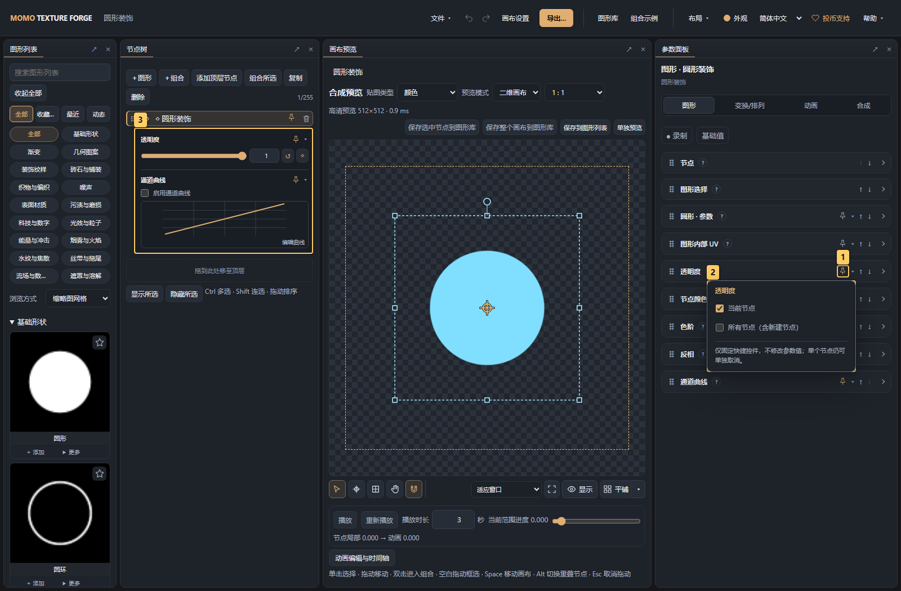

> 图中标记：1 图钉将模块固定到当前节点；2 选择当前节点或全部节点适用；3 直接编辑选中节点的快捷参数。

图钉旁的 **▾** 可选择 **当前节点** 或 **所有节点（包括新节点）**。全部适用后，仍可在个别节点取消固定；不适用的模块暂时隐藏，设置继续保留。图形参数、UV、透明度、颜色、色阶、反相、曲线，以及排列、合成、动画中的可操作模块均可固定；“节点”和“图形选择”不提供快捷固定。

快捷区随单选节点切换，多选时不显示。绑定保存在当前浏览器；在同一浏览器将图库预览添加到画布、复制节点或保存后重新插入图形时，会带上对应绑定。它属于工作区偏好，不写入项目或资源包，换浏览器或设备时不会自动同步。

通道曲线在快捷区显示小预览，点击 **编辑曲线** 打开完整窗口。按住窗口标题栏拖动即可移开，避免遮住画布；标题栏获得焦点后可用方向键移动，按住 **Shift** 加大步长。移动窗口不改变曲线或撤销记录。

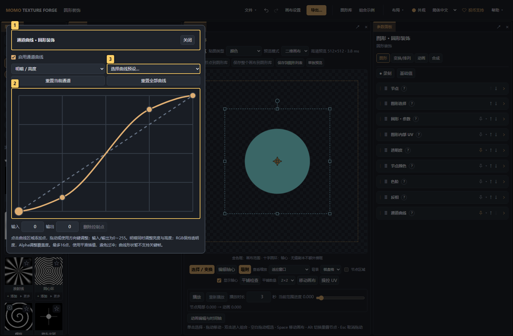

> 图中标记：1 拖动标题栏移动窗口，方向键也可移动；2 在网格中添加和拖动控制点；3 选择通道曲线预设。

### 多选后批量修改、对齐与等距分布

> 图中标记：1 Ctrl/Cmd 多选节点；2 多选保留原来的页签；3 多个值可统一修改；4 对齐与等距分布。

1. 按住 **Ctrl/Cmd** 选择多个节点，或在画布空白处框选；右侧自动切换为 **批量编辑**。
2. 通过原来的 **图形 / 变换/排列 / 动画 / 合成** 页签修改参数。不同值显示 **多个值**，复选框以横线表示不同状态；只覆盖你调整的参数。可切换 **编辑主选节点** 单独修改，再点 **返回批量编辑**。
3. 在 **变换/排列 → 对齐与分布** 选择 **所选范围** 或 **画布**，再点左/右/顶/底对齐或水平/垂直居中。
4. 至少选中三个节点可用 **水平等距 / 垂直等距**：按节点区域边缘保持相同间距，保留两端节点的位置。空间不足时允许重叠。

对齐按旋转后的节点区域外框计算，不按图案的不透明像素裁边；不同父级下可见、只有一个实例的节点也能对齐。隐藏节点或父级排列产生多个副本时不能直接对齐，请选择其外层组合。

批量修改只作用于最外层所选节点；父子同时选中不会重复修改子节点。锁定宽高比例的节点会同步改变另一边，超出参数范围则整次操作取消。每次操作及一次连续滑动都可整体撤销，修改会自动保存。

各页签的批量编辑范围：

| 页签 | 可批量修改 |
| --- | --- |
| 图形 | 同一种图形的半径、线宽等专属参数；图形的 UV、极坐标和兼容的运动设置；透明度、配色、纯色/渐变、色标、色阶与反相 |
| 变换/排列 | 位置、宽高、轴心、镜像、适配、无缝、排列及其随机/渐变/流场参数、图块接口；包含对齐与等距分布 |
| 动画 | 在父级中的时间范围、循环/往返、前后显示、源进度、固定进度与参数动画开关 |
| 合成 | 混合方式、轮廓、后处理与兼容的蒙版设置 |

混选不同图形不显示主选节点的专属参数，其他共有页签保持可用。UV 不作用于组合，因此混选组合时说明原因；“规则拼接”“沿图形轮廓”和组合专属配色需要全部选中组合。排列方式或密度图案不一致时，先统一类型再编辑对应参数。每个组合保留自己的子节点，不自动生成候选图块或轮廓来源。

颜色修改保留未调整的配色模式与色标；需要统一颜色时先选 **自定义配色**，再设置纯色或渐变。选择配色预设才会统一替换色标；色标数量相同时可逐个批改，不同时可先应用预设或恢复各自双色端点。组合内独立配色的子节点、父级整体调色仍按原规则生效。

普通模式下，任一目标字段由动画控制则不能直接批改；**录制** 在各节点当前局部进度记录关键帧，**基础值** 保留原动画。关键帧、数值曲线和时间重映射曲线从 **编辑主选节点** 进入单独编辑。多色色标不录制关键帧。

> 图中标记：1 在图形页签统一编辑颜色；2 批量调整透明度；3 选择自定义或继承配色；4 只统一修改填充颜色。

> 图中标记：1 选择同一种图形；2 进入图形页签；3 不同半径显示多个值；4 批量修改圆环线宽。

## 2. 节点占用区域与图形尺寸

> 图中标记：1 切换排列面板；2 节点占用区域。

在右侧 **变换/排列** 调整：

1. **节点占用区域**：位置、宽高、旋转、轴心；它定义节点在父区域中的范围。
2. **图形参数**：图形自身的半径、线宽、羽化等，改变区域内部的图案。
3. **实例尺寸**：排列后的每份内容大小。

区域宽高等空间参数使用 0～1，旋转使用度。宽画布中图形被拉扁时，检查图片比例、区域适配和排列实例比例，按实际层级调整。

画布支持拖动移动、旋转和轴心编辑；Shift 移动锁轴/旋转按 15° 吸附，Alt 拖动临时关闭吸附。Space 临时平移视图。

## 3. 选择排列方式

> 图中标记：1 选择排列方式；2 设置星光数量；3 设置每份图形尺寸。

| 方式 | 操作重点 |
| --- | --- |
| 网格排列 | 设置行列数、矩形/斜向/六角网格与实例尺寸 |
| 随机散布 | 设置目标数量、布局半径、种子与最小距离；实际数量可能不足目标 |
| 环形排列 | 数量、圈数、布局半径、内半径比例与朝向 |
| 螺旋排列 | 黄金角或规则螺旋，设置发散角/圈数与中心留空 |
| 沿路径 | 设置贝塞尔控制点、数量或间距、朝向与末端尺寸 |
| 对称排列 | 设置对称份数、偏角及旋转/镜像 |
| 边框排列 | 矩形/圆角矩形的宽高、圆角、沿线偏移、数量或间距 |
| 沿图形轮廓 | 组合首个子节点提供透明轮廓，后续子节点作为装饰 |
| 人字 / 编织 | 选择人字纹或篮式编织，设置重复块行列数 |
| 规则拼接 | 子节点提供候选图块并声明接口，自动选择匹配布局 |

截图的星形节点开启环形排列，每份只重复它自己的星形。选组合开启排列，则默认每份重复整个组合。

### 飘带与拖尾纹理

在 **图形库** 搜索“折叠线束”“折光薄膜”或“粒子细丝”，将其加入画布。三种图形都生成沿横向延伸的透明长条纹理，适合用作飘带、能量拖尾或薄纱的表面贴图；建议先将画布设为4:1或8:1。

在图形参数模块中选择对应的 **拖尾风格预设**，再调整参数：

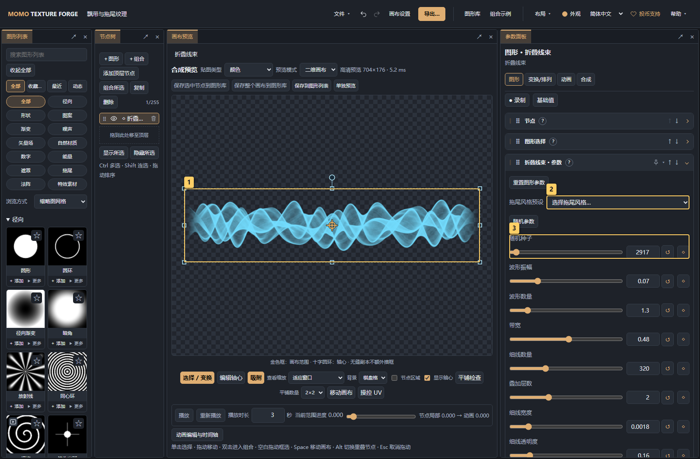

> 图中标记：1 用宽画布预览透明拖尾纹理；2 先选择拖尾风格预设；3 继续调整图形专属参数。

- **折叠线束**：连续细线汇聚成褶皱，提供月白薄纱、青蓝流光、游离烟丝三套预设。
- **折光薄膜**：连续带面有独立的内部透明度、边缘宽度/亮度、折痕亮度、薄膜底色和边缘颜色，提供冰蓝薄膜、紫金折光、月白轻纱三套预设。使用继承配色保留薄膜原色，也可通过节点颜色覆盖配色。
- **粒子细丝**：每条细丝具有独立扰动相位，细丝差异控制线宽与透明度变化，提供柔白细丝、蓝色流丝、烟尘游丝三套预设。

预设同时设置配色；后续可继续使用节点颜色、透明度、通道曲线和后处理调整。细线和薄膜边缘的宽度相对图形高度，缩小时自动计算像素覆盖，预览和导出保留相同的宽度比例。

**形态演变速度** 支持正向和反向变化，设为0时保持静止；UV滚动可继续用于纹理流动。启用 **横向无缝** 后，波形与扰动频率会按整数周期计算，并停用两端淡出，使横向边缘衔接。该设置控制空间平铺，不保证动画首尾帧相同。参数支持关键帧、快捷固定、撤销和项目/资源保存，导出沿用现有透明PNG与序列流程。

### 贝塞尔路径：放大与多段编辑

“贝塞尔光带”图形和“沿路径”排列共用路径编辑器。点击 **放大编辑** 打开独立窗口；滚轮或加减按钮缩放，拖拽空白平移，**适应全部** 找回所有控制点。视图操作不会改变作品；点坐标范围为 −8～8，不再受小框边缘限制。

按住放大窗口的标题栏可移动整个窗口；拖动图表空白只平移路径视图，拖动高亮控制点才修改路径。标题栏支持方向键移动，**Shift + 方向键** 加大步长。

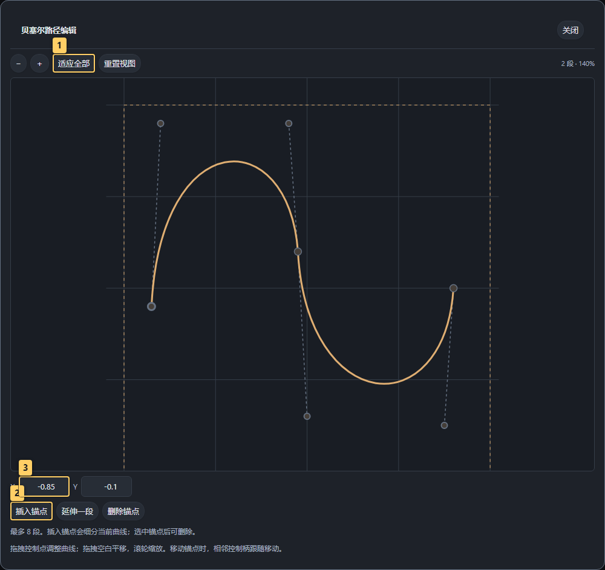

> 图中标记：1 适应全部控制点，滚轮缩放、拖拽空白平移；2 插入锚点细分当前曲线，也可从末端延伸；3 选中锚点或控制柄后精确输入坐标。

**插入锚点** 通过细分当前曲线段增加锚点，初始外形保持不变；**延伸一段** 从末端增加新的曲线段。每段为三次贝塞尔，相邻段共享锚点，最多8段。锚点移动时，相邻控制柄跟随；控制柄可独立调整。选中锚点或控制柄后，可在 X/Y 输入框精确设置坐标；选中锚点后可删除，至少保留一段。

路径的增删、拖动支持撤销、保存与导出。光带的线宽和绘制进度作用于整条路径，沿路径排列会沿全部曲线段按数量或间距采样。控制点及其周围的命中区域显示移动光标，悬停时高亮；空白区域显示抓手，平移时显示抓取状态，锁定点显示禁止操作。靠边抓取保留鼠标与点的偏移，避免一拖就跳位。

控制点支持参数录制；已有控制点关键帧或正在录制时会禁止增删锚点，避免关键帧对应到错误的点，仍可调整控制点和视图。

### 新增排列与示例

排列范围：网格、斜向网格、六角密排与规则拼接最多 16×16；人字/编织最多 8×8 重复块（512 份长砖）。普通环形/随机最多 128 份，高级排列、边框和轮廓最多 512 份；多圈环形与镜像成对排列按总实例数限额计算。圈数最多 32，螺旋圈数与流场波浪次数最多 24，排列/拼接种子为 1～99999。布局半径/路径缩放最多 2，内外或首尾尺寸倍率最多 4，默认参数保持不变。

密集排列会增加绘制开销。防堆叠或密度约束可能使实际数量少于目标；规则拼接仍保留搜索预算。排列实例不等于独立节点，“展开为独立节点”仍受画布 256 节点总量限制。

在顶栏 **组合示例 → 示例分类 → 新增排列** 可找到以下十个可编辑画布。打开后选择最外层节点，再切右侧 **变换/排列**；拼图板的每一块可分别选择编辑。

> 图中标记：1 筛选新增排列；2 打开排列示例。

| 示例 | 主要调整入口 |
| --- | --- |
| 无缝光晕接续 | 子级允许超出，外层无缝重复；可加描边、模糊和 Bloom，再开启平铺检查 |
| 内容边界对照 | 选择左右组合 → 变换/排列 → 边界处理，对比裁切和超出 |
| 跨格光点排列 | 外层组合允许超出，内部星光的合成 → Bloom；格距与行列数独立 |
| 拼图接口与圆角 | 逐块选节点，图形 → 接口样式、接口圆润度、主体四角 |
| 单块拼图网格 | 图形 → 四边凹凸、接口大小；变换/排列 → 网格行列数，按主体格距重复 |
| 彩色拼图板 | 逐块选节点，图形 → 最外侧平边与内部凹凸；图形 → 节点颜色 → 自定义配色 |
| 圆角边框灯带 | 边框宽/高、圆角半径、实例数量/沿线间距、沿线偏移；“实例朝向”决定短线沿切线或法线 |
| 星形轮廓光点 | 将首个子节点替换成图形、组合或透明图片，后续子节点替换成装饰；可关闭“显示轮廓来源” |
| 人字镶嵌底纹 | 人字 / 编织 → 人字纹；重复块行列数；进入内部调整长砖图案与留缝 |
| 篮式编织底纹 | 同一入口选篮式编织；每个重复块按 4×4 格构造，最多 512 份长砖 |
| 渐隐装饰点阵 | 展开“排列变化：渐变与流场”，设置渐变方向、尺寸倍率、透明度和旋转的起止值 |
| 波浪流场线阵 | 同一分区选波浪偏移或旋涡扭转；调整幅度、相位、跟随转向，波浪另有次数 |
| 接口匹配管线 | 规则拼接 → 图块接口配置，为每个直接子节点选择右/上/左/下接口，再调行列数与种子 |

沿轮廓排列读取**首个子节点最终透明度**，包含其变换和合成处理，按闭合边缘与孔洞布点。“轮廓透明度阈值”选择边界，“轮廓法向偏移”移动光点到边界两侧。来源固定以 256×256 采样，极细细节可能丢失；修改导出分辨率不会重排。不透明照片会沿整张图片边缘排列，要跟随其中的图案，可先去背景或在图片参数中切为亮度遮罩。来源显示一次，其余子节点按整组、随机一个或顺序循环重复。

人字纹与篮式编织按长砖区域绘制，内容随区域拉伸；需要跨四边接续时开启该组合的“边界处理 → 无缝重复”，并用“平铺检查”验证。更换画布比例会改变砖块长宽，旋转整组后仍应重新检查边缘。

渐变和流场可叠加到现有排列。渐变按横向、纵向、径向或实例序号改变每份实例；可反向。流场改变实例位置与朝向，**流场相位可录制关键帧**，示例已设置 0→360° 的循环。开启随机散布防堆叠时，渐变和流场暂不应用，避免改变尺寸/位置后破坏间距；设置会保留。位置渐变跨平铺边界可能出现节奏突变。

规则拼接依据声明的四边接口选择图块；图块需把连接点画在边中点，系统不识别图片里的实际线条。关闭无缝重复时外围接口封闭，开启时同时匹配首尾边。示例提供全部 16 种接口组合，可删减或替换候选，关闭某个子节点可将其移出候选。缺少端点、转角或空白块而无法拼接时会给出提示；搜索超限可减小行列或更换种子。为保持连接，规则拼接使用格子拉伸，且不应用渐变/流场。

### 组合里混排不同图形

1. 让不同花型成为一个组合的直接子节点。
2. 选组合并开启排列，设置 **实例内容**：整个组合、随机一个子节点、按顺序循环（取模）。
3. 随机时修改杂排种子；取模时调整节点树的候选顺序。
4. 需要逐份手工调整时，点 **展开为独立节点**，会增加节点数量，可撤销。

“随机一个子节点”允许重复，不保证每种均匀出现；子组合整体算一个候选，不会继续抽内部后代。关闭排列时重新显示整个组合。

### 防堆叠和保持比例

随机散布可启用 **防堆叠** 和额外间距。它按可见内容的保守外包圆避让，不能保证细长或凹形轮廓紧密嵌套；间距过大、实例过大时实际数量减少。

**实例比例 → 保持设计比例**保护每份图案形状；“铺满网格/铺满区域/分布适配”调整分布覆盖。它们与整个节点的区域适配不同。

### 单块拼图与凸耳越界

> 图中标记：1 选择四种接口造型；2 调节接口弯曲形状；3 单独设置四边凹凸。

图形列表的 **拼图块** 只有一个主体。**图形** 页签顶部的 **接口样式** 可选圆头凸耳、方头卡扣、梯形燕尾、波浪接口；**接口圆润度** 调整圆头方圆程度、卡扣／燕尾拐角及波峰曲线。上、右、下、左四边可分别设为平边、凸耳或凹口；接口大小、颈部收窄、线宽、羽化和轮廓／实心继续共用。图库提供对应样式、角块、边块和圆角主体预设。

> 图中标记：1 左上角：0为直角；2 右上角圆角大小；3 右下角圆角大小；4 左下角圆角大小。

展开 **主体四角：0为直角**，左上、右上、右下、左下可分别设置0～0.4：0为直角，数值越大圆角越大，支持滑条、数值、撤销和关键帧。主体圆角会让格点留空；需要紧密拼接时，把内部相接的角保留为0。接口圆润度控制接口本身的曲线，主体四角控制块体的四个角。

**拼图接口与圆角** 示例在同一画布并排放置四种接口；每块左上角为直角，其他三个角用不同圆角值，便于对照。

> 图中标记：1 使用现成网格排列；2 设置列数；3 设置行数。

主体占满蓝色节点区域，凸耳可以伸到蓝框之外；**变换/排列 → 网格** 按主体计算格距。增大凸耳不会缩小主体或推开邻格。相邻边要一凸一凹，接口样式、大小、颈部、圆润度保持一致，并保持对应朝向；矩形格需要把实例比例改为“随区域拉伸”。外边想平整时，将最外侧边设为平边。

**组合示例 → 新增排列** 中可打开 **单块拼图网格** 和 **彩色拼图板**。前者用一个图形排列16份；后者演示九块独立配色与外侧平边。拼图块默认允许超出节点区域；普通节点默认裁切，可通过下面的通用边界处理选项修改。

### 边界处理：裁切、允许超出、无缝重复

> 图中标记：1 选中允许超出的组合；2 切换三种边界模式；3 蓝框保留逻辑区域。

1. 打开 **组合示例 → 新增排列 → 内容边界对照**，选择“右侧：允许超出”。
2. 在 **变换/排列 → 节点占用区域 → 边界处理** 三选一：**裁切到节点区域** 截断越界部分；**允许超出节点区域** 继续向外显示；**无缝重复** 将越界部分接到对侧。
3. 蓝框继续表示逻辑区域，位置、轴心、对齐与排列格距保持不变；伸出的星光、移到边界外的子节点、描边及模糊/Bloom 仍可显示。
4. 需要连续穿过多层组合时，沿节点树把相关父组合也设为允许超出。任何一层仍设裁切，都在该层蓝框截断；金色画布始终是最终导出边界。
5. **无缝光晕接续** 中，子星光选择允许超出，外层组合选择无缝重复；右上角星光和泛光会接到左侧、下侧和左下角。开启 **平铺检查** 观察接续。两层的设置互相独立，同一个节点只保存一个边界模式。
6. **跨格光点排列** 演示三列三行网格。将外层组合设为允许超出后，相邻格可重叠，切回裁切时最右侧星光会被截断。每个图形自己的裁切设置仍单独生效。

> 图中标记：1 外层组合选择无缝重复；2 检查四边及四角接续；3 选择2×2、3×3或4×4；4 子级可单独允许超出。

普通图形和组合默认裁切，拼图块默认允许超出；支持多选批量修改、撤销/重做、保存与离散关键帧。伸出区域可按可见像素点击选择，蓝框与变换手柄保持原尺寸；框选和对齐仍按逻辑区域。

图片、矢量和生成器仍使用其资源本身的内容范围，开启此选项不会补画图片外不存在的像素；可以让整个子图片超出父组合，或让滤镜扩展。遮罩继续按原来的位置、范围和反向设置作用于实际内容。边界处理 → 无缝重复以逻辑区域作为一个周期，边缘内容回绕到周期内；允许超出不会扩大平铺周期。

## 4. 配色、混合、遮罩与后处理

### 颜色入口

> 图中标记：1 图形与颜色共用图形页签；2 展开节点颜色模块。

**图形** 页签内统一编辑外形和颜色。**透明度** 模块控制整个节点或组合，滑条和数值范围为 0～1，父子透明度相乘；它支持重置、关键帧、撤销/重做和保存项目。

展开 **节点颜色**，通过 **配色** 下拉框选择继承父级或自定义配色；组合还可以保留子节点颜色或统一重映射组合颜色。**着色方式** 使用分段选择，在纯色和数值渐变之间切换。独立配色后才能修改本节点的颜色，继承状态会显示来源和相关操作。

> 图中标记：1 下拉选择继承或自定义配色；2 复制当前配色以独立修改；3 前往父级配色来源。

- **继承自：某某组合** 显示实际配色来源；点 **前往来源** 编辑父级，影响继承它的节点。
- **改为独立配色** 复制当前看到的配色到此节点，再单独修改；父级和其他节点保持原样。
- 组合 **保留各子节点颜色** 时，可点 **为子节点设置配色**；已有独立配色的子节点保持原样。
- 图片或生成器保留原色时，会明确显示 **使用图片原色 / 使用生成器原色**；**自定义着色** 按亮度重新映射颜色。
- 上层组合开启 **组合统一配色** 时会提示最终受谁影响，可直接跳到该来源调整。

> 图中标记：1 点击渐变条添加色标，拖拽色标调整位置；2 修改选中色标的颜色；3 选择内置渐变预设。

**图形 → 节点颜色 → 着色方式** 可选纯色填充或数值渐变。直接点击渐变条添加色标，新增颜色会采样当前位置的渐变；拖拽色标或输入位置百分比调整分布。点击色标后，用色块或 HEX（如 `#80DFFF`、`F80`）修改它的颜色。最多8个，至少保留2个；方向键微调位置，Delete 删除选中色标。**反转渐变** 镜像色标位置，**内置渐变** 提供配色预设。

多选时保留未选中色标的差异，只修改当前色标。色标数量不同时，先选择共同预设或恢复双色渐变。双色端点支持关键帧；多色色标不单独录制关键帧，恢复双色渐变后可继续编辑暗部/亮部颜色动画。

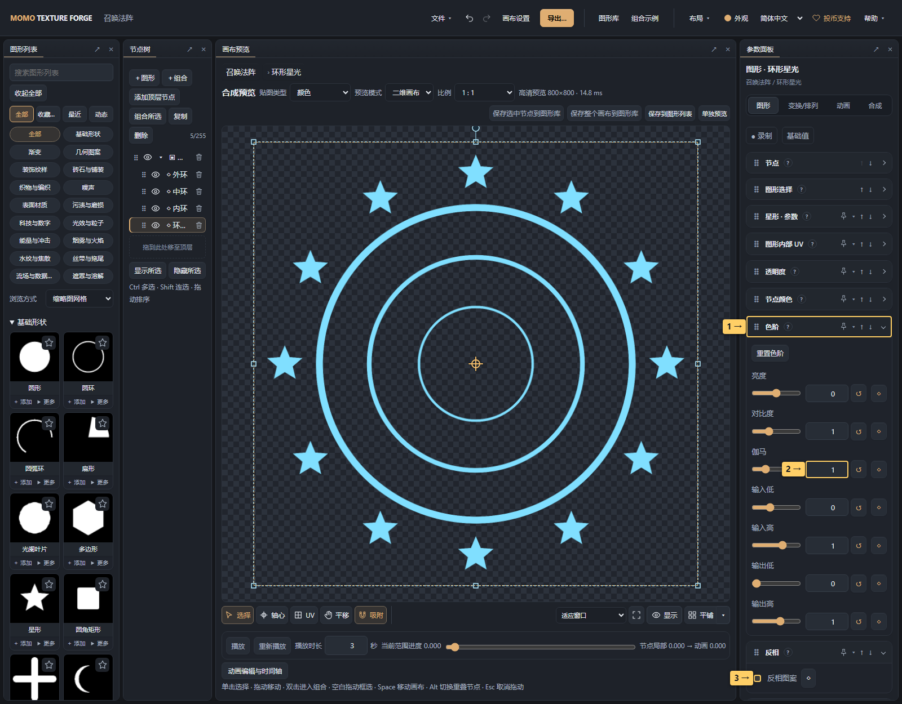

> 图中标记：1 展开色阶调整黑白场、伽马和输出范围；2 调整伽马；3 反转节点的明暗与高度值。

**色阶** 与 **反相** 位于图形页签，沿用原来的明暗后处理数据。色阶默认折叠，包含输入黑白场、伽马、亮度、对比度和输出范围；反相将节点明暗/高度值变为 `1 − 原值`，也会影响由明暗派生的透明度。它们支持关键帧、撤销和保存。仅需调换渐变方向时，使用渐变条旁的 **反转渐变**。

> 图中标记：1 选择节点配色来源；2 选择纯色或渐变；3 输入十六进制颜色。

数值渐变按图案数值从暗到亮映射，不代表从画布左到右的空间渐变。需要空间渐变时选择相应渐变图形。

### 合成与滤镜

> 图中标记：1 打开效果选择器，连续添加效果；2 查看说明、复位或移出效果并保留设置；3 调整当前节点的泛光强度；4 拖动效果手柄调整执行顺序。

1. 选中目标节点，切 **合成**，设置混合方式、轮廓和滤镜；透明度、配色与渐变在 **图形** 页签。
2. 需要一组统一配色时在父组合的 **图形** 页签设置，再让子节点继承；需要独立色彩时设置节点自己的配色。
3. 混合方式中的“遮罩/反向遮罩”影响同组中在它之前合成的内容，不影响后续节点；调整节点顺序验证范围。
4. 在 **图形 → 色阶/反相** 中调整基础颜色；在 **合成 → 后处理 → 添加效果** 中搜索并加入模糊、泛光、锐化、色差或阶调化，再编辑参数。

滤镜支持关键帧；组合先合成子节点再处理。模糊等半径以节点短边 512 像素为基准，随渲染尺寸等比缩放。泛光（Bloom）增强亮部，并不等于改变原始图形半径。

## 5. UV 与查看辅助

**图形 → 图形内部 UV**改变内部采样，而不是节点边框。缩放、旋转、偏移、滚动、漩涡和极坐标用于纹理变化；怀疑采样被扭曲时先复位 UV。

预览下方左侧依次是选择、轴心、UV、平移和吸附工具；右侧提供查看缩放、**显示** 和 **平铺**。**显示** 菜单包含棋盘格/黑/白背景、节点区域、显示轴心及边界说明。平铺按钮旁的箭头可选择 **2×2、3×3、4×4** 或关闭；选预设会开启检查，按钮可关闭或再次开启并保留所选数量，开启时直接显示当前数量。这些辅助仅影响预览，不改变画布、项目和导出尺寸。平铺检查只显示重复接缝，不自动消除接缝；开启边界处理 → 无缝重复后仍需观察效果。

**平移视图** 在适应窗口、缩小或放大时都能自由拖动，预览区的空白处也可以操作。按住 **空格** 临时平移，松开后恢复原工具。缩放下拉框旁的 **视图归位** 按钮会适应窗口并重新居中；选择“适应窗口”也会居中。平移偏移随各个试编辑会话保留，返回画布会恢复原画布的观看位置。平移不修改节点位置、UV 或关键帧，导出仍使用完整画布。

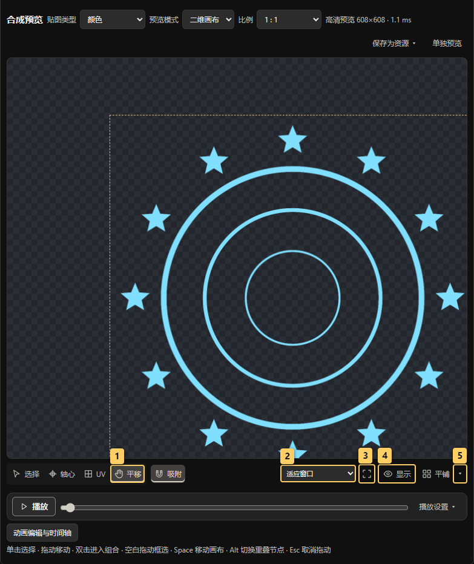

> 图中标记：1 切换平移视图，缩小或适应窗口时也可拖动；2 只调整观看缩放；3 适应窗口并重新居中；4 设置背景、轴心和节点区域；5 选择平铺检查数量。

快捷键：Ctrl/Cmd+D 复制、Delete 删除、Ctrl+Z 撤销、Ctrl+Shift+Z 重做。导出始终使用整张画布的设置边界。

## 6. 在背景上检查特效混合

> 图中标记：1 切换特效预览；2 切换深浅背景；3 对比透明与相加混合；4 播放或定位动画。

1. 画布上方 **预览模式 → 特效预览**；通常把“贴图类型”选为颜色。
2. **背景**可选深色、浅色、深浅对照或自定义颜色。深浅对照会显示两行，方便检查暗边和透明边缘。
3. **混合**可单独查看透明、相加，或并排对比。透明混合保留遮挡，相加将贴图颜色乘透明度后与背景叠亮。
4. 用原来的 **播放、重新播放、进度滑条和时间轴** 检查运动及消散；每格使用同一帧贴图，参数编辑也会同步更新。
5. **显示大小**调整画面中的占比，**预览亮度**模拟0～3倍颜色倍率；“复位特效预览”恢复默认深色并排对照。

背景、显示大小、混合和预览亮度仅用于观看，不写入项目、不改变节点混合方式、透明度或导出背景，也不进入PNG和序列帧。要修改最终贴图，仍在参数面板和导出设置中操作。这里用于检查屏幕中的混合观感；实际项目的HDR、色彩空间与材质着色需在引擎内确认。

特效预览期间画布变换和UV拖动暂停，右侧参数仍可编辑。切回 **二维画布** 可继续拖动画布图形；**三维材质**用于检查贴到模型后的受光。

## 通道曲线

选中一个图形或组合，进入 **图形 → 通道曲线**。继承配色的节点也能使用；组合先合成内部内容，再应用曲线。

- 通道可选 **明暗 / 高度、整体 RGB、红 R、绿 G、蓝 B、透明度 Alpha**。明暗调整亮度和高度；RGB 只改颜色，Alpha 改覆盖度并同步缩放高度的透明度贡献。
- 点击图表增加控制点，拖动或使用方向键调整；也可输入0～255的输入/输出值。首尾点固定在输入0和255，输出值可改；内部点可删除，最多16点。控制点之间使用平滑、连续的三次插值，曲线穿过控制点并避免过冲；界面、预览和导出使用相同形状。只有两个点时仍是直线。
- 调整控制点或选择预设会自动启用曲线；可临时取消启用、重置当前通道或重置全部。支持撤销/重做、项目保存、资源保存和导出。
- 曲线在基础亮度/色阶之后、轮廓与后处理之前应用。RGB 顺序为明暗、整体 RGB、单色通道；Alpha 最后调整。没有修改的通道保持原数值，避免仅调整 Alpha 时截断 HDR 颜色。
- 曲线形状暂不支持关键帧或多选批改；多选时进入主选节点编辑。这里处理像素数值，不是动画时间轴中的参数曲线。

需要让烟雾更透、遮罩边缘更柔时，先调整 Alpha；希望保留透明度只改变明暗层次时，使用 RGB。Alpha 曲线把输入0映射为非零时，会让原本透明的节点区域也产生覆盖。
