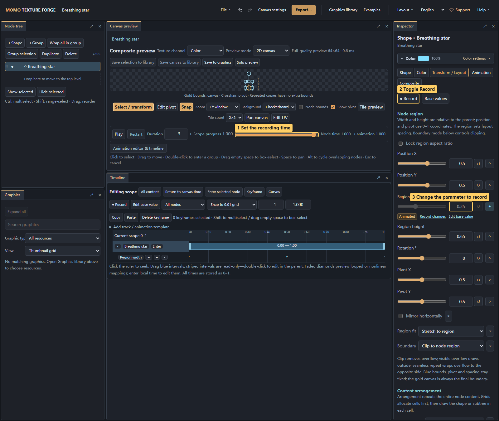
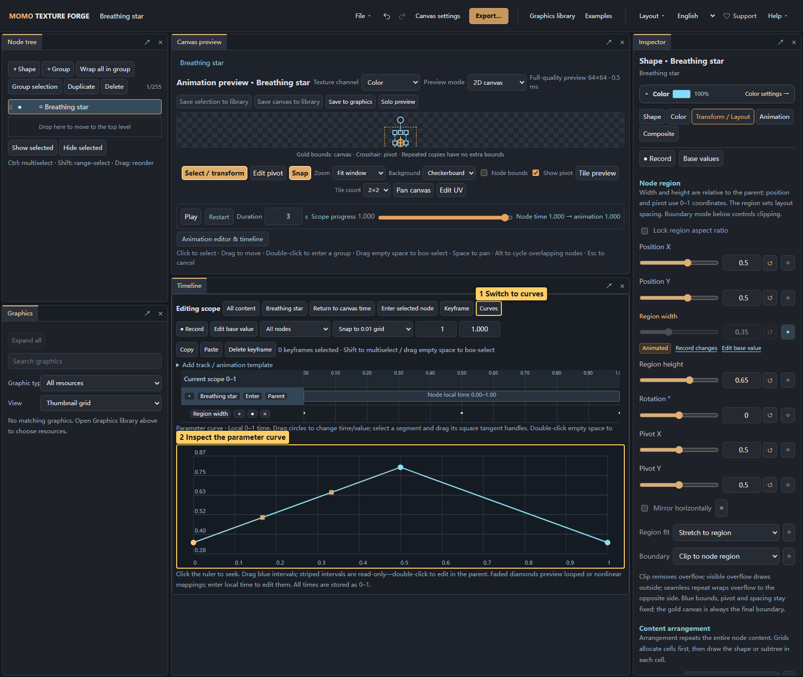
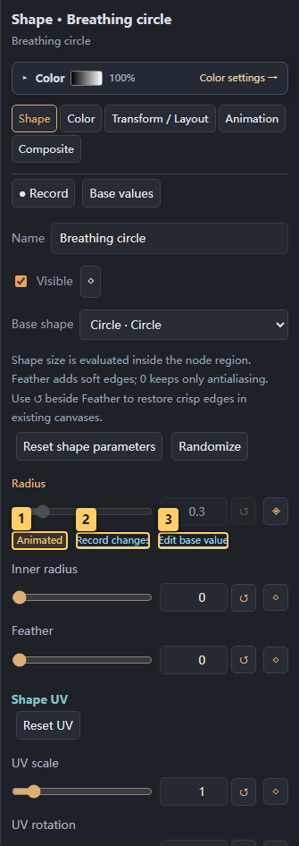

# 06 · Animation and timeline

<!-- doc-language -->
[简体中文](06-animation.md) · [English](06-animation.en.md)
<!-- /doc-language -->

[Manual contents](README.en.md) · Previous: [Canvas and compositing](05-canvas-and-compositing.en.md) · Next: [Normals and 3D](07-normal-and-material.en.md)

Download the [breathing-star starting project](examples/animation-star.json), open it with **File → Open project**, then follow this chapter. It starts without keyframes.

## 1. Record a width animation

> Callouts: 1 Set the recording time; 2 Toggle Record; 3 Change the parameter to record.

1. Select the breathing-star node and open **Transform / Layout**.
2. Open **Animation editor & timeline** below the preview. Check that the scope is the canvas or intended node. **Layout → Animation layout** also opens it.
3. Move progress to `0`, enable **● Record**, and set region width to `0.35`.
4. Move to `0.5` and set the same parameter to `0.8`.
5. Move to `1` and return it to `0.35`.
6. Disable recording and play. A duration of 3 seconds makes the width change easy to inspect.

The screenshot changes only width, stretching the star horizontally. To scale proportionally, also record height or use the breathing-scale template. The first recorded change preserves the starting base state. You can also add keys explicitly with the button beside a parameter.

## 2. Edit keys and curves

> Callouts: 1 Switch to curves; 2 Inspect the parameter curve.

- Diamonds are keys. Select them to drag or edit time and value; use Shift or box selection for multiple keys.
- Timeline tools copy, paste and delete keys and adjust time snapping and zoom.
- **Curves** shows the rate of change. Choose linear, smooth, hold or custom tangents. Enums and switches change discretely.
- Track modes replace, add to or multiply the base value. Start with absolute/replace mode.
- **Base values / Edit base value** temporarily bypasses this node's parameter animation. Exiting restores animation; tracks remain in saved projects and exports.

When a width track exists, ordinary edits are controlled by animation. Use base-value mode for the underlying state, or Record/key editing for a particular time.

> Callouts: 1 Parameter is animation-controlled; 2 Record changes at the current time; 3 Edit the base value.

**Animation controlled** means the input and reset button are currently governed by a track. **Record changes** edits the current time; **Edit base value** edits the underlying state. The active mode is shown beside the parameter. Pausing the track or disabling this node's parameter animation restores normal editing.

“Currently inactive” describes a parameter dependency; its setting is retained. Increase smoke blending above zero before adjusting smoke, set nonzero UV speed before changing scroll direction, or enable a contour before editing its width. Dependency guidance updates with timeline evaluation.

## 3. Apply animation templates

Expand **Add track / Animation templates** and choose breathing scale, fade, full rotation, pop, horizontal entrance or UV scrolling. Applying a template replaces tracks for the same parameters and retains unrelated tracks. Save a project copy before replacing existing animation.

## 4. Intervals, loops and local time

The **Animation** inspector defines a node's start/end progress in its parent, one-shot/loop/ping-pong playback, repetitions and hold/hide behavior outside its interval.

Double-click a node interval or choose **Enter selected node** to edit local time. **Return to canvas time** restores the full scope. Parent loops and nonlinear mappings may display read-only projections; repeated preview diamonds are not independent keys.

Per-instance animation phase offsets stagger repeated instances, useful for pulses or sequential flower appearances.

## 5. Generator time differs from keyframe time

| Time | Controls |
| --- | --- |
| Node-local progress from 0 to 1 | Parameter keys, intervals, looping and curves |
| `time` in seconds | Built-in formula/generator motion |

Graphics with built-in motion can expose autoplay, speed and offset. Disabling autoplay allows a fixed shape time. Stopping one time mechanism does not necessarily stop the other.

Loop playback does not guarantee matching endpoints. For seamless sequences, check keys, built-in seconds, UV scrolling and instance phase together. Export frame count depends on FPS and duration; see [Export](08-export.en.md).
