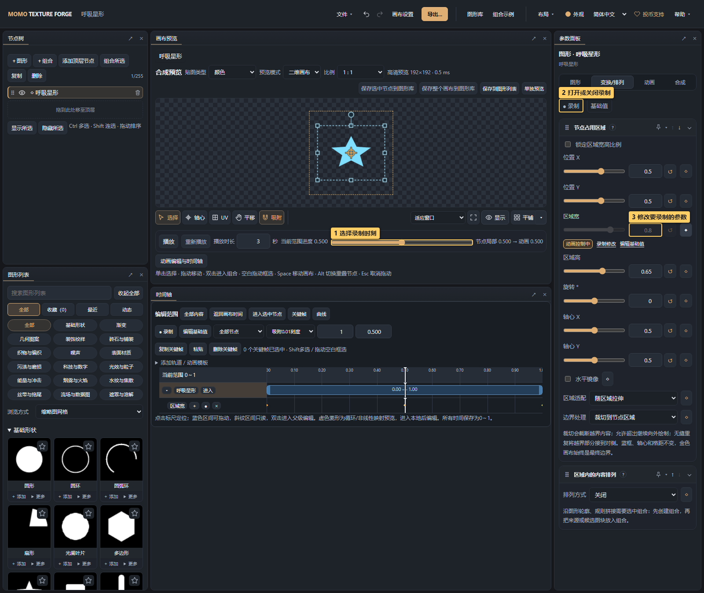
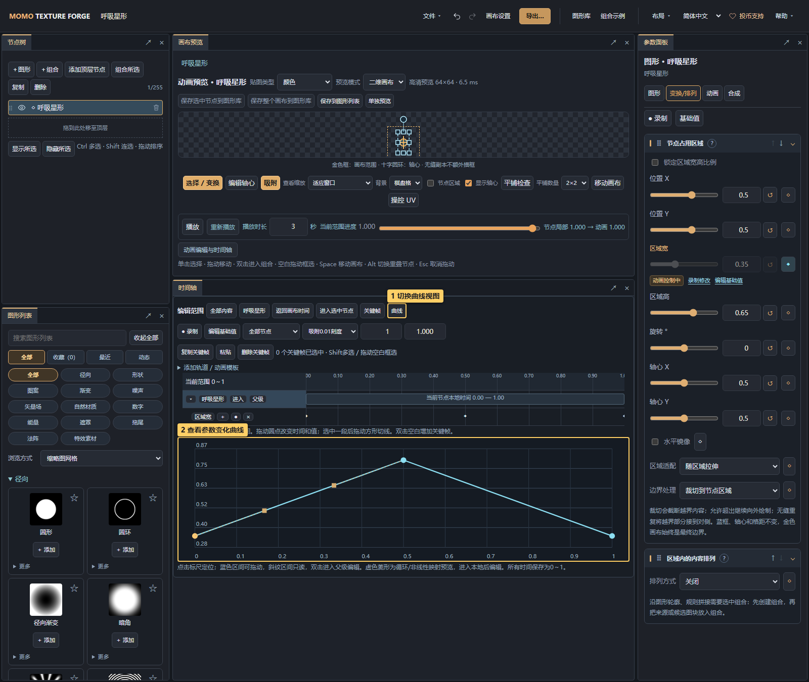
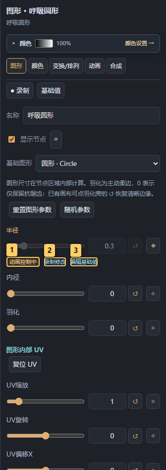

# 06 · 动画与时间轴

[手册目录](README.md) · 上一篇：[画布与合成](05-canvas-and-compositing.md) · 下一篇：[法线与三维](07-normal-and-material.md)

下载[呼吸星形起点](examples/animation-star.json)，通过“文件 → 打开项目”打开，再跟随本章录制。该文件初始没有关键帧。

## 1. 录制一个宽度变化动画

> 图中标记：1 选择录制时刻；2 打开或关闭录制；3 修改要录制的参数。

1. 在节点树选“呼吸星形”，右侧切 **变换/排列**。
2. 点预览下方 **动画编辑与时间轴** 打开时间轴面板，确认编辑范围为画布或当前目标节点；也可从顶部 **布局 → 动画布局** 打开。
3. 将进度移到 `0`，点 **● 录制**，把“区域宽”改为 `0.35`。
4. 将进度移到 `0.5`，把同一参数改为 `0.8`。
5. 将进度移到 `1`，改回 `0.35`。
6. 关闭录制，再播放检查；播放时长设为 3 秒即可看到宽度变化。

截图演示只改宽度，星形会横向伸缩。若希望等比呼吸，可同时记录区域高，或应用“呼吸缩放”模板。录制第一次修改会保留起点基础状态，参数旁的关键帧按钮也可显式添加。

## 2. 编辑关键帧与曲线

> 图中标记：1 切换曲线视图；2 查看参数变化曲线。

- 时间轴的菱形表示关键帧，选中后可拖动、修改时间与数值；Shift 多选或框选。
- 工具区可复制、粘贴、删除关键帧，调整时间吸附和缩放。
- 切 **曲线**查看变化速度，选择线性、平滑、保持或自定义切线；枚举与开关按离散值变化。
- 轨道作用可选绝对值、加到基础值、乘以基础值，初学先用绝对值。
- **基础值/编辑基础值**暂时旁路本节点参数动画；退出后恢复动画。保存和导出仍包含轨道。

同一节点的“区域宽”已经有动画时，普通编辑模式下会受动画控制。要改基础状态请用基础值模式，要改某个时刻请开录制或编辑关键帧。

> 图中标记：1 参数当前由动画控制；2 修改当前时刻的关键帧；3 编辑基础值。

参数旁的 **动画控制中** 表示输入框和复位按钮暂由轨道控制，点同一行的 **录制修改** 可直接改当前时刻，点 **编辑基础值** 可改基础状态。对应模式会显示“录制中”或“编辑基础值”；暂停轨道或关闭本节点参数动画后恢复普通编辑。

“当前不生效”是参数依赖提示，设置仍会保留。例如烟气混合为0时先提高混合量，UV滚动方向需要非零滚动速度，轮廓宽度需要先启用轮廓方式。提示会随当前时间轴求值更新。

## 3. 应用动画模板

展开 **添加轨道 / 动画模板**，选呼吸缩放、淡入淡出、旋转一周、弹出、横向进入或 UV 滚动，再应用。模板会替换同名参数轨道，其他轨道保留。已有动画时先保存项目副本。

## 4. 区间、循环和局部时间

右侧 **动画**决定节点在父级的开始/结束进度、播放一次/循环/往返、重复次数以及区间外保持或隐藏。

双击节点区间或点“进入选中节点”可编辑局部时间，用“返回画布时间”回整体。父级循环、非线性映射可能显示只读投影，不要把重复预览中的菱形当作独立关键帧。

排列页的“每份动画相位偏移”让重复实例错开节奏，适合连续脉冲或花朵依次出现。

## 5. 生成器的时间与关键帧不同

| 时间 | 控制什么 |
| --- | --- |
| 节点局部 0～1 进度 | 参数关键帧、区间、循环与曲线 |
| `time` 秒数 | 公式/生成器的内置运动 |

支持内置动画的图形可设置自动播放、运动速度、时间偏移；关闭自动播放后可设置图形时间定格。停止其中一种不一定停止另一种。

循环播放不保证运动首尾衔接。做无缝序列要同时检查起止造型、内置秒数运动、UV 滚动及实例相位。导出时 FPS 和秒数决定帧数，见[导出教程](08-export.md)。
