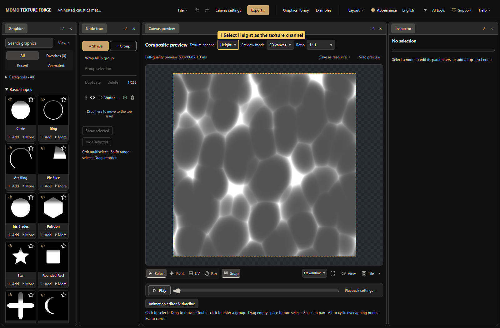
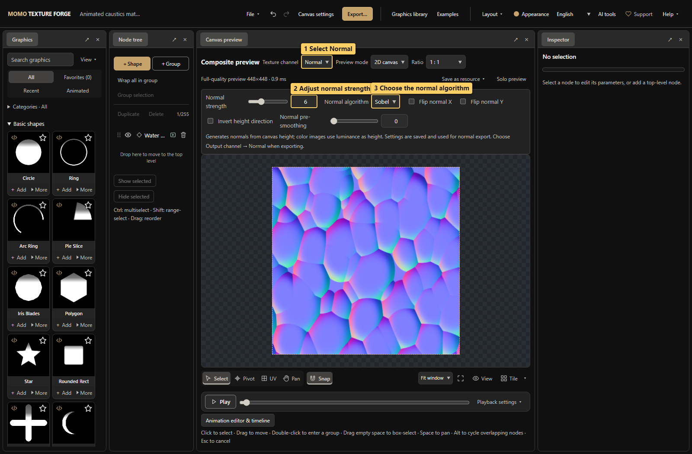

# 07 · Normals and 3D preview

<!-- doc-language -->
[简体中文](07-normal-and-material.md) · [English](07-normal-and-material.en.md)
<!-- /doc-language -->

[Manual contents](README.en.md) · Previous: [Animation](06-animation.en.md) · Next: [Export](08-export.en.md)

Open the [animated-caustics material example](examples/water-caustics.json) to reproduce the screenshots, or add your own image to the canvas.

## 1. Color, height and normals

| Texture | Meaning | Use |
| --- | --- | --- |
| Color | Surface color and alpha | Ordinary textures, decoration and effects |
| Height | Brightness represents relative elevation | Inspect height input and generate normals |
| Normal | Blue/purple RGB encodes surface direction | Simulate relief under material lighting |
| Custom RGBA | Pack height, normals and other data by channel | Match a consuming material's inputs |

## 2. Inspect height on the canvas

> Callouts: 1 Select Height as the texture channel.

Choose **Texture channel → Height** for grayscale. Color images use luminance multiplied by alpha, so brightness variations inside an opaque image contribute to normal generation. Formulas and generators contribute their scalar/height output.

This infers relief from brightness; it cannot accurately reconstruct real geometry from a photograph. Shadows, highlights and paint can all be interpreted as height. Start with a clear height map when you need predictable results.

## 3. Generate normals and adjust settings

> Callouts: 1 Select Normal; 2 Adjust normal strength; 3 Choose the normal algorithm.

1. **Texture channel → Normal** displays the generated normal texture.
2. **Normal strength** controls slope. Zero produces a flat normal; increase gradually from the default.
3. Choose **Sobel** or **Scharr** and compare edge detail.
4. **Flip X/Y** reverses the corresponding normal components to match the consuming application.
5. **Invert height** swaps raised and recessed areas. **Normal pre-smoothing** reduces noise and sharp detail.

Generation settings are saved in the project, support undo, and affect exported Normal or normal channels in Custom RGBA. They change generated data, unlike preview lighting controls.

Strength and pre-smoothing are normalized to a canvas short side of 512 pixels. Interactive sampling, full-quality rendering after release and exports at different sizes share the same strength scale. Sampling size can still change detail clarity.

## 4. Inspect lighting on a 3D material

> Callouts: 1 Switch to 3D material; 2 Choose a sphere or plane; 3 Drag to inspect lighting.

Select **Preview mode → 3D material** in the same preview area:

- Choose sphere, plane or cube and drag to rotate the view.
- Normal mode uses a neutral material to show relief lighting; Color shows a flat surface pattern, and Height shows grayscale.
- Light direction, main light intensity and ambient light intensity control preview lighting. The main light controls direct diffuse lighting and highlights; ambient light provides uniform fill so shaded surfaces remain visible. Both can be set to 0; their defaults are 1 and 0.18, respectively.
- Roughness, metalness, texture repeat and reset view aid inspection. Ambient light is simplified fill lighting without HDR environment reflections.
- Return to 2D canvas for selection, movement and UV editing.

This is a material preview, not a modeling or extrusion tool. Models and lights are not exported. Use Color when you want a graphic printed flat on the model without relief.

For fire, smoke or slash trails over backgrounds, choose **Effect preview** instead. See [alpha versus additive blending](05-canvas-and-compositing.en.md#6-inspect-effect-blending-on-backgrounds).

## 5. Confirm the export channel separately

Choose **Export… → Output content → Normal**. Changing the preview channel does not automatically change export settings, preventing an inspection step from changing delivery output.

The export is still a flat normal-map image. In your engine, import it as a normal map and connect it to a material that supports normals. The consuming application determines the direction convention.
