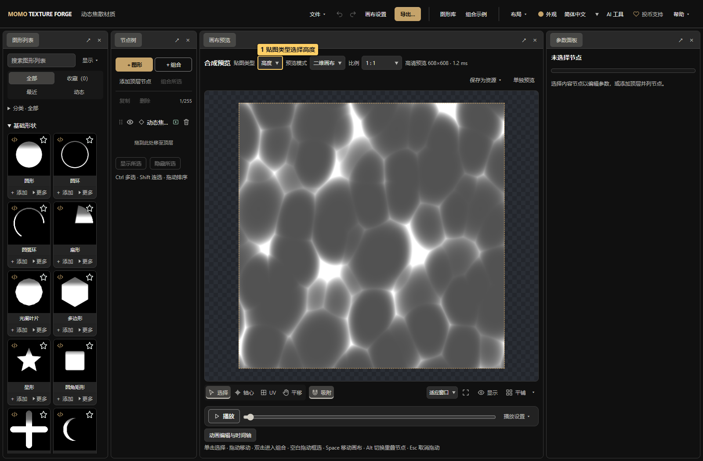
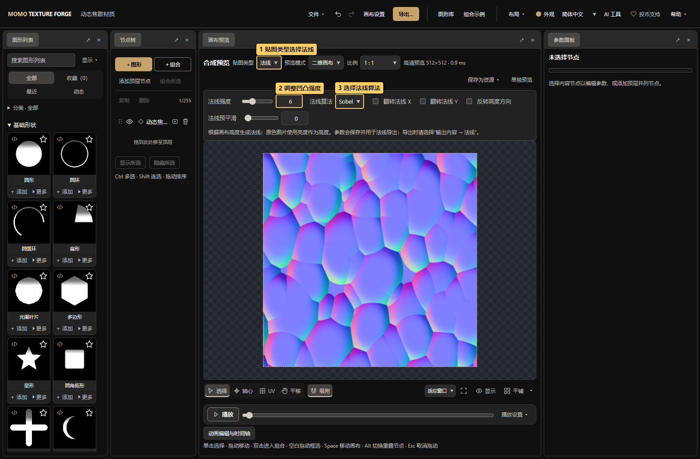

# 07 · 法线与三维预览

<!-- doc-language -->
[简体中文](07-normal-and-material.md) · [English](07-normal-and-material.en.md)
<!-- /doc-language -->

[手册目录](README.md) · 上一篇：[动画](06-animation.md) · 下一篇：[导出](08-export.md)

打开[动态焦散材质示例](examples/water-caustics.json)可复现截图；也可以将自己的图片添加到画布。

## 1. 区分颜色、高度与法线

| 贴图 | 表示什么 | 用途 |
| --- | --- | --- |
| 颜色 | 表面花纹的颜色与透明度 | 普通贴图、装饰、特效颜色 |
| 高度 | 明暗表示相对高低 | 检查凹凸来源、生成法线 |
| 法线 | 蓝紫色 RGB 编码表面方向 | 让材质受光呈现凹凸 |
| 自定义 RGBA | 按通道组合高度、法线等数据 | 适配使用端的材质输入 |

## 2. 在画布查看高度

> 图中标记：1 贴图类型选择高度。

画布顶部 **贴图类型 → 高度** 显示灰度。原色图片使用亮度乘透明度作为高度，因此不透明图片内部的明暗也能参与法线生成；公式和生成器按各自的标量/高度输出参与合成。

这是一种从明暗推导凹凸的方法，不能从照片准确恢复真实三维结构。阴影、反光和涂色都可能被解释为高度；想要可控结果，优先准备清晰的高度图。

## 3. 生成法线并调整参数

> 图中标记：1 贴图类型选择法线；2 调整凹凸强度；3 选择法线算法。

1. **贴图类型 → 法线**，显示实际生成的蓝紫色法线图。
2. **法线强度**控制坡度，0 生成平坦法线；先从默认值小幅增加。
3. **法线算法**选择 Sobel 或 Scharr，观察边缘细节。
4. **翻转 X/Y**改变对应法线分量方向，用来匹配使用端的方向约定。
5. **反转高度方向**交换凹凸，**法线预平滑**减轻输入噪点与尖锐细节。

生成参数会保存到项目，并用于法线或自定义 RGBA 中的法线通道导出，可撤销。不要把它们当成只改变观看效果的灯光参数。

强度与预平滑以画布短边 512 像素为基准计算。拖动时的快速采样、松开后的高清采样与不同尺寸导出使用同一强度尺度；细节清晰度仍会随采样尺寸变化。

## 4. 用三维材质检查受光

> 图中标记：1 切换三维材质；2 选择球体或平面；3 拖动旋转检查受光。

在同一位置切 **预览模式 → 三维材质**：

- 选球体、平面或立方体，拖动旋转视角。
- 法线模式用中性材质显示凹凸受光；颜色模式显示平贴花纹，高度模式显示灰度。
- 灯光方向、主光强度与环境光强度用于检查受光。主光强度同时控制直射漫反射和高光；环境光提供均匀补光，便于辨认背光面。两者均可设为 0，默认分别为 1 和 0.18。
- 粗糙度、金属度、纹理重复与复位视角用于观察。环境光是简化补光，不包含 HDR 环境反射。
- 切回二维画布可继续画布选择、移动与 UV 操作。

这不是建模或几何挤出工具，模型和灯光不会被导出。普通图案只想平贴在模型上时选颜色，不必给它生成凹凸。

火焰、烟雾、刀光等需要检查背景叠加时，可在同一菜单选 **特效预览**，详见[透明与相加对照](05-canvas-and-compositing.md#6-在背景上检查特效混合)。

## 5. 导出时再次确认贴图类型

**导出… → 输出内容 → 法线**。画布预览切换不会自动改变导出类型，防止只是查看法线时误导出。

导出的仍是平面法线图片。放入游戏引擎后，按引擎要求导入为法线贴图并接到支持法线的材质输入；具体方向约定由使用端决定。
