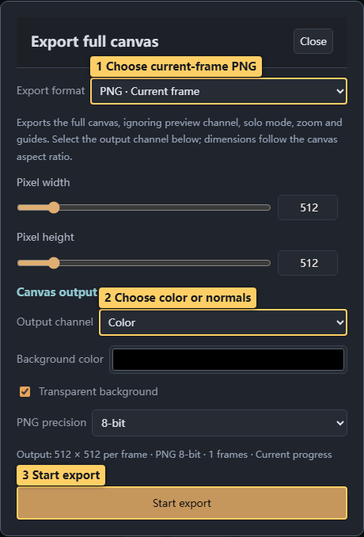
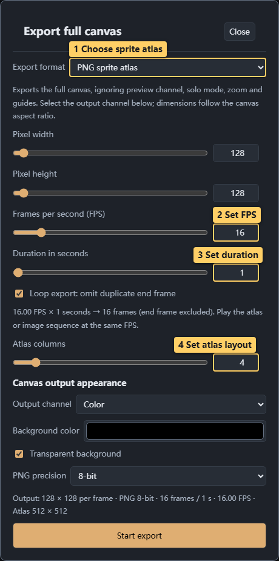
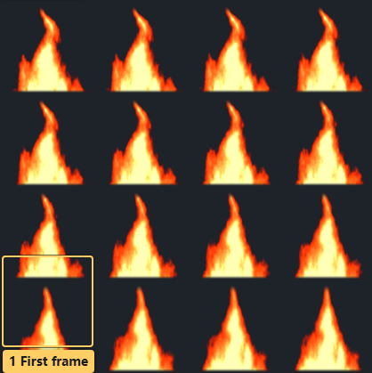
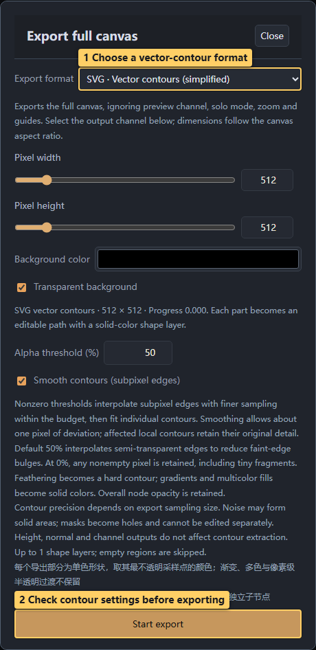

# 08 · Export and delivery

<!-- doc-language -->
[简体中文](08-export.md) · [English](08-export.en.md)
<!-- /doc-language -->

[Manual contents](README.en.md) · Previous: [Normals and 3D](07-normal-and-material.en.md) · Next: [Remote libraries](09-remote-libraries.en.md)

## 1. Export one PNG

> Callouts: 1 Choose current-frame PNG; 2 Choose color or normals; 3 Start export.

1. Open **Export…** and select **PNG · Current frame**.
2. Set pixel dimensions, which follow canvas aspect ratio. Change the ratio in **Canvas settings**.
3. Choose Color, Height, Normal or Custom RGBA under **Output content**.
4. Choose Transparent or Solid color in View → Canvas background below the preview, then select PNG 8/16-bit.
5. Check the dimension summary, choose **Start export**, and wait for the download.

Copy PNG8 always uses 8-bit output; download instead if the browser rejects clipboard access. 16-bit and EXR output require floating-point rendering support.

Export uses the entire canvas and ignores solo preview, viewing zoom, guides and the preview channel. Checkerboards, 3D models and lights are not included.

## 2. Export animated sequences

> Callouts: 1 Choose sprite atlas; 2 Set FPS; 3 Set duration; 4 Set atlas layout.

Open the [flame-sequence example](examples/fire-sequence.json):

1. Play to inspect motion, then open Export.
2. Choose **Frame PNG ZIP** for separate files or **Sprite atlas PNG** for frames arranged on one image.
3. Use `128 × 128` per frame, `16 FPS`, a `1 second` animation cycle, a `1 second` export duration, and `4 columns` for this exercise.
4. Enabling **Omit export endpoint frame** gives 16 frames: 4 columns × 4 rows in a `512 × 512` atlas.
5. Keep the delivery type selected and choose **Animation preview → Generate preview**. Inspect playback, scrub frames or expand **All frames**, then choose **Start export**.

> Callouts: 1 First frame; 2 Last frame.

Omitting the endpoint avoids duplicate sampling; it does not repair a discontinuous animation. Use the same FPS and grid dimensions in your engine. Use GIF export below for directly playable sharing; video export is not supported.

### Export a GIF animation directly

1. Choose **Export… → Export format → GIF animation**, set frame dimensions, FPS, animation cycle and export duration, and check the GIF summary for actual frame count and playback duration.
2. Defaults are 256 colors and a shared palette. Shared palettes sample up to 12 evenly spaced frames to reduce color flicker; choose **Per-frame palette** for rich color changes or missed brief colors. Select 16/32/64/128/256 colors; ordered dithering can improve gradients.
3. **Repeat GIF playback** controls repeating versus playing once. **Omit export endpoint frame** separately controls endpoint sampling. Including the endpoint adds a frame interval; the summary shows the actual playback duration.
4. GIF supports binary transparency. Alpha threshold is 0–255: pixels below the threshold become transparent, and fully transparent pixels always remain transparent. Choose Solid color canvas background below the preview to composite soft glow or semitransparent edges onto the background color. Use PNG/EXR for continuous alpha or precise channel data.
5. Choose **Start export**, wait for palette sampling, frame rendering and background encoding, and download `.gif`. Export can be canceled without changing the canvas or current animation progress. GIF settings persist with projects.

GIF export caps FPS at 50 without changing other formats' FPS settings; frame delays use 10 ms steps with cumulative rounding to reduce timing drift. The selected Color/Height/Normal/Custom RGBA output includes node animation, groups and post-processing. Preview zoom, solo and guides are excluded. GIF palette/alpha quantization loses precision; Custom RGBA is suitable only for visual previews.

### Animation cycle versus export duration

**Animation cycle (seconds, 0→1)** sets the speed of one keyframe cycle and is shared with the playback bar and canvas settings. **Export duration (seconds)** independently sets how long to record. A 2-second cycle exported for 6 seconds at 30 FPS with the endpoint omitted produces 180 frames spanning three progress cycles; a 1-second export samples half that cycle. Changing the cycle does not change export duration, and changing export duration does not change preview speed. GIF, PNG sequences, PNG/EXR atlases, atlas previews and three-size atlases share this rule.

Keyframe progress wraps each cycle while formula/generator seconds keep advancing. Omitting the endpoint removes only the final export sample, retaining intermediate cycle starts. Including it samples progress 1 at an exact cycle boundary, or the corresponding progress for a partial cycle. Multiple exported cycles or GIF repeat playback do not guarantee seamless motion. Old projects initialize both durations from their original duration; subsequent edits are independent.

GIF, PNG sequences, PNG/EXR atlases and three-size atlases each include an **Animation preview** module within their existing export panel. Keep the format selected and choose **Generate preview**. Sequences/atlases provide playback, pause, frame scrubbing and **All frames**; GIF displays an actual animation encoded with the current palette, dithering, alpha threshold and repeat settings, with replay available. Parameter or format changes retain the old result with an explicit stale notice; choose **Update preview**. Export always reads current settings. Three-size atlases offer 64/128/256 preview tiers. Preview frames use up to 128 pixels on the longest side, reduced further when needed. Sequences/atlases display in 8-bit; GIF uses current encoding settings. Delivery dimensions and precision stay unchanged.

## 3. Choose PSD, SVG or EXR

| Format | Use | Distinction |
| --- | --- | --- |
| PSD · Current-frame layers | Continue editing in an image application | Preserves hierarchy where possible; complex compositing is rasterized |
| SVG / PSD vector contours | Paths, holes and single-color shapes | Extracted from sampled alpha; gradients, feathering and semitransparency are simplified |
| EXR / Atlas EXR | High-precision data | Half data with optional lossless ZIP compression; requires float support |
| Three-size / Three-atlas ZIP | Deliver several standard sizes together | Uses the panel's predefined size tiers, not arbitrary batch processing |

> Callouts: 1 Choose a vector-contour format; 2 Check contour settings before exporting.

The default threshold is 50%; smoothing reduces stepped edges. A 0% threshold includes faint transparent edges. This is alpha-contour extraction, not semantic vector reconstruction of arbitrary textures. Inspect complex noise or soft glows carefully. Height and normal output do not determine vector contours.

## 4. When a budget limit appears

- A single image is limited to 4096 pixels per side. Check the actual aspect-linked dimensions.
- Atlases allow up to 8192 per side and 16,777,216 total pixels. Sequences and GIF allow up to 10,000 frames and 33,554,432 sampled pixels overall.
- These limits cannot all be reached simultaneously. Maximum frame dimensions usually cannot accompany maximum frame count; devices may have lower limits.
- Single PNG export composes on demand to reduce intermediate-texture memory. Complex canvases can be slower; arbitrary workloads are not guaranteed to complete.
- Use Cancel in the progress UI when needed. Read the specific error before reducing dimensions, frames or complexity.

## 5. Check before delivery

Open downloads in the target application and confirm dimensions, alpha, frame count, direction and color/normal channels. Save a project ZIP separately for later editing.

## 6. Pack nodes into RGBA

Preview with **Texture channel → Custom RGBA** above the canvas. For delivery, choose **Export… → Output channel → Custom RGBA channels**. Preview and export modes remain independent; both use the same four source settings saved in the project.

For each channel choose:

1. **Source**: a canvas channel, the whole canvas, or any ordinary graphic/group in the current node tree.
2. **Sample**: node luminance, red, green, blue, alpha or height. Canvas channels retain height, inverse height, normal components, opacity, slope and constants 0/0.5/1.

For example, put dissolve-noise luminance in R, a main shape's Alpha in G, an edge-glow group's luminance in B, and constant 1 in A. A single PNG/EXR then carries three masks for separate material inputs.

Sources render independently in full canvas coordinates, retaining ancestor transforms, arrangements, clocks, opacity, palettes, masks and filters. Siblings do not occlude the source. The source/ancestor path blends normally; the selected group's internal blend modes remain intact. Random-child, contour and rule layouts still compute placements using all original candidates. Ancestor effects apply to the isolated composite, rather than recovering a source's contribution from the final image.

Samples labeled “× Alpha” include alpha over transparent black. Color R/G/B preserve straight color without alpha multiplication. Choose Alpha for coverage only. Hidden or deleted sources output 0; missing sources are labeled, and undoing deletion restores the reference. Animation samples each frame's current state, shared by atlas and frame-sequence exports. References bind to node IDs, so renaming is safe; new projects need new source selections.

Different sources require additional compositing. Check complex, large outputs at a smaller size first. PNG16/EXR retain rendering precision; PNG8 quantizes. Packed A is data too: an ordinary image viewer may display packed pixels as transparent, which is expected.

- **Preserve color RGBA**: ordinary Color export already retains RGBA. Custom packing also offers **Use canvas RGBA**, setting R←Color R, G←Color G, B←Color B and A←Alpha. Each source remains editable. Canvas channels and isolated nodes both offer Color R/G/B without alpha multiplication, avoiding a second Alpha multiplication that would darken translucent edges.
- **Luminance / RGB × Alpha**: treat transparency as black, useful for masks. These are distinct from straight color components. Color luminance without alpha multiplication is also available. Preserved color means the current rendered color; hidden RGB in fully transparent original-file pixels cannot necessarily be recovered.
- Constants are explicitly labeled **Constant 0 (black), Constant 1 (white), and Constant 0.5 (middle gray)**. Each fills its entire destination channel with that value. For example, A=1 makes the packed image fully opaque.

RGBA packing does not bake the background. For an ordinary color image flattened onto the background, use Color output and Solid color canvas background.
