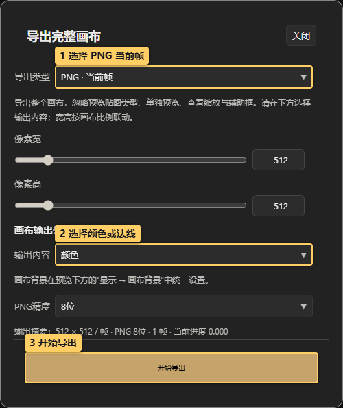
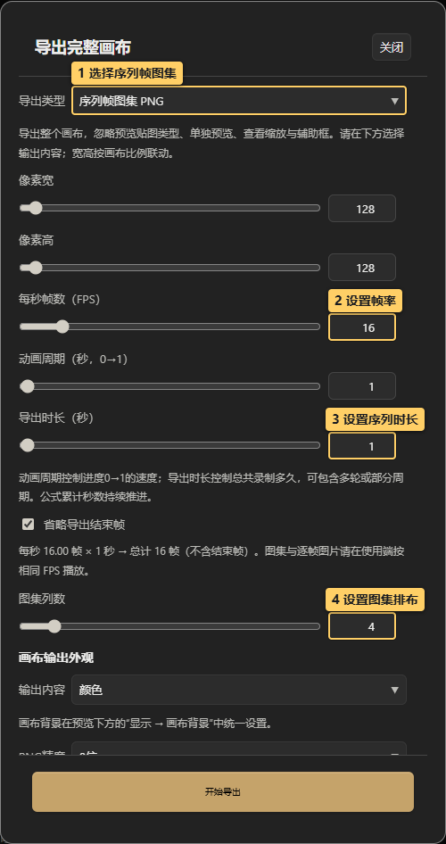
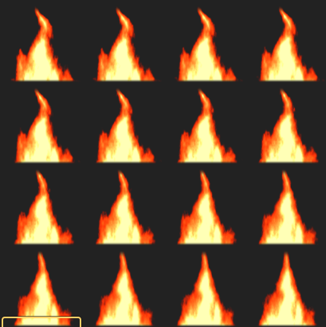
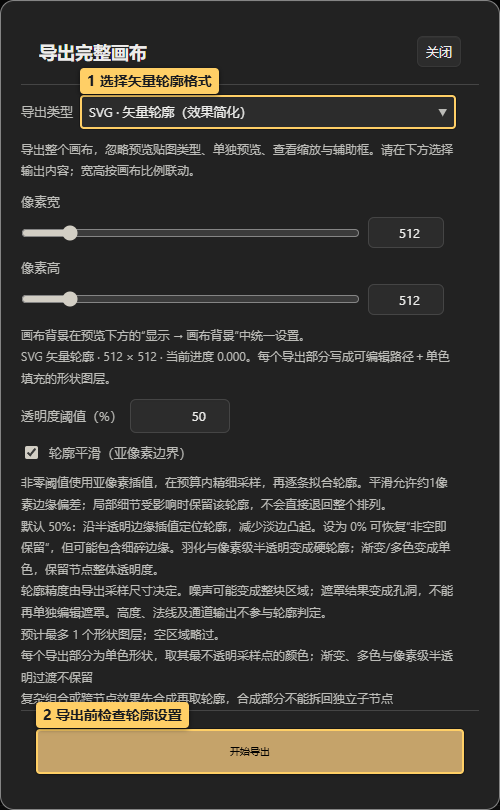

# 08 · 导出与交付

<!-- doc-language -->
[简体中文](08-export.md) · [English](08-export.en.md)
<!-- /doc-language -->

[手册目录](README.md) · 上一篇：[法线与三维](07-normal-and-material.md) · 下一篇：[远程图库](09-remote-libraries.md)

## 1. 导出单张 PNG

> 图中标记：1 选择 PNG 当前帧；2 选择颜色或法线；3 开始导出。

1. 点顶栏 **导出…**，导出类型选 **PNG · 当前帧**。
2. 设置像素宽/高，按画布比例联动。画布比例需回“画布设置”修改。
3. 在 **输出内容**中单独选择颜色、高度、法线或自定义 RGBA。
4. 在预览下方“显示 → 画布背景”统一选择透明或纯色，再选 PNG 8/16 位。
5. 查看尺寸摘要，点 **开始导出**，等待下载完成。

复制 PNG8 固定 8 位，浏览器拒绝复制时改用下载。16 位或 EXR 需要设备浮点渲染支持。

导出整个画布，忽略单独预览、查看缩放、辅助框及预览贴图类型；棋盘格不会被写进图片，三维模型/灯光也不会被导出。

## 2. 导出火焰等动态序列

> 图中标记：1 选择序列帧图集；2 设置帧率；3 设置序列时长；4 设置图集排布。

打开[火焰序列示例](examples/fire-sequence.json)：

1. 先播放检查时间演化，再打开导出面板。
2. 选择 **逐帧 PNG ZIP**，每一帧独立输出；或选 **序列帧图集 PNG**，把所有帧排列在一张图上。
3. 演示设置：单帧 `128 × 128`、`16 FPS`、动画周期 `1 秒`、导出时长 `1 秒`、`4 列`。
4. 勾“省略导出结束帧”时得到 16 帧；4 列 × 4 行形成 `512 × 512` 图集。
5. 保持所选导出类型，在 **动画预览** 模块点击 **生成预览**。检查播放、逐帧滑动或展开 **查看全部帧**，再点 **开始导出**。

> 图中标记：1 首帧；2 末帧。

“省略导出结束帧”避免重复采样结束状态，不修复本来不衔接的运动。游戏引擎应按相同 FPS 和列/行数播放。需要直接播放和分享时，使用下方的 GIF 导出；视频暂不支持。

### 直接导出 GIF 动画

1. 在 **导出… → 导出类型** 选择 **GIF 动画**，设置单帧尺寸、FPS、动画周期和导出时长，检查 GIF 摘要的实际帧数与播放时长。
2. 默认 256 色、共享调色板。共享调色板最多均匀采样 12 帧，减少颜色闪烁；颜色变化丰富或短暂变色没有保留时，切为 **逐帧调色板**。可选择 16/32/64/128/256 色，有序抖动有助于改善渐变。
3. **GIF 循环播放** 决定文件重复播放还是只播一次；**省略导出结束帧** 决定是否采样结束状态，两者独立。包括尾帧时，会额外停留一个帧间隔；摘要显示实际播放时长。
4. GIF 只有全透明或不透明。透明阈值为 0～255，低于阈值的像素透明，完全透明像素始终透明。要保留柔光或半透明边缘，请在预览下方将画布背景设为纯色，先合成到底色；需要连续 Alpha 或精确通道数据时仍使用 PNG/EXR。
5. 点击 **开始导出**，等待调色板采样、逐帧渲染与后台编码完成，下载 `.gif`。可取消，不改变画布或当前动画进度；GIF 设置随项目保存。

GIF 帧率最高按 50 FPS 导出，不修改其他格式的 FPS 配置；帧间隔按 10 毫秒分配以减少累计误差。使用输出内容中选择的颜色/高度/法线/自定义 RGBA，保留节点动画、组合与后处理；预览缩放、单独预览和辅助线不写入文件。GIF 的调色板和透明度会损失精度，自定义 RGBA 只适合预览展示。

### 动画周期与导出时长

**动画周期（秒，0→1）** 决定关键帧一轮的播放速度，与播放条和画布设置共用；**导出时长（秒）** 决定录制多久，独立保存。周期2秒、导出6秒、30 FPS且省略结束帧时，输出180帧，进度重复三轮；周期2秒、导出1秒只采样前半轮。修改周期不会改变导出时长，修改导出时长也不会改变预览速度。GIF、PNG序列、PNG/EXR图集、图集预览及三档图集使用同一规则。

每一帧的关键帧进度按周期回绕，公式/生成器的累计秒数持续推进，不在每轮归零。省略结束帧只去掉整个导出区间的最后一个采样点，不删掉中间周期的首帧；保留结束帧时，整周期结束采样进度1，部分周期结束采样对应进度。导出多个周期或勾选GIF循环播放都不保证视觉无缝。旧项目缺少独立导出时长时，用原时长初始化两个值；之后独立编辑。

GIF、PNG序列、PNG/EXR图集及三档图集都在当前导出面板内提供独立的“动画预览”模块，不需要切换格式。点击“生成预览”读取当前参数；序列/图集可播放、暂停、逐帧拖动并展开“查看全部帧”，GIF直接显示按当前调色板、抖动、透明阈值和循环设置编码的动画，可重新播放。修改参数或切换格式后，保留旧结果并明确提示待更新，点击“更新预览”刷新；导出始终读取当前参数。三档图集可选择预览64/128/256档。预览单帧最长边最多128像素，必要时继续缩小；序列/图集按8位显示，GIF保持当前编码设置，正式尺寸和精度不变。

## 3. PSD、SVG 和 EXR 怎么选

| 格式 | 使用场景 | 重要区别 |
| --- | --- | --- |
| PSD · 当前帧分层文件 | 继续在图像软件拆分编辑 | 尽可能保留层级，复杂合成会栅格化 |
| SVG / PSD 矢量轮廓 | 需要路径、孔洞、单色形状 | 依据采样透明度提取轮廓；渐变、羽化和半透明会简化 |
| EXR / 图集 EXR | 高精度数据交付 | Half 数据，可 ZIP 无损压缩，依赖浮点支持 |
| 三档尺寸 / 三档图集 ZIP | 一次交付多个常用尺寸 | 使用面板规定的尺寸档，不是任意批处理 |

> 图中标记：1 选择矢量轮廓格式；2 导出前检查轮廓设置。

轮廓默认阈值 50%，平滑可减少阶梯边缘；0% 会包含更细碎的透明边。它不是对任意纹理做语义矢量重建，复杂噪声和柔光需要检查结果。输出高度/法线不参与矢量轮廓判定。

## 4. 遇到预算提示时

- 单图像素宽高上限 4096，画布比例联动后还需看实际摘要。
- 图集边长最多 8192、总像素最多 16777216；序列和 GIF 最多 10000 帧，总采样像素预算 33554432。
- 上限不能随意叠加；最大单帧尺寸通常无法同时配最大帧数，设备可能有更低限制。
- 单张 PNG 使用按需合成以减少中间纹理占用，复杂画布可能更慢，仍不能保证任意规模都能完成。
- 需要取消时使用导出进度中的取消操作，失败后先读具体错误，再降低尺寸、帧数或复杂度。

## 5. 交付前检查

导出面板的标题、关闭和底部操作保持可见，长参数区在中间滚动。图片/动画格式输出已渲染像素；**Unity 实时 Shader ZIP** 和 **Unity 手绘后处理（ZIP）** 则交付代码、参数与依赖，能力范围见[Shader分类与Unity导出](14-shader-reference.md)。先查询支持，不支持的节点、样式或参数会阻止Shader导出；网页里能显示不等于已有Unity适配。项目ZIP仍用于保留可编辑作品。

用目标软件打开下载文件，确认尺寸、透明度、帧数、方向和颜色/法线通道。另存项目 ZIP，保留以后修改的源结构。

## 6. 按节点打包 RGBA

画布顶部 **贴图类型 → 自定义 RGBA** 可预览打包结果；正式交付时，在 **导出… → 输出内容 → 自定义 RGBA 通道** 选择同样模式。预览模式和导出模式仍独立，四个通道的来源配置共用并保存到项目。

每个通道分别选择：

1. **来源**：画布通道、整个画布，或当前节点树中的一个图形/组合。
2. **采样内容**：节点支持灰度、红、绿、蓝、透明度或高度；画布通道保留原有高度、反向高度、法线分量、透明度、坡度及0/0.5/1常量。

例如，把溶解噪声节点的灰度装进 R、主形状的 Alpha 装进 G、边缘光组合的灰度装进 B，A 选择常量1。三个遮罩就能随一张 PNG/EXR 交付，引擎材质分别读取 R/G/B。

节点按完整画布坐标单独渲染，保留祖先变换、排列、时间、透明度、配色、遮罩和滤镜。其他兄弟节点不参与遮挡；来源及祖先路径的混合按正常处理，所选组合内部仍保留原混合。随机子节点、轮廓和规则排列仍按完整候选计算，不会因为取一个通道而重新选择图块。祖先的整体效果会作用于单独合成的来源结果，并非从最终画面反推像素贡献。

标注“× Alpha”的 RGB/灰度以透明黑为底，包含透明度；颜色 R/G/B 保留原色，不乘透明度。需要纯覆盖度时选 Alpha。隐藏或已删除来源输出0，删除后面板提示来源缺失；撤销删除可恢复引用。动画按每帧当前状态采样，图集和逐帧导出共用同一逻辑。引用绑定节点ID，重命名不影响；新建项目需重新选择来源。

不同来源会增加合成工作量，大尺寸或复杂节点请先用小图确认结果。PNG16/EXR保留渲染精度；PNG8会量化。RGBA的A也属于打包数据，通道值可能让普通图片查看器把内容显示为透明，这是预期表现。

- **保留原色 RGBA**：正常导出选择“颜色”即可。自定义打包中也可点击 **使用画布 RGBA**，自动设置 R←颜色R、G←颜色G、B←颜色B、A←透明度；每个通道仍能继续修改来源。画布通道和单独节点都支持“颜色 R/G/B（不乘透明度）”，半透明边缘不会再次乘 Alpha 而变暗。
- **灰度 / RGB × Alpha**：把透明区视为黑，适合遮罩；与保留原色的颜色分量区分。颜色灰度（不乘透明度）也可单独选择。这里的原色指当前渲染后的颜色，不保证恢复原图文件中完全透明像素的隐藏 RGB。
- 常量明确显示为 **常量 0（黑）／常量 1（白）／常量 0.5（中灰）**，分别表示整个目标通道写入0、1或0.5。例如 A 写入常量1得到完全不透明的打包图。

RGBA打包不烘焙背景；若要背景合成后的普通彩色图片，使用“颜色”输出并在预览下方把画布背景设为纯色。
