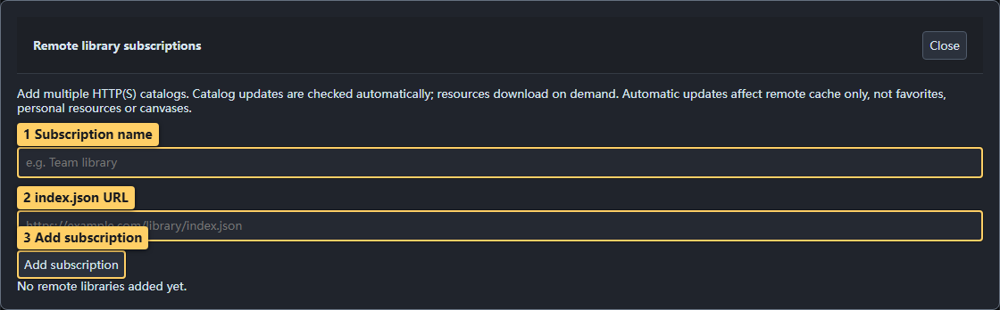
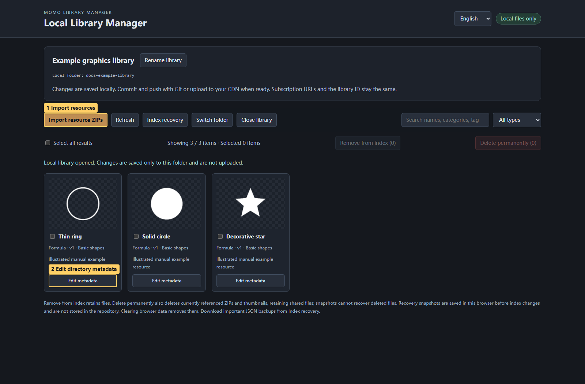
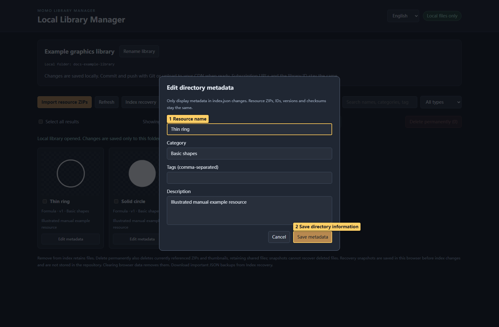

# 09 · Remote libraries and manager

<!-- doc-language -->
[简体中文](09-remote-libraries.md) · [English](09-remote-libraries.en.md)
<!-- /doc-language -->

[Manual contents](README.en.md) · Previous: [Export](08-export.en.md) · Next: [AI collaboration](10-ai-and-help.en.md)

## 1. Subscribe to a shared library



> Callouts: 1 Subscription name; 2 index.json URL; 3 Add subscription.

1. Open **Graphics library → Remote libraries** and enter a name and directory URL.
2. Refresh the directory to browse resources. The server must allow cross-origin access.
3. Download as needed, then add to the graphics list and canvas.
4. Downloaded resources work offline; refreshing or acquiring new resources needs a network connection.

Identical names can come from different subscriptions. Check source labels and versions before updating. “Downloaded” means a browser cache, not files copied into the manager's local folder.

## 2. Create your own static library

### 2.1 No build: copy an existing library and publish with GitHub Pages

**To avoid installing Node.js or running build commands, copy the [momo-texture-library repository](https://github.com/BreezyMomo/momo-texture-library).** It includes the gallery homepage, index, resource ZIPs, thumbnails and ready-to-open local manager.

**Step 1: copy it to your GitHub account.**

1. Sign in to GitHub, open the repository above and choose **Fork → Create a new fork**.
2. Choose your account and keep the name or use another, such as `my-texture-library`. The examples below use that name; substitute your own.
3. In your new repository, confirm that `index.html`, `index.json`, `library-manager.html`, `.nojekyll`, `resources/`, `thumbnails/` and `manager/` sit directly at its root, not inside an extra wrapper folder.

**Step 2: maintain resources with the included manager.**

1. Clone your repository. GitHub Desktop's **Clone repository** avoids the command line. Alternatively use **Code → Download ZIP** and extract the entire archive.
2. Open local `library-manager.html` in desktop Chrome/Edge. Choose **Select local library folder**, select the folder containing `index.json`, and grant read/write access.
3. Rename the library and remove unwanted examples from its directory as needed. In the editor, select your resources and **Export resources**. In the manager, import the resource ZIP, inspect and confirm it. See the maintenance section below.
4. Commit and push the local changes to **your repository's `main` branch**. In GitHub Desktop use **Commit to main → Push origin**. For a downloaded ZIP, use **Add file → Upload files** in your repository, preserving relative paths. Include new resource ZIPs and thumbnails, not just `index.json`.

The manager only changes your authorized local folder; **it does not upload to GitHub**. To test hosting first, keep the sample resources and continue to step 3.

**Step 3: enable GitHub Pages.**

1. Open **Settings → Pages** in **your library repository**.
2. Under **Build and deployment → Source**, choose **Deploy from a branch**.
3. Select branch `main` and folder **`/(root)`**, then **Save**. These files are already built. Retain `.nojekyll`; there is no need to build Momo Texture Forge.
4. Wait for deployment, then use **Visit site**. Check **Actions → pages build and deployment** if needed. A new fork needs its own Pages setup; the original repository's deployment settings are not inherited.

GitHub Free accounts can use a public repository for this workflow. See the [official publishing-source documentation](https://docs.github.com/en/pages/getting-started-with-github-pages/configuring-a-publishing-source-for-your-github-pages-site) for GitHub's UI and conditions.

**Step 4: subscribe to your URL in the editor.**

For username `your-name` and repository `my-texture-library`:

| Purpose | Example URL |
| --- | --- |
| Browse library | `https://your-name.github.io/my-texture-library/` |
| Subscribe in the editor | `https://your-name.github.io/my-texture-library/index.json` |
| Open manager online | `https://your-name.github.io/my-texture-library/manager/index.html` |

Substitute your real values and **use the address shown by Pages as the authority**. In **Graphics library → Remote libraries**, add the name and `index.json` URL, refresh and download one resource to verify. Do not use the GitHub repository page or `blob/main/index.json` page.

The online manager still selects a folder on your computer; it does not edit hosted files directly. After maintenance, commit/push to `main`, wait for Pages deployment and ask users to refresh the directory. For 404 errors, check deployment status, branch/root settings, repository name and path capitalization.

### 2.2 Generate with the CLI

Select resources in the editor and choose **Export resources** to get an official ZIP. Run at the repository root:

```sh
npm ci
node build-remote-library.mjs --input "library.zip" --out "remote-library" --name "My graphics library"
```

The initial build needs this repository and Node.js 22+. Using the generated manager or subscribing later does not require Node.js.

The current static-library CLI accepts base-ABI packs only. Packs containing generators report an incompatible resource-pack ABI. Import those official ZIPs directly into the editor instead of editing their manifests.

Output includes `index.json`, resources, thumbnails and `library-manager.html`. Reuse the output folder for updates to retain the library identity and existing entries.

## 3. Maintain the local library

Use the language selector at the top right of the library manager to choose English or Simplified Chinese. Switching changes interface text without rewriting library names, resource names or index data.



> Callouts: 1 Import resources; 2 Edit directory metadata.

Open `library-manager.html` in desktop Chrome/Edge, choose the entire local library folder and grant access.

- **Import resource ZIP:** preview before confirming; different content with the same ID/version cannot overwrite it.
- **Edit directory information:** changes names, categories, tags and descriptions without changing ZIPs, versions or hashes.
- **Remove from directory:** unlists an entry but keeps files for existing links.
- **Delete permanently:** removes the currently referenced pack and thumbnail while retaining shared files. Directory snapshots cannot recover deleted files.
- **Restore directory:** restore a browser snapshot or downloaded JSON backup. Snapshots stay in the current browser, not in the shared library folder.



> Callouts: 1 Resource name; 2 Save directory information.

The screenshots use a separate demonstration library. Names, categories, tags and descriptions are edited through its information dialog.

The manager edits authorized local files only. It does not replace Git/CDN publication or modify the editor's browser library.

## 4. Publish and update

1. Deploy the complete folder to an HTTPS static host or CDN.
2. Configure CORS for the index, ZIPs and thumbnails; public libraries may use `Access-Control-Allow-Origin: *`.
3. Share the `index.json` URL.
4. Upload resources and thumbnails before the new index. After local maintenance, commit/push or upload to the CDN yourself.

If the directory loads but downloads fail, check resource URLs, CORS and path case. See [Remote libraries and local manager](../REMOTE_LIBRARIES.en.md) for identities, versions, merged inputs, publishing order and recovery limits.
