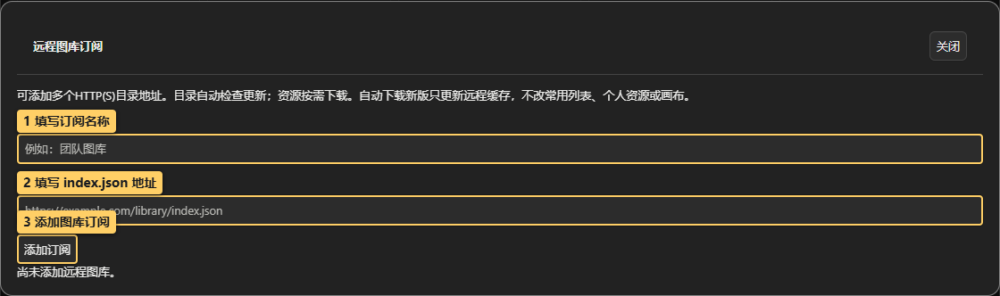
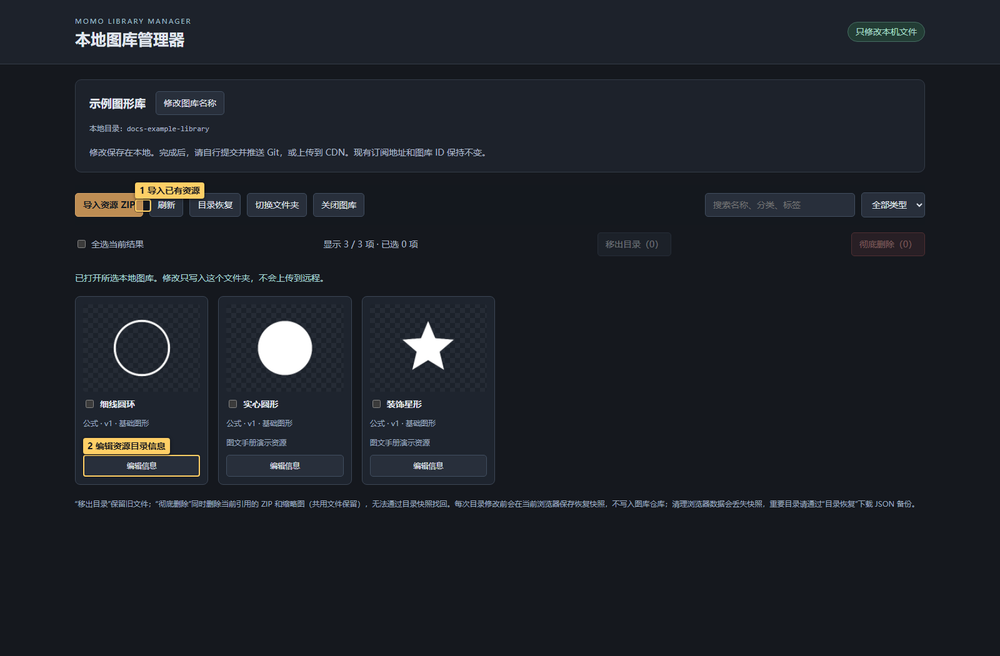
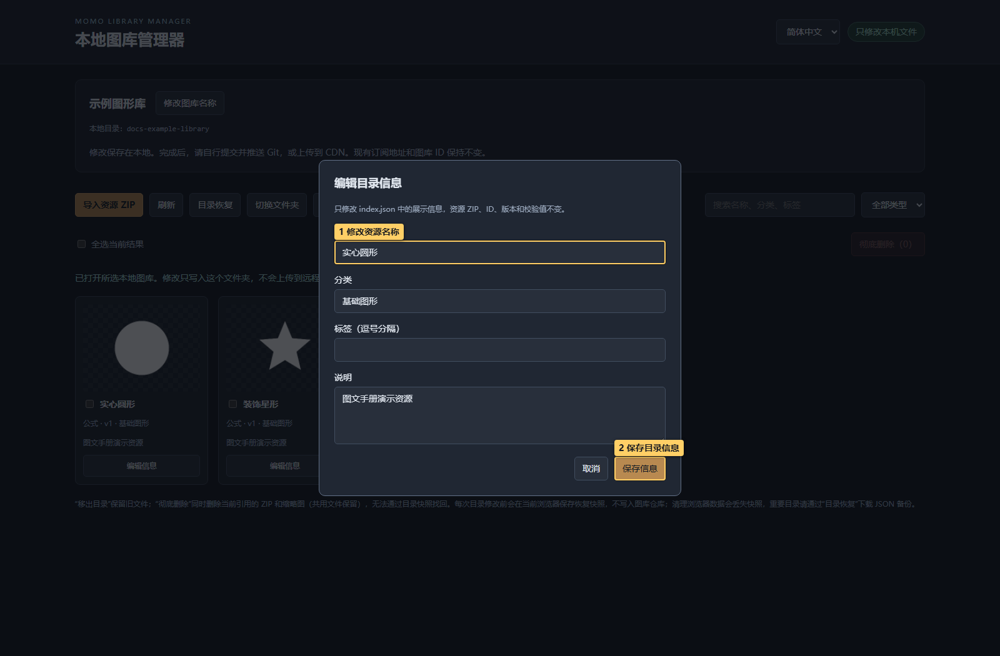

# 09 · 远程图库与管理器

<!-- doc-language -->
[简体中文](09-remote-libraries.md) · [English](09-remote-libraries.en.md)
<!-- /doc-language -->

[手册目录](README.md) · 上一篇：[导出](08-export.md) · 下一篇：[AI 协作](10-ai-and-help.md)

## 1. 订阅别人分享的图形库



> 图中标记：1 填写订阅名称；2 填写 index.json 地址；3 添加图库订阅。

1. **图形库 → 资源管理 → 远程图库**，填订阅名称和 `index.json` 目录地址。
2. 刷新目录，查看可用资源。远程服务必须允许跨域访问。
3. 按需下载，再添加到图形列表和画布。
4. 下载过的资源可离线使用；刷新和下载新资源需要网络。

同名资源可来自不同订阅，先看来源标签和版本再更新。“已下载”是浏览器中的缓存，不是把远程服务器文件下载到管理器的本地目录。

## 2. 生成自己的静态图库

### 2.1 免编译：复制现成图库并发布到 GitHub Pages

**不想安装 Node.js 或运行构建命令，可以直接复制 [momo-texture-library 图库仓库](https://github.com/BreezyMomo/momo-texture-library)。** 仓库已包含图库首页、资源目录、ZIP、缩略图和可直接打开的本地管理器；复制后即可维护并发布自己的图库。

**第一步：复制到自己的 GitHub 账号。**

1. 登录 GitHub，打开上面的图库仓库，点右上角 **Fork → Create a new fork**。
2. 选择自己的账号，仓库名可保留 `momo-texture-library`，也可改成例如 `my-texture-library`，然后创建 Fork。下面示例统一用 `my-texture-library`，请替换成自己的实际仓库名。
3. 回到自己账号下的新仓库，确认根目录中有 `index.html`、`index.json`、`library-manager.html`、`.nojekyll`，以及 `resources/`、`thumbnails/`、`manager/`。它们应直接位于仓库根目录，不要再套一层文件夹。

**第二步：用现成管理器整理自己的资源。**

1. 将自己的仓库克隆到电脑；不熟悉命令行可使用 GitHub Desktop 的 **Clone repository**。也可以 **Code → Download ZIP**，下载后完整解压。
2. 使用桌面 Chrome / Edge 打开本地 `library-manager.html`，点 **选择本地图库目录**，选中包含 `index.json` 的整个仓库文件夹并授权读写。
3. 修改图库名称，按需将不需要的示例资源**移出目录**；在编辑器中勾选自己的图形并点 **导出资源**，然后在管理器点 **导入资源 ZIP**，预览并确认。详细操作见下方“用本地管理器维护”。
4. 将本地修改提交并推送到**自己仓库的 `main` 分支**。使用 GitHub Desktop 时，检查改动后 **Commit to main → Push origin**。如果通过 Download ZIP 获取文件，可在自己的 GitHub 仓库使用 **Add file → Upload files** 上传新增或修改的文件，保留相对目录结构后提交；不要只上传 `index.json` 而漏掉新增 ZIP 和缩略图。

管理器只修改你授权的本地文件夹，**不会自动上传到 GitHub**。只想先验证发布流程，也可以保留仓库现有资源，直接进行第三步。

**第三步：开启 GitHub Pages。**

1. 在**自己的图库仓库**打开 **Settings → Pages**。
2. 在 **Build and deployment → Source** 选择 **Deploy from a branch**。
3. **Branch** 选择 `main`，文件夹选择 **`/(root)`**，点 **Save**。这里发布的是现成静态文件，保留根目录的 `.nojekyll`，无需运行本工具的构建命令。
4. 等待部署完成，在 Pages 页面通过 **Visit site** 打开图库首页；也可在 **Actions** 查看 `pages build and deployment` 的结果。新建 Fork 后需要在自己的仓库单独开启 Pages，不会沿用原仓库的站点配置。

GitHub Free 账号使用公开仓库即可按此方式发布。界面与发布来源说明见 [GitHub Pages 官方文档](https://docs.github.com/en/pages/getting-started-with-github-pages/configuring-a-publishing-source-for-your-github-pages-site)。

**第四步：把自己的图库地址添加到编辑器。**

假设 GitHub 用户名为 `your-name`、仓库名为 `my-texture-library`，发布后对应地址为：

| 用途 | 地址示例 |
| --- | --- |
| 浏览图库 | `https://your-name.github.io/my-texture-library/` |
| 编辑器订阅地址 | `https://your-name.github.io/my-texture-library/index.json` |
| 在线打开管理器 | `https://your-name.github.io/my-texture-library/manager/index.html` |

将 `your-name` 和仓库名替换成自己的实际值，**最终以 Pages 页面显示的站点地址为准**。在 Momo Texture Forge 的 **图形库 → 资源管理 → 远程图库**中填写名称和自己的 `index.json` 地址，添加订阅、刷新目录，并下载一个资源确认可用。不要填写 GitHub 的仓库页面地址或 `blob/main/index.json` 页面地址。

在线管理器仍需选择电脑上的图库文件夹，它不会直接修改线上文件。之后每次用管理器整理资源，再提交推送到 `main`，GitHub Pages 就会重新部署；发布完成后，让使用者刷新远程目录获取更新。若打开站点或资源提示 404，先确认部署成功、分支/根目录选择正确，并检查地址中的仓库名和文件路径大小写。

### 2.2 命令行生成：适合自行打包与集成

首先在编辑器图形库勾选资源，点 **导出资源**得到正式 ZIP。在仓库根目录执行：

```sh
npm ci
node build-remote-library.mjs --input "图库.zip" --out "remote-library" --name "我的图形库"
```

首次构建需要本仓库与 Node.js 22+；之后使用生成的管理器、订阅资源无需安装 Node.js。

当前命令行静态图库构建入口仅接受基础接口资源包，含生成器的资源包会报“资源包接口版本不兼容”；此类资源先用正式 ZIP 直接导入编辑器，不要手改包内 manifest。

输出包含 `index.json`、资源、缩略图和 `library-manager.html`。继续更新同一输出目录以保留图库身份和既有条目。

## 3. 用本地管理器维护

图库管理器右上角可选择简体中文或 English，切换只改变界面文字，不改写图库名称、资源名称或目录数据。



> 图中标记：1 导入已有资源；2 编辑资源目录信息。

打开生成的 `library-manager.html`，使用桌面 Chrome / Edge 的“选择本地图库目录”，选择整个图库文件夹并授权读写。

- **导入资源 ZIP**：先预览再确认导入，不覆盖相同 ID/版本的不同内容。
- **编辑目录信息**：修改名称、分类、标签和说明，不改资源 ZIP、版本或校验值。
- **移出目录**：从目录撤下条目，保留资源文件，旧链接仍可使用。
- **彻底删除**：删除当前引用的资源和缩略图，保留其他资源共用的文件；不能靠目录快照找回已删除文件。
- **目录恢复**：恢复目录快照或下载 JSON 备份。快照保存在当前浏览器，不随图库目录共享。



> 图中标记：1 修改资源名称；2 保存目录信息。

截图使用独立的演示图库，名称、分类、标签与说明在“编辑信息”中修改。

管理器只修改授权的本地文件夹，不代替 Git 或 CDN 发布，也不操作编辑器浏览器里的图库。

## 4. 发布与更新

1. 将整个图库目录部署到 HTTPS 静态网站或 CDN。
2. 为目录、ZIP 和缩略图配置跨域响应。公开图库可使用 `Access-Control-Allow-Origin: *`。
3. 把目录的 `index.json` 地址发给使用者。
4. 更新时先上传资源和缩略图，再更新目录；本地管理完成后自行 Git 提交推送或上传 CDN。

如果能看到目录但无法下载，检查资源地址、跨域与路径大小写。身份、版本、多包合并、发布顺序和恢复边界的完整说明见[远程图库与本地管理器](../REMOTE_LIBRARIES.md)。
