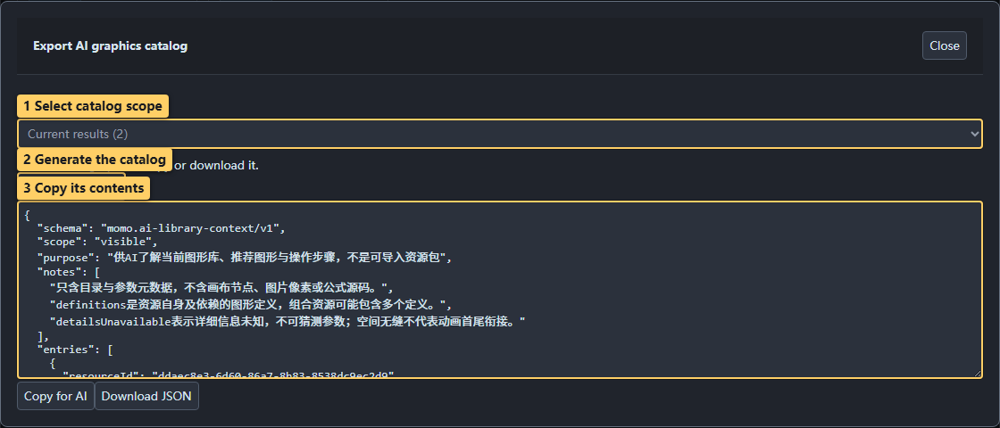

# 10 · AI collaboration and help

<!-- doc-language -->
[简体中文](10-ai-and-help.md) · [English](10-ai-and-help.en.md)
<!-- /doc-language -->

[Manual contents](README.en.md) · Previous: [Remote libraries](09-remote-libraries.en.md)

## 1. Toolbar and Help menu

- **Quick guide:** searchable text help inside the editor.
- **Detailed guide ↗:** opens the README and its illustrated tutorial index. Chinese opens Chinese documentation; other interface languages open English documentation.
- **AI tools:** a separate toolbar entry for Skill installation, ZIP downloads, MCP settings, catalog export and project handoff.
- **GitHub repository ↗:** opens source and issue reporting in a new tab.
- **Gitee repository ↗:** opens the mainland source mirror for documentation and downloads; it follows GitHub synchronization.
- **Support:** an independent toolbar entry opens the WeChat appreciation code for voluntary donations toward maintenance and development.

The hand-drawn effect panel offers **Download handdrawn postprocess**, including current parameters, actual RGBA input, shared Shader/Compute, a Unity component, importer and comparison images. Images, live RTs and supported graphic inputs share automatic contour and fill processing; frozen strokes and separate fill reference packages are retired. Use the authoring Skill for game integration. See [Handdrawn postprocess and Shader delivery](14-shader-reference.en.md).

In **AI tools → Install Skills**, select an agent and Skills, then **Choose directory and install…** to select and authorize a location in the system dialog. For personal use, follow the recommended path to an existing Skill directory. For a project, choose its root and the tool completes the agent subdirectories. Every installation asks for a directory; canceling does not write files.

After installation, copy the next step’s startup instructions to AI. AI prepares the runtime and starts the service following the Skill; users do not install dependencies themselves. Successful file installation does not prove agent activation. See [installation instructions](../skills/texture-forge-author/references/installation.en.md).

**Download ZIP** on the right of each Skill row provides its complete archive for manual extraction and installation. Skills are not graphic resources and should not be imported into the library.

## 2. Give the AI your current graphics catalog

> Callouts: 1 Select catalog scope; 2 Generate the catalog; 3 Copy its contents.

1. Open catalog export through **AI tools → MCP → Export AI graphics catalog**, or search/filter resources in **Graphics library**.
2. Select items, or use the export dialog's scope options for the current results.
3. Choose **Export AI graphics catalog**, then copy the result or download JSON.
4. Provide it together with your goal and relevant reference screenshots.

The catalog contains resource names, categories, parameters and capabilities. It does not contain the current canvas, image pixels or formula source. Supply screenshots separately for visual assessment. Skills do not embed a fixed graphics catalog, which would otherwise recommend resources you may not have loaded.

## 3. Bring AI output back into the tool

- Follow workflow advice in the form “select this node → open this panel → set this parameter → inspect this result.”
- For authoring JSON, use **Create resource → Import files**, select or paste and parse it, inspect the preview, and import.
- Generator JSON can also be entered directly in **Create resource → Generator** to validate code, steps and parameters.
- Use the Image tab for bitmap/SVG background, aspect and contour checks.
- For a complete project ZIP, use **File → Open project**. Nodes, groups, masks, effect order, tracks and dependencies remain editable. Save the project to return revisions to AI.

Successful compilation does not establish visual correctness. Inspect defaults, parameter extremes and multiple times before saving. A retained last-successful frame does not mean the new code compiled.

## 4. Report an issue

Open GitHub from Help and describe the steps, expected versus actual results and browser information, with relevant screenshots. Attach a minimal project or resource pack when possible. Check the files for material you do not intend to publish before submitting.

CLI validation and output examples: [AI authoring CLI](../AI_AUTHORING_CLI.en.md).

The Authoring Skill bundles offline node-authoring tools. After initial runtime setup, AI can query the actual catalog, create or revise native projects and render multiple verification times without opening the website. See the [offline project workflow](../skills/texture-forge-author/references/offline-projects.en.md).

## 5. Give AI direct access to the current web work

First use follows **Install Skill → Ask AI to start MCP → Configure MCP**. Install the Authoring Skill in AI tools, continue and copy the startup instructions to AI. AI checks the runtime, installs missing dependencies and starts and verifies the service. Only then return to step 3 to connect the page and copy the MCP configuration into the client. Users do not run installation or startup commands themselves. Allow local network access when asked.

AI calls `forge_pages` to identify the intended work by name and page ID, then `forge_capture({pageId})` to pin its complete main canvas and read nodes, effects, tracks, sources and images or render previews. Capture again after edits; one snapshotId always retains one version. For requested creation/editing, AI queries forge_schema / forge_catalog and submits a recipe with forge_edit. Changes support undo; stale revisions are rejected. Capture and render again after editing. Closing the panel keeps it active; **Disconnect this page** revokes only that page. Refreshing or closing requires enabling again. Exit graphic preview before capturing.

See [Live editor and MCP connection](../skills/texture-forge-author/references/live-editor.en.md) for configuration, origins and tools. The page, helper and MCP client must reach the same computer; cloud-only clients cannot directly reach a local loopback address.
