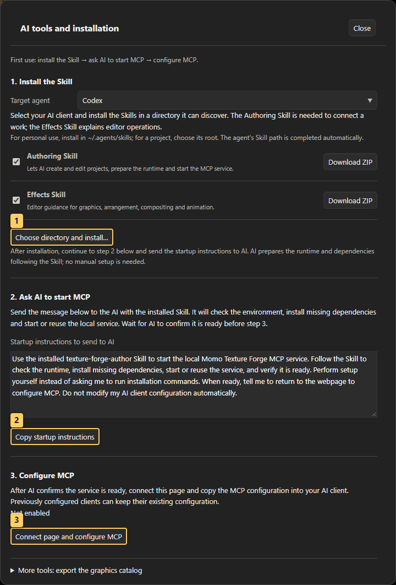

# 10 · AI collaboration and help

<!-- doc-language -->
[简体中文](10-ai-and-help.md) · [English](10-ai-and-help.en.md)
<!-- /doc-language -->

[Manual contents](README.en.md) · Previous: [Remote libraries](09-remote-libraries.en.md)

## 1. Toolbar and Help menu

- **Quick guide:** searchable text help inside the editor.
- **Detailed guide ↗:** opens the README and its illustrated tutorial index. Chinese opens Chinese documentation; other interface languages open English documentation.
- **AI tools:** one panel containing Skill installation, service startup instructions and MCP configuration in order, plus catalog export.
- **GitHub repository ↗:** opens source and issue reporting in a new tab.
- **Gitee repository ↗:** opens the mainland source mirror for documentation and downloads; it follows GitHub synchronization.
- **Support:** an independent toolbar entry opens the WeChat appreciation code for voluntary donations toward maintenance and development.

First use follows three steps in the same panel, without separate Install Skill / MCP tabs:

| Step | Action and result |
| --- | --- |
| 1. Install Skill | Select an agent. Use the Authoring Skill for creation or live access, and the Effects Skill for operation guidance. **Choose directory and install…** authorizes an existing Skill directory or project root; the tool completes the path. Each row also provides **Download ZIP** for manual installation. |
| 2. Ask AI to start MCP | Send the startup instructions to AI with the Authoring Skill loaded. AI prepares missing runtime/dependencies, starts or reuses the service and verifies it; users do not install prerequisites themselves. |
| 3. Configure MCP | Once the service is ready, choose **Connect page and configure MCP**, connect this page, copy the generated configuration into the AI client and refresh its tool list. Allow local network access when asked. |

File installation, Skill loading, service startup, page connection and client configuration are separate states. Installing a Skill does not authorize access to the canvas. A Skill ZIP is not a graphic resource pack and must not be imported into the library.

> Callouts: 1 Choose a directory to install or update Skills; 2 Copy instructions for AI to start the service; 3 Connect the page and configure MCP.

To update, select the same directory again: unchanged files are skipped and changed files are backed up before replacement. Reload the Skill as required by the client. New tool definitions require restarting the updated MCP service and refreshing the client's tool list; refreshing the editor requires reconnecting that page. See [Installation and updates](../skills/texture-forge-author/references/installation.en.md).

## 2. Give the AI your current graphics catalog

> Callouts: 1 Select catalog scope; 2 Generate the catalog; 3 Copy its contents.

1. Expand **AI tools → More tools: export the graphics catalog** and choose **Export AI graphics catalog**. Alternatively, search/filter in **Graphics library**, then expand **Manage resources → Export AI graphics catalog**.
2. Select items, or use the export dialog's scope options for the current results.
3. Choose **Export AI graphics catalog**, then copy the result or download JSON.
4. Provide it together with your goal and relevant reference screenshots.

The catalog contains resource names, categories, parameters and capabilities. It does not contain the current canvas, image pixels or formula source. Supply screenshots separately for visual assessment. Skills do not embed a fixed graphics catalog, which would otherwise recommend resources you may not have loaded.

## 3. Bring AI output back into the tool

- Follow workflow advice in the form “select this node → open this panel → set this parameter → inspect this result.”
- For authoring JSON, use **Create resource → Import files**, select or paste and parse it, inspect the preview, and import.
- Generator JSON can also be entered directly in **Create resource → Generator** to validate code, steps and parameters.
- Use the Image tab for bitmap/SVG background, aspect and contour checks.
- For a complete project ZIP, use **File → Open project**. Nodes, groups, masks, effect order, tracks and dependencies remain editable. Save the project to return revisions to AI.

Successful compilation does not establish visual correctness. Inspect defaults, parameter extremes and multiple times before saving. A retained last-successful frame does not mean the new code compiled.

## 4. Report an issue

Open GitHub from Help and describe the steps, expected versus actual results and browser information, with relevant screenshots. Attach a minimal project or resource pack when possible. Check the files for material you do not intend to publish before submitting.

CLI validation and output examples: [AI authoring CLI](../AI_AUTHORING_CLI.en.md).

The Authoring Skill bundles offline node-authoring tools. After initial runtime setup, AI can query the actual catalog, create or revise native projects and render multiple verification times without opening the website. See the [offline project workflow](../skills/texture-forge-author/references/offline-projects.en.md).

## 5. Give AI direct access to the current web work

The editor page, local MCP service and AI client are separate components. Both the page and client connect to the same service, which forwards structured requests to the page. Static websites and offline HTML can run the editor; a browser does not thereby become an MCP server listening on a local port. The Authoring Skill includes the service tools and AI starts them; the Effects Skill has no server.

AI calls `forge_pages` to identify the intended work by name and page ID, then `forge_capture({pageId})` to pin its complete main canvas and read nodes, effects, tracks, sources and images or render previews. Capture again after edits; one snapshotId always retains one version. For requested creation/editing, AI queries forge_schema / forge_catalog and submits a recipe with forge_edit. Changes support undo; stale revisions are rejected. Capture and render again after editing. Preserve existing work by default; create mode requires a request for a new work. Closing the panel keeps it active; **Disconnect this page** revokes only that page. Refreshing or closing requires enabling again. Component trials require explicit component context; those snapshots cannot authorize main-canvas writes.

See [Live editor and MCP connection](../skills/texture-forge-author/references/live-editor.en.md) for configuration, origins and tools, and [MCP capabilities](mcp-capabilities.en.md) for coverage and limits. The page, service and client must reach the same computer; cloud-only clients cannot directly reach local loopback addresses. AI may query loaded libraries when requested. Without a connected page, use supplied project ZIPs or catalogs rather than automatically reading an entire personal library.

For game Shader delivery, query actual support and choose [graphic generation or image postprocessing export](14-shader-reference.en.md). Realtime analytic adaptation and handdrawn postprocessing are separate routes; visible web effects are not automatically exportable Unity Shaders.
