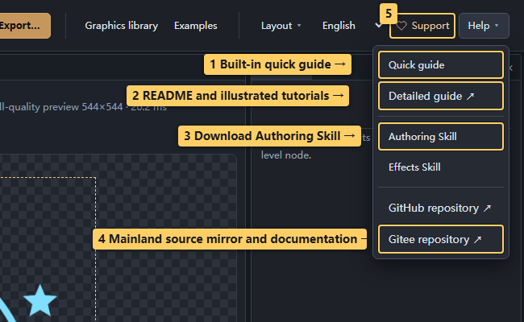

# 10 · AI collaboration and help

<!-- doc-language -->
[简体中文](10-ai-and-help.md) · [English](10-ai-and-help.en.md)
<!-- /doc-language -->

[Manual contents](README.en.md) · Previous: [Remote libraries](09-remote-libraries.en.md)

## 1. Toolbar and Help menu

> Callouts: 1 Built-in quick guide; 2 README and illustrated tutorials; 3 Download Authoring Skill; 4 Mainland source mirror and documentation; 5 WeChat donation code.

- **Quick guide:** searchable text help inside the editor.
- **Detailed guide ↗:** opens the README and its illustrated tutorial index. Chinese opens Chinese documentation; other interface languages open English documentation.
- **Authoring Skill:** helps an AI choose formula/SVG/bitmap workflows and create validated importable resources.
- **Effects Skill:** helps an AI explain editor steps and parameters for a requested result.
- **GitHub repository ↗:** opens source and issue reporting in a new tab.
- **Gitee repository ↗:** opens the mainland source mirror for documentation and downloads; it follows GitHub synchronization.
- **Support:** an independent toolbar entry opens the WeChat appreciation code for voluntary donations toward maintenance and development.

Skills download as ZIPs. Extract them and load them in a Skill-capable AI application. They are not graphic resources and should not be imported into the library.

## 2. Give the AI your current graphics catalog

> Callouts: 1 Select catalog scope; 2 Generate the catalog; 3 Copy its contents.

1. Search or filter resources in **Graphics library**.
2. Select items, or use the export dialog's scope options for the current results.
3. Choose **Export AI graphics catalog**, then copy the result or download JSON.
4. Provide it together with your goal and relevant reference screenshots.

The catalog contains resource names, categories, parameters and capabilities. It does not contain the current canvas, image pixels or formula source. Supply screenshots separately for visual assessment. Skills do not embed a fixed graphics catalog, which would otherwise recommend resources you may not have loaded.

## 3. Bring AI output back into the tool

- Follow workflow advice in the form “select this node → open this panel → set this parameter → inspect this result.”
- For authoring JSON, use **Create resource → Import files**, select or paste and parse it, inspect the preview, and import.
- Generator JSON can also be entered directly in **Create resource → Generator** to validate code, steps and parameters.
- Use the Image tab for bitmap/SVG background, aspect and contour checks.

Successful compilation does not establish visual correctness. Inspect defaults, parameter extremes and multiple times before saving. A retained last-successful frame does not mean the new code compiled.

## 4. Report an issue

Open GitHub from Help and describe the steps, expected versus actual results and browser information, with relevant screenshots. Attach a minimal project or resource pack when possible. Check the files for material you do not intend to publish before submitting.

CLI validation and output examples: [AI authoring CLI](../AI_AUTHORING_CLI.en.md).
