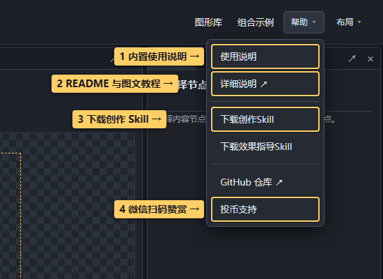
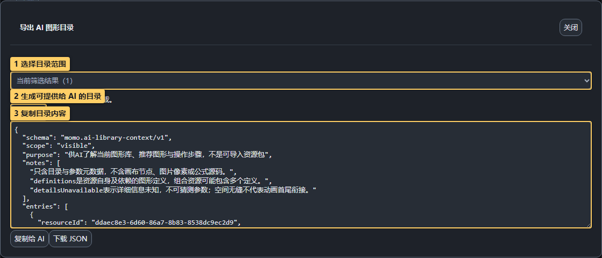

# 10 · AI 协作与帮助

[手册目录](README.md) · 上一篇：[远程图库](09-remote-libraries.md)

## 1. 从帮助菜单拿到工具

> 图中标记：1 内置使用说明；2 README 与图文教程；3 下载创作 Skill；4 微信扫码赞赏。

- **使用说明**：编辑器内置的文字手册，可搜索参数和操作。
- **详细说明 ↗**：直接打开项目 README，从教程索引进入带标记的分步操作手册。
- **下载创作Skill**：让 AI 选择公式/SVG/位图方案，制作和验证可导入资源。
- **下载效果指导Skill**：让 AI 根据需求解释编辑器中的操作步骤和参数。
- **GitHub 仓库 ↗**：新标签打开源码仓库，可反馈问题和参与贡献。
- **投币支持**：弹出微信赞赏码，可使用微信扫码自愿打赏，支持工具持续开发与维护。

Skill 下载结果为 ZIP，解压后交给支持 Skill 的 AI。它不是图形资源，不要导入图库。

## 2. 给 AI 当前可用的图形目录

> 图中标记：1 选择目录范围；2 生成可提供给 AI 的目录；3 复制目录内容。

1. 在 **图形库**搜索或筛选资源。
2. 勾选资源，或按目录窗口提供的范围导出当前结果。
3. 点 **导出 AI 图形目录**，复制内容或下载 JSON。
4. 把目录、目标描述和必要的参考截图一起提供给 AI。

目录包含当前资源的名称、分类、参数和能力。它不包含当前画布、图片像素或公式源码；需要 AI 判断视觉效果时另外提供截图。Skill 不携带固定图形清单，避免推荐当前没有加载的资源。

## 3. 将 AI 结果导回工具

- 操作建议：按“选哪个节点 → 哪个面板 → 参数 → 预期结果”执行。
- 创作 JSON：**创建资源 → 导入文件**选择或粘贴并解析，检查预览后导入图库。
- 生成器 JSON：也可直接在 **创建资源 → 生成器**输入，验证代码、步骤与参数。
- 图片 / SVG：使用图片页检查背景、比例和轮廓。

编译通过不等于视觉正确，保存前查看默认值、参数范围和多个时间位置。不要将“上次成功预览”当成新代码已成功。

## 4. 反馈问题时提供什么

从帮助菜单打开 GitHub 仓库，描述操作步骤、预期与实际结果、浏览器信息，附相关截图。可附最小演示项目或资源包来复现；提交前自行检查其中是否包含不适合公开的素材。

命令行验证和输出示例：[AI 创作 CLI](../AI_AUTHORING_CLI.md)。
