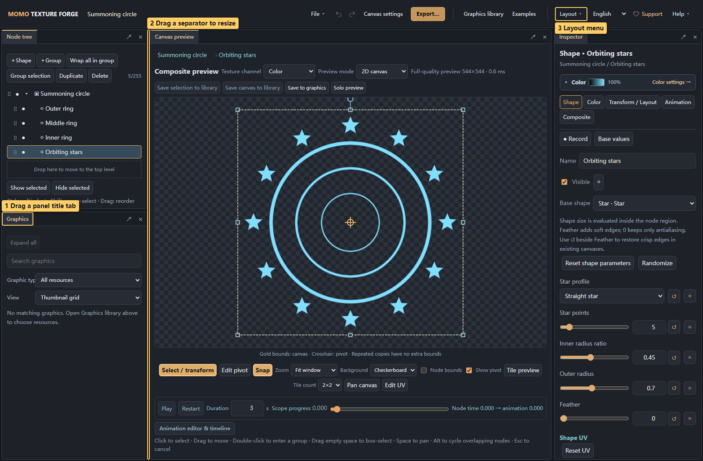
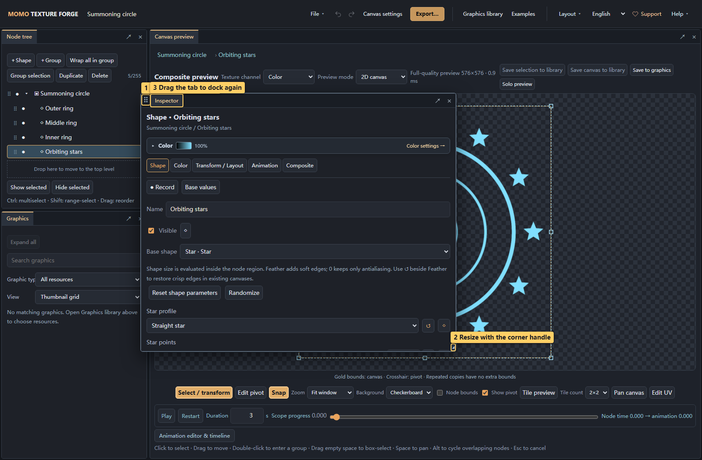
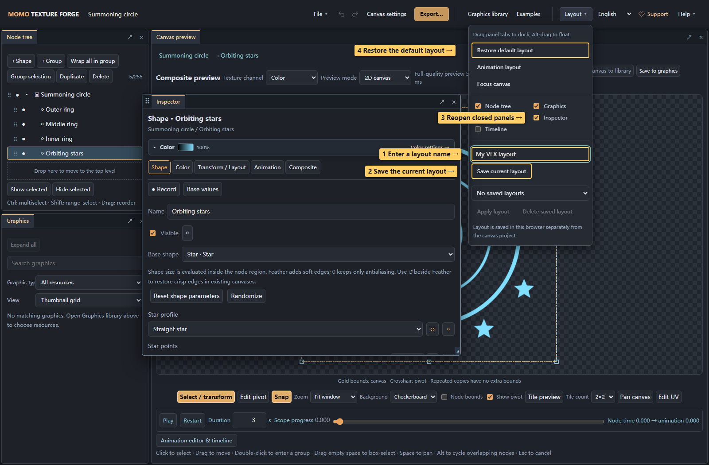

# 11 · Custom panel layouts

<!-- doc-language -->
[简体中文](11-workspace-layout.md) · [English](11-workspace-layout.en.md)
<!-- /doc-language -->

[Manual contents](README.en.md) · [Quick start](01-quick-start.en.md)

The node tree, graphics list, canvas preview, inspector and timeline can be positioned independently. Enlarge the canvas, move parameters closer to the preview, or reserve more room for animation editing.

## 1. Drag, split and merge tabs

> Callouts: 1 Drag a panel title tab; 2 Drag a separator to resize; 3 Layout menu.

1. Drag a panel's title tab, such as Graphics.
2. Move it to a target panel's left, right, top or bottom edge. Release when the blue docking region and docking hint appear to create a split.
3. Move to the target's center and release on the merge-tabs hint to share its space. Click tab names to switch panels.
4. Drag separators to change proportions, or focus a separator and use arrow keys for small adjustments.

Press **Esc** to cancel dragging. Panel content, selection, parameters and canvas undo history remain intact. Dragging a panel tab differs from dragging a node in the tree.

## 2. Float, close and reopen panels

> Callouts: 1 Move with the handle; 2 Resize with the corner handle; 3 Drag the tab to dock again.

- Click **↗** to float the active tab inside the webpage, or Alt-drag its tab.
- Use the upper-left handle to move a floating window and the lower-right handle to resize it.
- Drag its title tab onto another panel to dock or merge it again.
- **×** closes the active tab. Reopen it by checking its name in **Layout**; canvas content is retained.

Floating windows stay within the page; they do not open separate browser windows. **Animation editor & timeline** toggles the timeline. Recording or adding a track also opens it automatically.

## 3. Save a workspace

> Callouts: 1 Enter a layout name; 2 Save the current layout; 3 Reopen closed panels; 4 Restore the default layout.

1. Arrange panels, then open **Layout**.
2. Enter a name and choose **Save current layout**. Saving the same name replaces it; up to 12 named layouts are supported.
3. Select a saved name and **Apply layout**, or delete an unneeded saved layout.
4. **Restore default layout** starts over; **Animation layout** opens a separate timeline, and **Focus canvas** displays only the preview.

The current layout is remembered automatically and restored after reload. Named layouts let you switch between working arrangements.

Layouts store panel positions, proportions, tabs and visibility. Nodes, graphics, parameters, animations and project files keep their own persistence. Layouts belong to the current browser and origin: they are not stored in project ZIPs, shared with canvases or synchronized across devices. Switching layouts does not replace **File → Save project**.
