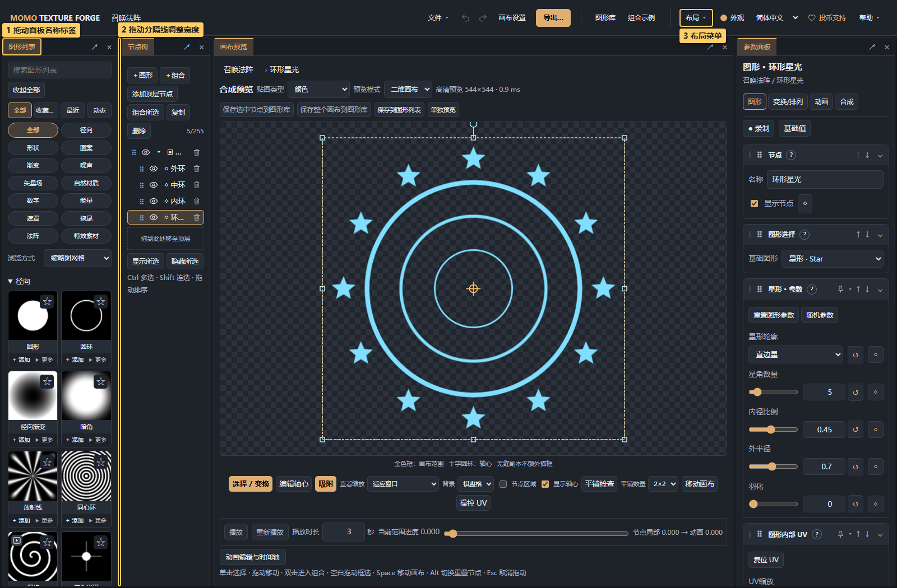
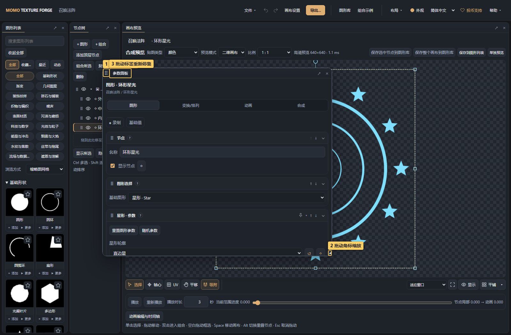
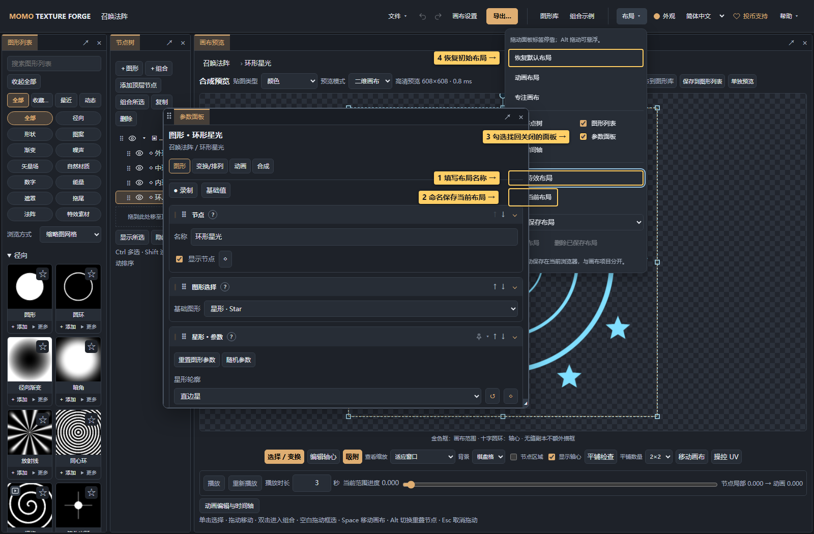

# 11 · 自定义面板布局

<!-- doc-language -->
[简体中文](11-workspace-layout.md) · [English](11-workspace-layout.en.md)
<!-- /doc-language -->

[手册目录](README.md) · [快速上手](01-quick-start.md)

节点树、图形列表、画布预览、参数面板和时间轴可以分别调整位置。适用于想放大画布、让参数靠近预览，或留出更大动画编辑空间的工作方式。

默认布局从左到右为 **图形列表、节点树、画布预览、参数面板**，四栏占满工作区高度，宽度约为 15%、13%、50%、22%。画布保留主要空间，节点名称和参数也有更充足的宽度。已有布局和命名布局会继续保留；想采用新的四栏布局，打开 **布局 → 恢复默认布局**。

## 1. 拖动、拆分和合并标签

> 图中标记：1 拖动面板名称标签；2 拖动分隔线调整宽度；3 布局菜单。

1. 按住面板最上方的名称标签，例如“图形列表”。
2. 拖到目标面板的左、右、上、下边缘，出现蓝色区域和“停靠…”提示后松开，即可拆分。
3. 拖到目标面板中央，会提示“合并为标签”；松开后两个面板共用空间，点名称切换。
4. 拖动两面板间的分隔线，只调整紧邻两侧的面板，其他分隔线保持原位；上下分栏同样适用。达到相邻面板的最小尺寸时停止，不会继续挤动其他面板。也可聚焦分隔线后用方向键微调，Home/End 调到可用范围两端，拖动时按 Esc 可取消。缩放整个浏览器窗口时，布局仍会按比例适配。

拖动时按 **Esc** 取消。面板内容、选中节点、参数和画布撤销记录保留。拖动面板标签与拖动节点树中的节点是两种操作。

## 2. 悬浮、关闭和找回面板

> 图中标记：1 拖动握柄移动；2 拖动角标缩放；3 拖动标签重新停靠。

- 点面板右上角 **↗**，将当前标签悬浮在网页内；按 **Alt** 拖动标签也可悬浮。
- 拖动标题栏左侧的握柄移动悬浮窗口，拖动底边右侧的握柄调整大小；两处握柄均与标签、滚动内容分开。
- 把悬浮面板的名称标签拖到其他面板，即可重新停靠或合并。
- **×** 关闭当前标签。从顶部 **布局** 菜单勾选对应面板可找回，画布内容不会删除。

悬浮窗口位于当前网页中，不会打开独立浏览器窗口。画布里的“动画编辑与时间轴”按钮可打开或关闭时间轴；进入录制或新增轨道时也会自动打开它。

## 3. 保存自己的布局

> 图中标记：1 填写布局名称；2 命名保存当前布局；3 勾选找回关闭的面板；4 恢复初始布局。

1. 调整好面板后，打开右上角 **布局**。
2. 在“布局名称”填写名称，点 **保存当前布局**。同名再次保存会覆盖，最多保存12套。
3. 从“已保存布局”选择名称，点 **应用布局** 恢复；不需要时点 **删除已保存布局**。
4. 想重新开始，可选 **恢复默认布局**；**资源浏览布局** 放大图形列表，**动画布局** 展示独立时间轴，**专注画布** 只展示画布预览。

当前布局会自动记住，刷新后恢复。命名保存便于在多套工作方式之间切换。

布局保存的是面板位置、比例、标签与显示状态；节点、图形列表、参数、动画和项目文件仍按原有方式保存。布局保存在当前浏览器及访问地址下，不写入项目 ZIP，不随画布分享，也不跨设备同步。切换布局不会替代“文件 → 保存项目”。

## 4. 面板内的显示与参数顺序

- 图形列表的 **分类** 可展开筛选，收起时仍显示当前条件。**显示** 菜单中可切换网格/列表、收起或展开图形分组。列表放到底部时，缩略图区域独立滚动。
- 图形页默认先显示图形参数与节点颜色。已有自定义模块顺序继续保留；在 **参数布局 → 恢复当前页的模块顺序** 中可单独重置。它不改变面板位置、模块展开状态或固定参数。
- 参数面板较宽时，标签、滑杆、数值和操作按钮同排对齐；变窄时自动分行，极窄时滑杆独占一行，数值、重置和关键帧按钮放到下一行。
- **保存为资源** 按图形列表和图形库分组，显示当前选中对象；保存项目仍在 **文件** 菜单。资源试编辑会提示更新对已有实例的影响。
- 播放与进度滑杆常驻画布下方，周期、重新播放和节点时间在 **播放设置** 中。

## 5. 主题、控件与密度

顶栏 **外观** 提供七个完整主题：玄黑鎏金、水墨朱砂、月白墨青、青瓷流金、青花映月、敦煌矿彩与藕荷雪青。默认玄黑鎏金采用中性黑灰与暖金；每个主题自行定义底色与明度，不另选深浅模式，也不跟随系统。

控件风格、页签形态和紧凑/舒适密度独立设置；四种自定义交互色分别用于动作、选中、导航和参数控件。切换主题会恢复该主题推荐的交互色，切换控件风格保留主题。实时预览后点 **保存外观** 记住设置，取消或Esc恢复打开前的完整设置。外观不改变作品颜色、项目数据或导出结果，换设备/访问地址后需分别设置。

长弹窗仅滚动中间内容，标题、关闭与底部操作保持可达；悬浮面板的标题和缩放握柄也与内容滚动分开。设计与扩展规则见[界面设计规则](ui-design-guidelines.md)。
